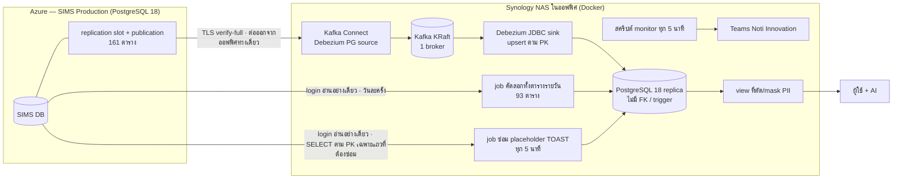

---
pmPageId:
pmParentId:
pmTitle: "[AD] สำเนา SIMS แบบเกือบ real-time บน NAS ด้วย Debezium + Kafka (CDC)"
pmSyncedAt:
---

# สำเนาฐานข้อมูล SIMS บน NAS ด้วย CDC (Debezium + Kafka) — แทน Fabric สำหรับงานรายงานด้วย AI

บันทึกว่าทำไมต้องมีสำเนาฐาน SIMS Production ในออฟฟิศ ทำไมเลือก Debezium + Kafka บน NAS ขอบเขตกี่ตาราง จะตั้งค่าอะไรเพราะอะไร
ยอมรับข้อจำกัดอะไร ต้องทำตามลำดับไหน และย้อนกลับอย่างไร
ผู้อ่าน: tech lead (ผู้เซ็น) · ผู้ขอโครงการ · ทีม SIMS / เจ้าของฐานข้อมูล · ผู้ดูแล firewall · ผู้ดูแล NAS · เจ้าของข้อมูล (PDPA) · ขั้นตอนปฏิบัติการอยู่ใน [`RB-sims-cdc.md`](RB-sims-cdc.md)

> **ผู้ขอโครงการ** ในเอกสารนี้ = ผู้ใช้ที่ขอทำสำเนาเพื่อใช้ AI ทำรายงาน และเป็นผู้ตัดสินขอบเขต / แนวทาง PDPA / วิธีทำ —
> 2026-11-10 ผู้ขอโครงการยืนยันว่า**เป็นเจ้าของฐาน SIMS, ข้อมูล และ NAS ด้วย** จึงอนุมัติเรื่องของเจ้าของเหล่านี้ได้เอง (เอกสารนี้ยังต้องให้ tech lead เซ็น)

| | |
|---|---|
| เวอร์ชันเอกสาร | 2026-11-10 |
| ชั้นเอกสาร | C — ร่างจากการตัดสินใจของผู้ขอโครงการ รอ tech lead เซ็น |
| เจ้าของ | Tech lead |
| สถานะ | เสนอ (ยังไม่เซ็น) — โครงการอยู่ระยะ 0 (เก็บข้อมูลและขออนุมัติ) ยังไม่แตะ Production |
| แทนที่ | — (ฉบับแรกของเรื่องนี้) |
| แหล่งความจริง | เอกสารทีม "On-Prem CDC Plan (ฉบับปรับปรุง)" — _(ผู้เซ็นระบุชื่อไฟล์ / ตำแหน่งบน shared drive หรือ NAS / วันที่ของฉบับที่ใช้เทียบ)_ · ผลสำรวจระยะ 0 วันที่ 2026-11-10 ในไฟล์ `phase0-survey-findings.md`, `phase0-nas-checklist.md`, `phase0-requests.md` ของโฟลเดอร์งาน `SIMS-CDC` (อยู่นอก repo — _ผู้เซ็นระบุตำแหน่งที่เก็บกลาง_) |

> ⚠️ repo นี้เป็น public — เอกสารนี้ตั้งใจไม่ระบุ host / ชื่อฐานข้อมูล / port / ชื่อ role / IP / ชื่อ resource ของ Azure /
> ขนาดและสถานะ storage ของ Production / รายละเอียด network rule / ชื่อตารางอ่อนไหวด้านความปลอดภัย
> ค่าจริงอยู่ในไฟล์ของโฟลเดอร์งาน `SIMS-CDC` ที่ระบุในแถว "แหล่งความจริง" (ไม่ commit)

## 1. บริบท

- **Fabric กำลังจะถูกปิด** (archive ข้อมูลแล้ว 2026-11-06) และ Fabric เป็น mirror ของ F&O ไม่ใช่ของ SIMS
- **งานหลักย้ายจาก F&O ไป SIMS ตั้งแต่ cutover 2026-10-31** — ข้อมูลใบงานใหม่ทั้งหมดอยู่ในฐาน SIMS (Azure Database for PostgreSQL Flexible Server, PostgreSQL 18)
- ผู้ขอโครงการต้องการ **ใช้ AI อ่านข้อมูล SIMS เพื่อทำรายงาน** โดย **ไม่ไปโหลดฐาน Production** ของระบบใบงานจริง
- ข้อเท็จจริงของฐานต้นทาง (อ่านจาก Azure + สำรวจแบบอ่านอย่างเดียว 2026-11-10):

| เรื่อง | ค่า | ผลต่อการออกแบบ |
|---|---|---|
| เวอร์ชัน | PostgreSQL 18.6 · UTF8 · timezone UTC | ต้องใช้ Debezium รุ่นที่รองรับ PG 18 |
| ขนาด | 260 ตาราง ตอนสำรวจ (schema เดียว) · 6.64 GB · 2026-11-11 พบตารางธุรกิจใหม่อีก 1 ตาราง (สร้างหลังสำรวจ) รวม 261 | ตารางใหม่ต้องเพิ่มเข้าขอบเขต (runbook R4) |
| Storage | ดิสก์ของฐานไม่ขยายอัตโนมัติ | ถ้า WAL ค้างจนดิสก์ใกล้เต็ม Azure จะสลับฐานเป็น read-only → ต้องมีเพดาน WAL ของ slot + alert storage |
| `wal_level` | `replica` (static parameter) | ต้องเปลี่ยนเป็น `logical` + **restart 1 ครั้ง** |
| `max_slot_wal_keep_size` | ต้องตั้งเพดาน | dynamic parameter ไม่ต้อง restart |
| `max_replication_slots` / `max_wal_senders` | 10 / 10 | พอ |
| Network | เข้าถึงผ่าน network rule ที่จำกัดต้นทาง | NAS ต่อ**ออก**ทางเดียว + TLS `verify-full` |
| โหลด | CPU สูงสุด ~10% · connection สูงสุด 23 | มีพื้นที่เผื่อพอ |
| ปริมาณ WAL (วัดแล้ว 2026-11-10) | ตำแหน่ง LSN ช่วงเวลางาน 0.235 GB/ชม. → **5.6 GB/วัน** (ใช้ตั้งค่า) · `pg_stat_wal` **1.82 GB/วัน** (ปริมาณเปลี่ยนแปลงจริง) · LSN ตั้งแต่สร้างเซิร์ฟเวอร์ ~4.8 GB/วัน (ใช้ cross-check เท่านั้น) | slot กักไฟล์ WAL ตามตำแหน่ง LSN ทั้งไฟล์ → ใช้ 5.6 GB/วัน กำหนดเพดานของ slot และดิสก์ Kafka · ใช้ 1.82 GB/วัน ประมาณจำนวน event |

## 2. การตัดสินใจ

| # | ตัดสินใจ | รายละเอียด |
|---|---|---|
| 1 | ทำ **CDC (Change Data Capture)** จาก SIMS Production ไปเก็บใน **PostgreSQL 18 บน Synology NAS ในออฟฟิศ** ด้วย **Debezium + Kafka** | อ่าน WAL ผ่าน logical decoding (`pgoutput`) → Debezium PostgreSQL source connector → Kafka (KRaft) → Debezium JDBC sink connector → PostgreSQL ปลายทาง · ทั้งหมดรันด้วย Docker บน NAS |
| 2 | เวอร์ชัน **Debezium 3.6.3.Final** (ตรึงเวอร์ชัน ห้ามใช้ `latest`) | ทดสอบกับ PostgreSQL 14–18 · รองรับ PG 18 ตั้งแต่ 3.4.0 · Kafka 4.x (KRaft) |
| 3 | **ขอบเขต 254 ตาราง** จาก 261 | รายละเอียดข้อ 4 |
| 4 | **ข้อมูลส่วนบุคคล: เก็บครบทุกคอลัมน์ใน replica แล้วให้ AI อ่านผ่าน view เท่านั้น** | รายละเอียดข้อ 5 |
| 5 | **ไม่ใช้ VM application server เดิมที่ใช้งานอยู่** ในงานนี้ | ดูข้อ 3 |
| 6 | **ไม่มี DDL บนตารางของแอป SIMS** | ไม่ทำ `REPLICA IDENTITY FULL` · สิ่งที่สร้างบน Production มีแค่ object ใหม่ของ CDC (role, publication, slot, ตาราง heartbeat/signal ของ Debezium) · ปัญหา TOAST แก้ด้วย **job ซ่อมฝั่ง NAS** ไม่เปลี่ยนอะไรเพิ่มบน Production (ข้อ 6 แถว TOAST) |
| 7 | กฎของทีม: **ถ้าต้องเลือกระหว่างรักษา CDC กับรักษา Production ให้รักษา Production** | CDC re-snapshot ได้เสมอ |

ที่มาของแต่ละข้อ:
- **ข้อ 1, 3, 4, 5 — ผู้ขอโครงการตัดสิน** · ข้อ 1 ทำตามเอกสารทีม "On-Prem CDC Plan (ฉบับปรับปรุง)" · ข้อ 3–4 ดูข้อ 4–5 · ข้อ 5 เพราะทรัพยากรของ VM ไม่พอ
- **ข้อ 2 — ผลการตรวจ release notes ในระยะ 0** (ผู้ร่างเอกสาร / AI) ตามขั้นตอนในแผนที่ผู้ขอโครงการอนุมัติ ("ตรวจเวอร์ชันแล้วตรึง") — _รอผู้เซ็นยืนยัน_
- **ข้อ 6 — ผลตามมา** จากการตัดสินให้ใช้ job คัดลอกรายวันกับตารางที่ไม่มี PK (ข้อ 4) + การแก้ปัญหา TOAST โดยไม่ใช้ `REPLICA IDENTITY FULL` · ระยะ 0 เสนอ `ReselectColumnsPostProcessor` แต่ซ้อมระยะ 1 บน NAS (2026-11-10) พบว่าใช้กับตารางของ SIMS ไม่ได้ → **ผู้ขอโครงการ (เจ้าของฐาน SIMS) ตัดสิน 2026-11-10: ซ่อมฝั่ง NAS ไม่มี DDL และไม่เปลี่ยนอะไรอื่นบน Production** (ข้อ 6 แถว TOAST)
- **ข้อ 7 — กฎจากเอกสารทีม** "On-Prem CDC Plan (ฉบับปรับปรุง)"
- _(เหตุผลเพิ่มเติมที่ยังไม่มี — ให้ผู้เซ็นกรอก)_

## 3. ทางเลือกที่พิจารณาแล้วไม่เลือก

คอลัมน์สุดท้ายระบุว่าเหตุผลมาจากใคร: **[ผู้ขอ]** = ผู้ขอโครงการให้เหตุผลเอง · **[ผลทางเทคนิค]** = ข้อเท็จจริงทางเทคนิคที่ผู้ร่างสรุป ไม่ใช่เหตุผลที่ผู้ตัดสินให้ไว้

| ทางเลือก | ผลทางเทคนิค | ทำไมไม่เลือก |
|---|---|---|
| **Native logical replication** (publication บน SIMS + subscription บน PostgreSQL ที่ NAS) | เกณฑ์ในเอกสารทีมเอง: ถ้ามีปลายทาง PostgreSQL ตัวเดียวและไม่ต้องแปลงข้อมูล native ก็พอ · ไม่มี Kafka / Kafka Connect → ชิ้นส่วนน้อยกว่า ใช้ RAM บน NAS น้อยกว่า · ข้อเสีย: ไม่มี log กลางที่เก็บ event ไว้ให้ replay ย้อนหลัง · เพิ่มปลายทางได้แต่ต้องมี slot บน Production เพิ่มต่อปลายทาง (กัก WAL บน Production มากขึ้น) · mask ได้แค่เลือกคอลัมน์ (column list, PG 15+) / กรองแถว (row filter) ของ publication — แปลงค่าระหว่างทางไม่ได้ | AI แนะนำทางนี้ แต่**ผู้ขอโครงการเลือก Debezium + Kafka** ตามเอกสารทีม · _(เหตุผลเพิ่มเติม — ให้ผู้เซ็นกรอก)_ |
| ใช้ **VM application server เดิม** เป็นปลายทาง | ไม่ต้องซื้อ/เตรียมเครื่องใหม่ · VM นี้รันงานอื่นอยู่แล้ว | **[ผู้ขอ]** ทรัพยากรไม่พอสำหรับ Kafka + Connect + PostgreSQL |
| **`pg_dump` ทั้งฐานทุกคืน** | ง่าย ไม่ต้องเปลี่ยน `wal_level` ไม่มี slot · **[ผลทางเทคนิค]** อ่านทุกแถวทุกตารางทุกครั้ง · ข้อมูลในออฟฟิศเก่าได้ถึง ~24 ชม. ซึ่งไม่ตรงเป้า "อัปเดตแทบทันที" ในแผนที่ผู้ขออนุมัติ (ยังใช้วิธีคัดลอกทั้งตารางกับ 93 ตารางแก้ข้อมูลชั่วคราว ดูข้อ 4) | _(ให้ผู้เซ็นกรอก)_ |
| **คง Fabric ไว้** | **[ผลทางเทคนิค]** Fabric เป็น mirror ของ F&O ไม่มีข้อมูล SIMS และกำลังจะถูกปิด | _(ให้ผู้เซ็นกรอก)_ |

## 4. ขอบเขต — 254 จาก 261 ตาราง

ผลสำรวจ (การจัดกลุ่มใช้รูปแบบชื่อตาราง — **ทีม SIMS ต้องยืนยันรายชื่อ** โดยเฉพาะว่ากลุ่มแก้ข้อมูลชั่วคราวไม่ใช่ตารางที่แอปใช้งานจริง):

| กลุ่ม | จำนวน | ขนาด | ไม่มี PK | วิธีส่ง | เหตุผล |
|---|---|---|---|---|---|
| ตารางธุรกิจ | 132 (131 ตอนสำรวจ + 1 ตารางใหม่ 2026-11-11) | 1.96 GB | 0 | **CDC real-time** | PK ครบ ไม่ต้องแก้อะไรบน Production |
| log ของระบบ | 29 | 4.15 GB (63% ของฐาน) | 0 | **CDC real-time** | PK ครบ · เป็นต้นเหตุหลักของปริมาณ WAL / event แต่ผู้ขอโครงการเลือกเอาด้วย |
| ตารางแก้ข้อมูลชั่วคราว (backfill / backup / dedup) | 93 | 0.41 GB | 29 | **job คัดลอกทั้งตารางวันละครั้ง** ด้วย login อ่านอย่างเดียว | ถ้าใส่ตารางไม่มี PK ใน publication → UPDATE/DELETE ของแอป SIMS บนตารางนั้นจะ error และ sink ทำสำเนาให้ตรงไม่ได้ · ทางแก้ปกติคือ `REPLICA IDENTITY FULL` ซึ่งเป็น DDL บน Production → เลี่ยงด้วยการคัดลอกรายวัน |
| อ่อนไหวด้านความปลอดภัย | 7 | 0.09 GB | 0 | **ไม่ส่งออกเด็ดขาด** | 7 ตารางที่เก็บ token / session / auth profile / credential ของการเชื่อมต่อระบบอื่น / payload ดิบ — ถ้าหลุด ใช้สวมรอยเข้าระบบได้ (เหตุผลด้านความปลอดภัย ไม่ใช่แค่ PDPA) · ผู้ขอโครงการยืนยันหลังรับฟังความเสี่ยง |

รวม CDC **161 ตาราง** + คัดลอกรายวัน **93 ตาราง** = **254 ตาราง**

- **คอลัมน์ไฟล์ (`bytea`) ส่งออกด้วย** (ผู้ขอโครงการสั่ง) → ต้องขยายเพดานขนาดข้อความของ Kafka (ข้อ 6)
- **ความลับใน payload ของตาราง log**: สแกน **9 จาก 29 ตาราง log** — เลือกตาราง log ของ integration / request / error / audit ซึ่งเก็บข้อความที่รับส่งกับระบบอื่น (รวม 5.17 ล้านแถว) — หาความลับรูปแบบที่พบบ่อยแล้ว**ไม่พบ** · ยืนยันด้วย positive control ว่าตัวตรวจจับทำงานจริง
  - **ยังไม่ได้สแกน**: log อีก 20 ตาราง และคอลัมน์ payload / JSON ในตารางธุรกิจที่อยู่ในขอบเขต CDC
  - **ระยะ 4** สุ่มตรวจ payload บนสำเนาซ้ำ โดยรวมตารางที่ยังไม่ได้สแกนด้วย

## 5. การปกป้องข้อมูล (PDPA)

| เรื่อง | ตัดสินใจ |
|---|---|
| คอลัมน์ข้อมูลส่วนบุคคล | **เก็บครบใน replica** (ไม่ตัดที่ต้นทางด้วย `column.exclude.list`) — ผู้ขอโครงการเลือก |
| ผู้ใช้ + AI | อ่านผ่าน **role อ่านอย่างเดียวที่เห็นเฉพาะ view** ซึ่งตัด/mask ข้อมูลส่วนบุคคลตามที่เจ้าของข้อมูลอนุมัติ · **ห้าม AI อ่านตารางดิบ** · ต่อ AI ผ่าน RIM หรือ MCP |
| คอลัมน์ payload ของ log | **view ต้องไม่เปิด** — มีข้อมูลลูกค้าปน ตรวจระดับคอลัมน์ไม่ได้ |
| NAS (เพราะถือข้อมูลส่วนบุคคลเต็มชุด) | volume encryption · จำกัดสิทธิ์ PostgreSQL / SSH / DSM · backup ต้องเข้ารหัส |
| การอนุมัติ | ✅ 2026-11-10 เจ้าของข้อมูลอนุมัติให้ NAS ถือข้อมูลเต็มชุด และ view **เปิดทุกระดับ A–D** (คอลัมน์ payload ของ log ยังซ่อนเสมอ) · ถ้า AI เป็นบริการภายนอก ข้อมูลที่ view เปิดจะถูกส่งให้ผู้ให้บริการประมวลผล → ควรมีข้อตกลงประมวลผลข้อมูลรองรับ |

กลุ่มคอลัมน์ที่สำรวจพบในตารางธุรกิจ (ให้เจ้าของข้อมูลตัดสินรายคอลัมน์):

| ระดับ | ประเภท | ข้อแนะนำ |
|---|---|---|
| A | ข้อมูลติดต่อบุคคล — ชื่อผู้ติดต่อ เบอร์โทร อีเมล เลขผู้เสียภาษี | ไม่เปิดใน view |
| B | ที่อยู่ / พิกัด (latitude, longitude) | ตัดสินตามการใช้งานรายงาน |
| C | ชื่อพนักงาน / ผู้ใช้ระบบ (ช่าง หัวหน้า ผู้ขอ) | รายงานผลงานช่างอาจต้องใช้ |
| D | ชื่อธุรกิจ / ร้าน | มักต้องใช้ในรายงาน — ร้านที่เป็นบุคคลธรรมดานับเป็นข้อมูลส่วนบุคคล |

ทางที่ไม่เลือก: ตัดคอลัมน์ PII ที่ต้นทางด้วย `column.exclude.list` — ปลอดภัยกว่าสำหรับ NAS แต่ถ้าวันหลังรายงานต้องใช้คอลัมน์นั้นต้อง re-snapshot

## 6. ค่าที่จะตั้ง (ยังไม่ได้ตั้ง) และเหตุผล

> ทุกค่าในตารางนี้เป็น**แผน** สำหรับระยะ 1–2 — ณ 2026-11-10 ยังไม่ได้ตั้งค่าใดบน Production (ยังไม่มี slot / publication, `wal_level` ยังเป็น `replica`) และยังไม่ได้ติดตั้งอะไรบน NAS
> ค่าตัวเลขเป็น GB ของเพดาน / alert บน Production อยู่ในไฟล์ของโฟลเดอร์งาน `SIMS-CDC` และจะอยู่ใน runbook ภายใน

| ที่ตั้ง | ค่า | เหตุผล |
|---|---|---|
| SIMS: `wal_level` | `logical` | logical decoding ต้องใช้ · เป็น static parameter → **restart ฐาน 1 ครั้งใน maintenance window** ร่วมกับทีม SIMS (แจ้งผู้ใช้ล่วงหน้า) |
| SIMS: `max_slot_wal_keep_size` | ≈ **7 วัน** ของ WAL ที่อัตรา 5.6 GB/วัน (ครอบคลุมวันหยุดยาว) · เพดานรวมกับข้อมูลปัจจุบันยังห่างจากจุดที่ Azure สลับเป็น read-only มาก | เพดาน WAL ที่ slot กักไว้ได้ — ถึงเพดานแล้ว PostgreSQL ทิ้ง (invalidate) slot เพื่อรักษาดิสก์: Production ทำงานต่อ CDC ต้อง re-snapshot · ถ้าไม่มีเพดาน ดิสก์ซึ่งไม่ขยายอัตโนมัติเต็มได้ → ฐานกลายเป็น read-only |
| เกณฑ์เตือน WAL ที่ slot กัก | warning ≈ slot ค้าง **~1.4 วัน** · critical ≈ **~4.3 วัน** (สัดส่วนของเพดานตามเอกสารทีม) | ให้มีเวลาแก้ก่อนถึงเพดาน · critical → runbook drop slot |
| SIMS: publication | `FOR TABLE` เฉพาะ 161 ตาราง **+ ตาราง heartbeat และ signal ของ Debezium (รวม 163)** | ตารางที่ไม่อยู่ใน publication ไม่ถูกส่งออก (รวม 7 ตารางอ่อนไหว) · publication แบบระบุตาราง ทำให้ Debezium เห็นเฉพาะตารางในรายการ จึงต้องใส่ heartbeat (ให้ slot เลื่อน) และ signal (สั่ง incremental snapshot) ด้วย — 2 ตารางนี้ไม่อยู่ใน include list ของ connector จึง**ไม่ถูกส่งไป replica** |
| SIMS: ตาราง heartbeat + signal ของ Debezium | heartbeat ทุก 30 วินาที | heartbeat ให้ slot เลื่อนแม้ตารางในขอบเขตไม่มีการเปลี่ยน · signal ใช้สั่ง incremental snapshot |
| Kafka message size | **32 MiB** (broker `message.max.bytes` + `replica.fetch.max.bytes`, producer `max.request.size`, `buffer.memory` 64 MiB, consumer `max.partition.fetch.bytes`) · compression `zstd` | วัดแล้วแถวใหญ่สุด **12.7 MB** (คอลัมน์ `jsonb` ของตาราง log integration) — ใน event ของ Debezium `jsonb` กลายเป็น string ที่ถูก escape → ~13–17 MB · ไฟล์ `bytea` ใหญ่สุด ~0.9 MB → ~1.2 MB เมื่อเป็น base64 · **ถ้าใช้ค่าเริ่มต้น ~1 MB connector จะหยุดที่ 36 แถว → slot ไม่เลื่อน → WAL ค้างบน Production** · 32 MiB = ~2 เท่าของ event ใหญ่สุด เผื่อโต |
| Debezium `max.queue.size.in.bytes` · `snapshot.fetch.size` · Connect heap | 256 MiB · 2000 แถว · ตาม profile ประหยัด RAM (ข้อ 7) | กันแถวใหญ่หลายแถวกองใน heap ตอน snapshot · ต้องจด memory จริงตอนซ้อมระยะ 1 |
| TOAST (แก้ 2026-11-10 หลังซ้อมระยะ 1) | **job ซ่อมฝั่ง NAS** แทน `ReselectColumnsPostProcessor`: บน replica มี trigger ต่อแถว (AFTER INSERT OR UPDATE) บนตารางที่มีข้อมูล TOAST จริง (ผลสำรวจระยะ 0: วันนี้ 14 จาก 161 ตาราง · รายชื่อสร้างจากผลสำรวจ เพิ่มตารางแล้วรัน setup ซ้ำได้) → แถวที่มีค่า placeholder เข้าคิว → สคริปต์ทุก 5 นาทีอ่านค่า**ปัจจุบัน**จาก SIMS ตาม PK ด้วย login อ่านอย่างเดียว แล้วแก้บน replica **เฉพาะ cell ที่ยังเป็น placeholder** (ไม่ทับค่าที่ใหม่กว่า) · แถวที่ต้นทางลบไปแล้ว = ทิ้งรายการ (event ลบที่ตามมาลบแถวเอง) · แจ้ง Teams เมื่อรายการค้างนานหรือลองซ้ำเกินเกณฑ์ · **ไม่ตั้ง post processor ของ reselect** · **`unavailable.value.placeholder` = JSON ที่ถูกต้อง** (ค่า default ไม่ใช่ JSON → placeholder ที่ตกคอลัมน์ jsonb ทำให้ sink หยุดทั้งเส้น · ซ้อมบน NAS ยืนยันว่า sink ยัง RUNNING) | ทุกตารางของ SIMS เป็น `REPLICA IDENTITY DEFAULT` → UPDATE ที่ไม่แตะคอลัมน์ใหญ่ WAL จะไม่มีค่าคอลัมน์นั้น Debezium ส่ง placeholder แทน และ JDBC sink จะ**เขียน placeholder ทับข้อมูลจริงในสำเนา** · **ทำไมไม่ใช้ reselect**: ใน Debezium 3.6.3.Final (และสาขาหลัก ณ 2026-11-10) query ที่ post processor สร้างไม่ใส่เครื่องหมายคำพูดให้ชื่อคอลัมน์ PK → ตารางที่ชื่อคอลัมน์ PK มีตัวพิมพ์ใหญ่ (ทุกตารางของ SIMS) query ล้มทุกครั้ง placeholder จึงหลุดถึงสำเนา และเหลือแค่ query ที่ล้มยิงเข้า Production (ซ้อมระยะ 1 ยืนยัน) · **ผู้ขอโครงการ / เจ้าของฐานตัดสิน: ไม่มี DDL และไม่เปลี่ยนอะไรอื่นบน Production** → ทางที่ไม่เลือก: `REPLICA IDENTITY FULL` (DDL + WAL ใหญ่ขึ้น) · แก้/build Debezium เอง · **ผลที่ยอมรับ**: ระหว่างรอซ่อม (ปกติ ≤ 5 นาที) cell นั้นในสำเนาเป็น placeholder · ภาระบน Production = SELECT ตาม PK 1 ครั้งต่อแถวที่ต้องซ่อม (log ส่วนใหญ่เป็น INSERT ไม่ต้องซ่อม) · ถ้า Debezium รุ่นใหม่แก้ปัญหานี้ ซ้อมซ้ำก่อนพิจารณากลับไปใช้ reselect |
| Kafka retention | 7 วัน | ถ้า replica บน NAS ล่ม event รอใน Kafka ได้ 7 วัน (slot ยังเลื่อนตามปกติ) |
| ดิสก์บน NAS | Kafka ≈ 5.6 GB/วัน × 7 × 1.5 ≈ **60 GB** + snapshot ตั้งต้น ~15–20 GB + PostgreSQL ปลายทาง ~7 GB + เผื่อโต | → เกณฑ์ NAS ว่าง **≥ 200 GB** |
| JDBC sink | `insert.mode=upsert` · `primary.key.mode=record_key` · `delete.enabled=true` · `schema.evolution=basic` · `errors.tolerance=none` | Kafka ส่งแบบ at-least-once → upsert ตาม PK ทำให้ event ซ้ำไม่เป็นอันตราย (idempotent) · error ต้องหยุดให้เห็น ไม่ข้ามเงียบ |
| ตารางปลายทาง | สร้างจาก schema-only dump · **คง PK ตัด FK + trigger** | แต่ละตารางอยู่คนละ topic → event ต่างตารางมาไม่ตามลำดับ (เช่นใบงานมาก่อนลูกค้าใหม่) FK จะทำให้ sink ล้ม · ความสัมพันธ์ตรวจด้วย reconciliation แทน |
| Snapshot ตั้งต้น | ตารางเล็ก/กลาง `snapshot.mode=initial` นอกเวลา peak · ตารางใหญ่ `no_data` + incremental snapshot ผ่าน signal table | ไม่อ่านตารางใหญ่ทั้งก้อนในครั้งเดียว |
| ความปลอดภัยฝั่ง NAS | Kafka อยู่บน Docker network ภายใน (`internal: true` — ไม่มี port ออกนอกเครื่อง, มีแค่ Kafka Connect ต่อถึง) ใช้ PLAINTEXT · REST API ของ Kafka Connect เปิดเฉพาะ localhost ของ NAS · replica บังคับ TLS + SCRAM และ superuser เข้าทาง network ไม่ได้ · secret ไม่อยู่ใน repo | **ต่างจากร่างแรก** (ระบุ Kafka SASL/SCRAM + TLS): เมื่อ Kafka ไม่มีทางเข้าจากนอก Docker network การเพิ่ม SASL/TLS ไม่ลดความเสี่ยงที่มีนัยสำคัญแต่เพิ่มชิ้นส่วนที่พังได้ — _รอ tech lead ยอมรับ_ · ถ้าวันหลังต้องเปิด Kafka ให้เครื่องอื่น ต้องเพิ่ม SASL/TLS ก่อน |

## 7. ข้อจำกัดที่ยอมรับ

| ข้อจำกัด | ต่างจากเอกสารทีมอย่างไร | ผล / ทางกู้ |
|---|---|---|
| **NAS เครื่องเดียว = Kafka 1 broker, replication factor 1** | เอกสารทีมแนะนำ 3 broker, RF 3, `min.insync.replicas=2` | เหมาะกับงานรายงาน ไม่ใช่ระบบธุรกรรม · Kafka เสียข้อมูล → re-snapshot |
| **ต่อตรงผ่าน network rule ที่จำกัดต้นทาง + TLS `verify-full`** แทน VPN ในรอบแรก | เอกสารทีมกำหนด VPN | NAS ต่อ**ออก**ทางเดียว · ตรวจทั้ง CA และชื่อ host · network rule ของ CDC ต้องตรงกับต้นทางที่ NAS ใช้จริง (ตรวจในระยะ 0 ตาม checklist) |
| **NAS ล่มทั้งเครื่อง** | — | event รอใน Kafka ไม่ได้ (อยู่เครื่องเดียวกัน) → slot ค้าง → WAL โตบน Production จนถึงเพดาน → slot ถูกทิ้ง → re-snapshot |
| 93 ตารางแก้ข้อมูลชั่วคราวเก่าได้ถึง ~24 ชม. | — | ไม่ใช่ข้อมูลรายงานหลัก |
| **RAM ของ NAS จำกัดและเพิ่มไม่ได้** (ตรวจ 2026-11-10 · ผู้ขอโครงการยืนยันว่าเพิ่มแรมไม่ได้) | เกณฑ์เดิมในแผนต้องการ RAM ว่างมากกว่านี้ | ใช้ profile ประหยัดถาวร: จำกัด RAM รวมของ Kafka + Kafka Connect + PostgreSQL ปลายทางด้วย `mem_limit` ไม่ให้แย่ง RAM ระบบอื่นบน NAS · ดิสก์เป็น HDD และ cache น้อย → query รายงานหนัก ๆ จะช้า (จำกัด `statement_timeout` / จำนวน connection ของ role ที่ AI ใช้) · ถ้า RAM ตึงต่อเนื่อง ทางถอยคือ native logical replication (ไม่ต้องมี Kafka / Connect) |
| ไม่ทำ failover slot | เอกสารทีมมีขั้นตอนนี้ | ไม่ต้องจัดการ failover slot ในโครงสร้างปัจจุบันของฐาน SIMS |

## 8. ลำดับที่ต้องทำ (บังคับ)

| ระยะ | งาน | แตะ Production? |
|---|---|---|
| 0 | สำรวจฐานแบบอ่านอย่างเดียว · สำรวจ NAS · ตรวจเวอร์ชัน · เขียน AD นี้ · **ขออนุมัติให้ครบ** (ข้อ 10) | ไม่ |
| 1 | ติดตั้ง Docker บน NAS: Kafka KRaft + Kafka Connect + PostgreSQL 18 · ซ้อมทั้ง pipeline กับฐานทดสอบ (CRUD, ภาษาไทย, `jsonb`, restart Connect, ปิด replica 1 ชม., **UPDATE คอลัมน์เล็กของแถวที่มี payload ใหญ่แล้วสำเนาต้องได้ payload เดิมคืนหลัง job ซ่อมรอบถัดไป**) | ไม่ |
| 2-ก | เตรียม Production **ที่ไม่ต้อง restart**: ตั้ง `max_slot_wal_keep_size` · admin ของ SIMS รัน SQL สร้าง role CDC (REPLICATION + SELECT), ตาราง heartbeat/signal, publication · network rule ชื่อเฉพาะของ CDC · Azure Monitor alert ของ storage (ระดับ warning / critical ตาม runbook ภายใน) | **ใช่** (ไม่มี downtime) |
| 2-ข | **ขั้นสุดท้ายก่อนเปิดระบบ** (ผู้ขอโครงการกำหนด 2026-11-10): `wal_level=logical` + restart ฐาน 1 ครั้งใน maintenance window → ตรวจผล | **ใช่** (downtime สั้น) |
| 3 | Snapshot ข้อมูลตั้งต้น · เฝ้า WAL ที่ slot กักไว้ตลอด (ต้องไม่โตต่อเนื่อง) | อ่าน |
| 4 | เปิด sink · reconciliation ทุกตาราง (row count + checksum เฉพาะคอลัมน์ที่ซิงก์ ตั้ง `TimeZone='UTC'` ทั้ง 2 ฝั่ง) · สุ่มอ่าน payload หาความลับ (รวมตารางที่ระยะ 0 ยังไม่ได้สแกน) | อ่าน |
| 5 | Monitoring ทุก 5 นาที → Teams "Noti Innovation" · reconciliation รายวัน · เขียน `RB-sims-cdc.md` | อ่าน |
| 6 | role อ่านอย่างเดียว + view ตามที่เจ้าของข้อมูลอนุมัติ · ต่อ AI | ไม่ |
| 7 | Go/No-Go checklist ของเอกสารทีม (ปรับตามข้อ 7) · บันทึกเวอร์ชัน · ซ้อม runbook 1 ครั้ง · ทยอยเปิด | — |

- **ห้ามสร้าง slot ก่อนตั้ง `max_slot_wal_keep_size` และ alert ของ storage** — slot ที่ไม่มีเพดานกัก WAL บนดิสก์ Production ได้ไม่จำกัด จนฐานหยุดรับการเขียน
- **ห้ามเริ่มระยะ 2 ก่อนระยะ 1 ผ่าน** และก่อนได้อนุมัติครบ
- SQL บน Production ทุกคำสั่ง **admin ของ SIMS เป็นคนรัน** (AI ช่วยร่าง SQL ได้ แต่ไม่รันบน Production)
- เกณฑ์ผ่านก่อน go-live: CRUD เห็นในสำเนาภายใน < 1 นาที · restart Connect แล้วไม่ซ้ำ/ไม่หาย · reconciliation ตรง 100% ติดกัน 3 วัน · heartbeat อัปเดตทุก 30 วินาที · ปิด replica 1 ชม. แล้ว WAL บน SIMS ไม่โต · หยุด Connect จน alert ดังแล้วกู้ได้ · ผู้ใช้ถาม AI ได้รายงานจาก view และไม่เห็นคอลัมน์ PII

## 9. ย้อนกลับ (rollback) และความเสี่ยง

**ย้อนกลับ / เลิกใช้ — ต้องทำครบทุกครั้ง** (admin ของ SIMS รัน):

1. หยุด Debezium connector บน NAS
2. **drop replication slot** — ถ้าไม่ drop slot จะกัก WAL ต่อไปเรื่อย ๆ แม้ไม่มีใครอ่าน
3. drop publication
4. drop ตาราง heartbeat/signal ของ Debezium
5. drop role CDC
6. ควรพิจารณาร่วมกับทีม SIMS / ผู้ดูแล firewall: ถอด network rule ของ CDC · `wal_level` คืนเป็น `replica` หรือไม่ (ต้อง restart อีกครั้ง)

**ความเสี่ยงและวิธีเฝ้า**

| ความเสี่ยง | ผลถ้าเกิด | วิธีกัน / เฝ้า |
|---|---|---|
| **WAL โตบน Production** (connector / Kafka / NAS / network หยุด) — ดิสก์ของฐานไม่ขยายอัตโนมัติ | ดิสก์ใกล้เต็ม → SIMS เป็น read-only = ระบบใบงานหยุดรับการเขียน | `max_slot_wal_keep_size` · สคริปต์ทุก 5 นาทีเช็ค WAL ที่ slot กักไว้ + `wal_status` (warning / critical ตามข้อ 6) · Azure Monitor alert ของ storage · runbook: ถึงขั้นวิกฤตให้ **drop slot** แล้ว re-snapshot ทีหลัง |
| **Slot กำพร้า** (เลิกใช้แล้วลืม drop) | กัก WAL ไปเรื่อย ๆ จนชนเพดาน | rollback บังคับ drop slot · ตรวจรายการ slot รายสัปดาห์ |
| **Network rule ของ CDC ถูกลบ / ต้นทางของ NAS เปลี่ยน** | connector ต่อไม่ได้ → WAL กัก | rule ชื่อเฉพาะของ CDC + แจ้งผู้ดูแลห้ามลบ · alert เมื่อ connector FAILED / ต่อไม่ได้ |
| **ข้อมูลส่วนบุคคลถึง AI** | ละเมิด PDPA | AI อ่านผ่าน view เท่านั้น · ไม่เปิดคอลัมน์ payload · เจ้าของข้อมูลอนุมัติรายการคอลัมน์ · ระยะ 6 ทดสอบว่า AI ไม่เห็นคอลัมน์ PII |
| **ความลับหลุดผ่าน payload** | สวมรอยระบบอื่นได้ | 7 ตารางอ่อนไหวไม่อยู่ใน publication · สแกน 9 ตาราง log ที่เก็บข้อความรับส่งกับระบบอื่นแล้วไม่พบ (log อีก 20 ตาราง + คอลัมน์ payload ในตารางธุรกิจยังไม่ได้สแกน) · ระยะ 4 สุ่มตรวจซ้ำรวมส่วนที่ยังไม่ได้สแกน |
| **Placeholder ของ TOAST เขียนทับข้อมูลจริง** | สำเนาผิดชั่วคราว (จนกว่าจะซ่อม) | job ซ่อมฝั่ง NAS ทุก 5 นาที (ข้อ 6 แถว TOAST) · การ์ดเมื่อคิวซ่อมค้างนาน / ลองซ้ำเกินเกณฑ์ (ทั้งจาก job ซ่อมและจาก monitor) · เช็ครายวันว่าไม่มีค่า placeholder (จับตารางที่ยังไม่อยู่ในรายการของ job ซ่อม) · checksum ของ reconciliation จับได้ |
| **sink ของ replica FAILED แล้วไม่กลับมาเอง** (ซ้อมระยะ 1: ปิด replica แล้ว sink FAILED ค้าง) | สำเนาหยุดอัปเดต · Production ไม่กระทบ (event รอใน Kafka 7 วัน) | monitor restart task ของ sink ที่ FAILED เองเมื่อ replica ตอบ (ปิดได้) · แจ้ง critical ถ้ารอบถัดไปยัง FAILED · แจ้ง warning ถ้าต้อง restart เองบ่อย (≥ 2 ครั้งใน 60 นาที) · ไม่ restart source อัตโนมัติ |
| **แถวใหม่ใหญ่เกิน 32 MiB** | connector FAILED → WAL กัก | alert connector FAILED · แก้โดยเพิ่มเพดาน หรือตัดคอลัมน์นั้นเฉพาะตาราง |
| **PostgreSQL 18 ยังใหม่** | bug ที่ไม่รู้ล่วงหน้า | ตรึง Debezium 3.6.3.Final ที่ทดสอบกับ PG 18 · ซ้อมระยะ 1 ก่อนแตะ Production |
| **Kafka / NAS เสียข้อมูล** (RF 1, เครื่องเดียว) | สำเนาไม่ครบ | re-snapshot |

## 10. เรื่องที่ยังค้าง (ณ 2026-11-10)

| เรื่อง | ผู้รับผิดชอบ | ผลต่อการตัดสินใจ |
|---|---|---|
| (ไม่บังคับ) วัด WAL ช่วงกลางคืนเพื่อยืนยัน — อัตราที่ใช้ตั้งค่า (5.6 GB/วัน) วัดแล้ว 2026-11-10 | ผู้ขอโครงการ | ถ้าช่วงกลางคืนสูงกว่าคาด ปรับเพดานของ slot / ดิสก์ NAS |
| ✅ 2026-11-10 NAS checklist — DSM / CPU / ดิสก์ / Container Manager ผ่าน · **RAM ไม่ผ่านเกณฑ์และเพิ่มไม่ได้** → ยอมรับเป็นข้อจำกัด (ข้อ 7: profile ประหยัด) · ไม่มี UPS → ยอมรับ (re-snapshot ได้) | ผู้ดูแล NAS | — |
| ✅ 2026-11-10 ยืนยันแล้วว่า 93 ตารางชั่วคราวแอปไม่ได้ใช้งานจริง · นัด maintenance window สำหรับ restart (ทำเป็นขั้นสุดท้ายหลังซ้อมบน NAS ผ่าน) | เจ้าของฐาน SIMS | ระยะ 2 เริ่มไม่ได้จนกว่าจะได้ window |
| ผู้ดูแล firewall: network rule ชื่อเฉพาะสำหรับ CDC | ผู้ดูแล firewall ของฐาน SIMS | ระยะ 2 |
| ✅ 2026-11-10 เจ้าของข้อมูลอนุมัติการเก็บ PII เต็มชุดบน NAS + view เปิดทุกระดับ A–D | เจ้าของข้อมูล | — |
| ตรวจว่า image ของ Kafka Connect ที่เลือกมี Debezium JDBC sink ในตัวหรือไม่ | Dev | ระยะ 1 |
| ซ้อม job ซ่อม placeholder บน NAS (UPDATE คอลัมน์เล็ก → เข้าคิว → ซ่อมแล้วได้ค่าจริง · ไม่ทับค่าที่ใหม่กว่า · แถวที่ถูกลบ) และซ้อมปิด replica ซ้ำโดยให้ monitor restart sink เอง | Dev | ก่อนระยะ 2 |
| (ไม่บังคับ) แจ้งปัญหาการ quote ชื่อคอลัมน์ PK ของ reselect ไปที่โครงการ Debezium | Dev | ไม่กระทบแผน — job ซ่อมใช้แทนได้ |
| ✅ 2026-11-10 เขียน `RB-sims-cdc.md` แล้ว (R1 WAL วิกฤต → drop slot · R3 re-snapshot · R4 DDL เปลี่ยน · rollback) — รอ DevOps เซ็น + ซ้อม runbook 1 ครั้ง | DevOps (เจ้าของ RB) | ก่อน go-live |

AI ช่วยร่างงานในตารางนี้ได้ (SQL, config, runbook) แต่ผู้รับผิดชอบคือบทบาทที่ระบุ

## 11. การเซ็นรับรอง

> 2026-11-11: ผู้ขอโครงการเป็นเจ้าของฐาน SIMS, ข้อมูล (PDPA) และ NAS เอง และรับเป็น**ผู้เซ็นเอกสารนี้คนเดียว** (ทำหน้าที่ tech lead) — เห็นชอบโดย review และ merge PR ของเอกสารนี้

| บทบาท | ชื่อ | วันที่ | เห็นชอบ |
|---|---|---|---|
| ผู้ขอโครงการ — เจ้าของระบบ (tech lead · เจ้าของฐาน SIMS · เจ้าของข้อมูล PDPA · ผู้ดูแล NAS) | | | ☐ |
