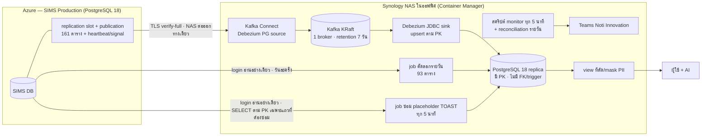

---
pmPageId:
pmParentId:
pmTitle: "[RB] สำเนา SIMS บน NAS ด้วย CDC (Debezium + Kafka) — ตรวจประจำ · แจ้งเตือน · แก้เหตุ · restart ครั้งเดียว · rollback"
pmSyncedAt:
---

# สำเนาฐาน SIMS บน NAS ด้วย CDC — runbook

เอกสารนี้ตอบคำถาม 5 ข้อ: ระบบ CDC มีชิ้นส่วนอะไรและใครดูแล · ทุกวันต้องดูอะไร · การ์ดแจ้งเตือนขึ้นแล้วทำอะไร (R1–R8) ·
เปลี่ยนค่าบน Production ครั้งเดียว (`wal_level` + เพดาน WAL + restart) ทำอย่างไรและตรวจผลอย่างไร · ถ้าจะเลิกใช้ ต้องถอนอะไรบ้าง
เหตุผลของทุกค่าอยู่ใน `docs/AD-sims-cdc-to-nas.md` เอกสารนี้ไม่อธิบายซ้ำ
**คนอ่าน**: DevOps / ผู้ดูแลระบบ CDC บน NAS · คนที่ได้รับการ์ดแจ้งเตือนในแชต Teams "Noti Innovation" · เจ้าของฐาน SIMS (คนรัน SQL บน Production)

| | |
|---|---|
| เวอร์ชันเอกสาร | 2026-11-10 |
| ชั้นเอกสาร | C — เจ้าของต้องตรวจ/เซ็น (AI ร่างจาก `docs/AD-sims-cdc-to-nas.md` และผลสำรวจระยะ 0 วันที่ 2026-11-10 · **ยังไม่ได้ซ้อม** ต้องซ้อม 1 ครั้งในระยะ 7 ก่อนเซ็น) |
| เจ้าของ | DevOps |
| สถานะระบบ | ยังไม่ได้ติดตั้ง — ณ 2026-11-10 ยังไม่มี slot / publication บน Production และยังไม่มีอะไรบน NAS |
| แหล่งความจริง | `docs/AD-sims-cdc-to-nas.md` · ไฟล์ของโฟลเดอร์งาน `SIMS-CDC` (อยู่นอก repo): `phase0-survey-findings.md` (ขอบเขต, ขนาด, อัตรา WAL, เพดาน, เกณฑ์แจ้งเตือนเป็นตัวเลขจริง) และไฟล์ config / SQL / สคริปต์ของระยะ 1 ในโฟลเดอร์ `phase1` |

> ⚠️ **repo นี้เป็น public** — เอกสารนี้ใช้ตัวแปร `<…>` แทนค่าจริงทุกตัว (host, ชื่อฐานข้อมูล, port, ชื่อ role/login, ชื่อ slot/publication,
> ชื่อ resource ของ Azure, IP, ชื่อ network rule, ค่าเพดาน/เกณฑ์เป็น GB, ขนาดและสถานะ storage ของ Production, ชื่อ 7 ตารางอ่อนไหว, secret ทุกชนิด)
> **ค่าจริง: ดูไฟล์ภายในโฟลเดอร์งาน SIMS-CDC (นอก repo)** · ห้ามคัดลอกค่าจริงกลับเข้ามาในไฟล์นี้ หรือวางใน Teams / issue / PR

> ⛔ **กฎที่อยู่เหนือทุกข้อในเอกสารนี้** (จาก AD ข้อ 2 #7): ถ้าต้องเลือกระหว่างรักษา CDC กับรักษา Production → **รักษา Production**
> CDC เสียแล้ว re-snapshot ได้เสมอ (R3) แต่ถ้าดิสก์ของฐาน SIMS เต็ม ฐานจะกลายเป็น read-only = ระบบใบงานหยุดรับการเขียน

---

## 1. ภาพรวมและขอบเขต



| กลุ่มตาราง | จำนวน | ส่งอย่างไร | ถ้าผิดพลาดดูข้อ |
|---|---|---|---|
| ตารางธุรกิจ + log ของระบบ | 132 + 29 = **161** (ณ 2026-11-11 รวมตารางที่สร้างหลังสำรวจ 1 ตาราง) | **CDC** แบบเกือบ real-time ผ่าน slot + publication · ตารางที่มีค่า TOAST มี job ซ่อม placeholder ทุก 5 นาที (R8) | R1–R8 |
| ตารางแก้ข้อมูลชั่วคราว (backfill / backup / dedup) | **93** | **job คัดลอกทั้งตารางวันละครั้ง** (ข้อมูลเก่าได้ถึง ~24 ชม.) | ข้อ 4 แถว "job คัดลอกรายวัน" |
| อ่อนไหวด้านความปลอดภัย | **7** | **ไม่ส่งออกเด็ดขาด** — ไม่อยู่ใน publication และ role ของ CDC / job คัดลอก **ต้องไม่มีสิทธิ์ SELECT** | รายชื่ออยู่ในไฟล์ภายใน ห้ามเขียนในเอกสารนี้ |

ตารางทุกตัวอยู่ใน schema `public` และใช้ชื่อแบบ PascalCase ที่ต้องใส่เครื่องหมายคำพูดใน SQL เช่น `public."SMAServiceTo"`
(ใน config ของ Debezium เขียน `public.SMAServiceTo` ไม่มีเครื่องหมายคำพูด — ตัวพิมพ์เล็ก/ใหญ่ต้องตรงตัว)

### ตัวแปรที่ใช้ในเอกสารนี้ (ค่าจริงอยู่ในไฟล์ภายใน)

| ตัวแปร | คือ |
|---|---|
| `<sims_admin>` | admin ของฐาน SIMS ที่รัน SQL บน Production (เจ้าของฐาน) |
| `<cdc_role>` · `<copy_login>` | role ของ Debezium (REPLICATION + SELECT เฉพาะตารางในขอบเขต) · login อ่านอย่างเดียวที่สคริปต์บน NAS ใช้ (job คัดลอกรายวัน + reconciliation + job ซ่อม placeholder) |
| `<repair_queue>` | ตารางคิวของ job ซ่อม placeholder **บน replica** (ชื่อเต็มรวม schema · ไม่มีบน SIMS) |
| `<slot_name>` · `<publication_name>` | ชื่อ replication slot และ publication |
| `<heartbeat_table>` · `<signal_table>` | ตาราง heartbeat และตาราง signal ของ Debezium บน SIMS (ชื่อเต็มรวม schema) — **ไม่ถูกส่งไป replica** (ไม่อยู่ใน include list ของ connector: มีไว้ให้ slot เลื่อน / รับคำสั่ง snapshot เท่านั้น) |
| `<source_connector>` · `<sink_connector>` | ชื่อ connector ใน Kafka Connect |
| `<CONNECT_URL>` | REST API ของ Kafka Connect (เปิดเฉพาะเครื่อง admin) |
| `<BOOTSTRAP>` · `<client.properties>` | ที่อยู่ broker และไฟล์ตั้งค่า client (SASL/SCRAM + TLS) สำหรับเครื่องมือ command line ของ Kafka |
| `<cap>` · `<warn>` · `<crit>` | เพดาน `max_slot_wal_keep_size` และเกณฑ์ warning / critical ของ WAL ที่ slot กัก (เป็น GB ในไฟล์ภายใน) |
| `<cdc_rule>` · `<nas_egress_ip>` | network rule ชื่อเฉพาะของ CDC บนฐาน SIMS · IP ขาออกของ NAS ที่ Azure เห็น |
| `<secrets_dir>` | โฟลเดอร์ secret บน NAS (สิทธิ์อ่านเฉพาะ container ที่ต้องใช้) |

---

## 2. ชิ้นส่วนและผู้ดูแล

> ณ 2026-11-10 **ผู้ขอโครงการเป็นเจ้าของเองทั้งฐาน SIMS, ข้อมูล (PDPA) และ NAS** — คนเดียวกันอนุมัติและลงมือในแถวเหล่านี้ได้
> ถ้าวันหลังเปลี่ยนผู้รับผิดชอบ แก้ตารางนี้และตารางเซ็นข้อ 10

| ชิ้นส่วน | อยู่ที่ไหน | ผู้ดูแล | หมายเหตุ |
|---|---|---|---|
| ฐาน SIMS Production + server parameters + restart | Azure Database for PostgreSQL Flexible Server | เจ้าของฐาน SIMS (ผู้ขอโครงการ) | **SQL / การตั้งค่าบน Production ทุกอย่าง เจ้าของฐานเป็นคนรัน** — AI ร่างได้ แต่ไม่รันบน Production |
| object ของ CDC บน SIMS: `<cdc_role>`, `<copy_login>`, publication, slot, `<heartbeat_table>`, `<signal_table>` | ฐาน SIMS | เจ้าของฐาน SIMS | slot ถูกสร้างโดย Debezium ตอน start ครั้งแรก · publication ถูกสร้างโดย admin (`publication.autocreate.mode=disabled`) |
| network rule `<cdc_rule>` | Azure portal → Networking ของฐาน SIMS | เจ้าของฐาน SIMS (เพิ่ม rule เองได้) | มีคนอื่นแก้ rule ของฐานนี้เป็นประจำ → **แจ้งทุกคนที่แก้ rule ว่าห้ามลบ `<cdc_rule>`** |
| Azure Monitor alert ของ storage ฐาน SIMS | Azure portal → Alerts | เจ้าของฐาน SIMS | เป็นตัวเตือนที่ **ไม่ขึ้นกับ NAS** (ใช้ได้แม้ NAS ดับ) · เกณฑ์อยู่ในไฟล์ภายใน |
| NAS + Container Manager + volume encryption + backup เข้ารหัส | ออฟฟิศ | ผู้ดูแล NAS (ผู้ขอโครงการ) | ถือข้อมูลส่วนบุคคลเต็มชุด |
| Kafka (KRaft, 1 broker) · Kafka Connect (Debezium 3.6.3.Final) · PostgreSQL 18 replica | container บน NAS | DevOps | ตรึงเวอร์ชันทุก image ห้ามใช้ `latest` |
| สคริปต์ monitor (ทุก 5 นาที) · job ซ่อม placeholder (ทุก 5 นาที) · reconciliation (รายวัน) · job คัดลอก 93 ตาราง (รายวัน) | Synology Task Scheduler บน NAS | DevOps | ส่งการ์ดไปแชต Teams "Noti Innovation" · URL ของ webhook อยู่ในไฟล์ secret ใน `<secrets_dir>` · trigger + `<repair_queue>` ของ job ซ่อมอยู่บน replica |
| view สำหรับ AI + role อ่านอย่างเดียวบน replica | PostgreSQL บน NAS | DevOps + เจ้าของข้อมูล | เจ้าของข้อมูลอนุมัติรายการคอลัมน์ (ระดับ A–D ตาม AD ข้อ 5) · **ห้าม AI อ่านตารางดิบ** |
| เอกสารนี้ | `docs/RB-sims-cdc.md` | DevOps | |

### secret — อยู่ที่ไหน (ชื่อเท่านั้น)

| secret | เก็บที่ | ใช้โดย |
|---|---|---|
| รหัสผ่าน `<cdc_role>` · รหัสผ่าน role ของ replica · user/pass SASL ของ Kafka | ไฟล์ properties ใน `<secrets_dir>` อ่านผ่าน **Kafka `FileConfigProvider`** เช่น `"database.password": "${file:<secrets_dir>/<file>.properties:<key>}"` | Kafka Connect |
| CA bundle ของ Azure (DigiCert Global Root G2 + Microsoft RSA Root CA 2017 + DigiCert Global Root CA) | ไฟล์ PEM ใน `<secrets_dir>` (เป็นใบรับรองสาธารณะ ไม่ใช่ความลับ แต่เก็บรวมไว้ที่เดียว) | `database.sslmode=verify-full` · `database.sslrootcert` |
| รหัสผ่าน `<copy_login>` | ไฟล์ใน `<secrets_dir>` | job คัดลอกรายวัน |
| webhook URL ของแชต "Noti Innovation" | ไฟล์ใน `<secrets_dir>` | สคริปต์ monitor / reconciliation |

**ห้าม** ใส่ secret ใน `docker-compose.yml`, ใน connector config แบบตัวอักษรตรง ๆ, ใน environment ที่ `docker inspect` อ่านได้, หรือใน repo นี้

---

## 3. ตรวจประจำ

### ทุกวัน (ใช้เวลา ~5 นาที)

| ดูอะไร | ที่ไหน / อย่างไร | ปกติคือ | ไม่ปกติ → |
|---|---|---|---|
| การ์ดสรุปรายวัน + reconciliation | Teams "Noti Innovation" | มีการ์ดของวันนี้ · ทุกตารางตรง 100% | **ไม่มีการ์ดเลย** = สคริปต์บน NAS ไม่ทำงาน หรือ NAS ดับ → R5 · ไม่ตรง → R6 |
| connector ทั้ง 2 ตัว | `curl -s "<CONNECT_URL>/connectors?expand=status"` | `<source_connector>` และ `<sink_connector>` เป็น `RUNNING` ทั้ง connector และทุก task · บรรทัด "auto-restart ของ `<sink_connector>`" ในการ์ดรายวันไม่เพิ่มบ่อย | `FAILED` → R2 · `PAUSED` / `STOPPED` ที่ไม่มีใครตั้งใจ → ถามทีมก่อน resume · auto-restart เพิ่มทุกวัน → หาสาเหตุตาม R2 แม้ sink กลับมาเอง |
| WAL ที่ slot กักบน SIMS | การ์ด monitor (ตัวเลขเดียวกับ query ในข้อ 4.1) | ต่ำกว่า warning มาก และไม่โตต่อเนื่อง · `wal_status` = `reserved` หรือ `extended` (ดูความหมายในข้อ 4.1) | warning / critical → R1 · `unreserved` / `lost` → R1 ทันที |
| heartbeat | บน **SIMS** (login อ่านอย่างเดียว): `SELECT now() - ts FROM <heartbeat_table>;` และ `confirmed_flush_lsn` ของ `<slot_name>` ใน `pg_replication_slots` ต้องเลื่อนระหว่าง 2 ครั้งที่ดู | อายุ heartbeat < 1 นาที · `confirmed_flush_lsn` เลื่อน | ค้างเกิน 5 นาที → R2 / R7 (ตาราง heartbeat ไม่ถูกส่งไป replica — อย่าดูจาก replica) |
| consumer lag ของ sink | `kafka-consumer-groups.sh --bootstrap-server <BOOTSTRAP> --command-config <client.properties> --describe --group connect-<sink_connector>` | LAG ใกล้ 0 (ไม่โตต่อเนื่อง) | โตต่อเนื่อง → R5 (replica ช้า/ล่ม) |
| ค่า placeholder ของ TOAST ในสำเนา | ผลเช็คในการ์ดรายวัน (ค้นคำ `__debezium_unavailable_value` ในคอลัมน์ text / jsonb / bytea) + บรรทัด "คิวซ่อม placeholder" ในการ์ด monitor | 0 แถว (หรือมีเฉพาะแถวที่เพิ่งเข้าคิว < 30 นาที) · คิวว่างหรือเก่าสุดไม่กี่นาที | placeholder ค้าง / คิวค้าง → R8 |
| job คัดลอก 93 ตาราง | การ์ดของ job | สำเร็จ 93/93 | ล้ม → ดูข้อความ error ในการ์ด แล้วรันซ้ำ · ถ้าล้มเพราะต่อไม่ได้ → R7 |
| ดิสก์ NAS | การ์ด monitor | ว่างเกินเกณฑ์ในไฟล์ภายใน | ใกล้เต็ม → R5 |

### ทุกสัปดาห์ (เจ้าของฐาน SIMS รันใน pgAdmin — อ่านอย่างเดียว)

```sql
-- 1) slot ทั้งหมดบนฐาน — ต้องมีแค่ slot ของ CDC ตัวเดียว · slot ที่ไม่รู้จัก = slot กำพร้า → ตามหาเจ้าของ แล้ว drop
SELECT slot_name, plugin, slot_type, active, wal_status,
       pg_size_pretty(pg_wal_lsn_diff(pg_current_wal_lsn(), restart_lsn)) AS wal_retained
FROM pg_replication_slots;

-- 2) จำนวนตารางใน publication — ต้องเท่ากับค่าในไฟล์ภายใน (161 ตาราง + <heartbeat_table> + <signal_table>)
SELECT count(*) FROM pg_publication_tables WHERE pubname = '<publication_name>';

-- 3) role ของ CDC / job คัดลอก ต้องไม่มีสิทธิ์ SELECT บน 7 ตารางอ่อนไหว — ผลต้องเป็น 0 แถว
--    (วางรายชื่อ 7 ตารางจากไฟล์ภายใน)
SELECT r.rolname, c.relname
FROM pg_class c
JOIN pg_namespace n ON n.oid = c.relnamespace AND n.nspname = 'public'
CROSS JOIN (VALUES ('<cdc_role>'), ('<copy_login>')) AS r(rolname)
WHERE c.relname = ANY (ARRAY[ /* 7 ชื่อจากไฟล์ภายใน */ ]::name[])
  AND has_table_privilege(r.rolname, c.oid, 'SELECT');

-- 4) 7 ตารางอ่อนไหวต้องไม่อยู่ใน publication — ผลต้องเป็น 0 แถว (รายชื่อเดียวกับข้อ 3)
SELECT tablename FROM pg_publication_tables
WHERE pubname = '<publication_name>'
  AND tablename = ANY (ARRAY[ /* 7 ชื่อจากไฟล์ภายใน */ ]::name[]);
```

และฝั่ง NAS: ตรวจว่า backup ของ replica สำเร็จและเข้ารหัส · ตรวจรายชื่อผู้มีสิทธิ์เข้า DSM / SSH / PostgreSQL ไม่มีคนเกิน

---

## 4. การแจ้งเตือนและวิธีรับมือ

### 4.1 ตารางแจ้งเตือน

เกณฑ์ WAL เขียนเป็น "จำนวนวันที่ slot ค้าง" ที่อัตรา WAL ซึ่งใช้ตั้งค่า (ค่าเป็น GB ในไฟล์ภายใน):

| การ์ด | เงื่อนไข | ระดับ | ทำ |
|---|---|---|---|
| WAL ที่ slot กัก ≥ `<warn>` | slot ค้าง **~1.4 วัน** | ⚠️ warning | หาสาเหตุ (ส่วนใหญ่คือ R2 / R5 / R7) และแก้ภายในวัน |
| WAL ที่ slot กัก ≥ `<crit>` | slot ค้าง **~4.3 วัน** | 🔴 critical | **R1** — ตัดสินใจ drop slot |
| `wal_status` = `unreserved` หรือ `lost` | WAL ใกล้/เกินเพดาน `<cap>` (≈ **7 วัน**) | 🔴 critical | `unreserved` → R1 ทันที · `lost` = slot ใช้ไม่ได้แล้ว → R1 ขั้น drop แล้ว R3 |
| Azure Monitor alert ของ storage ฐาน SIMS | เกณฑ์ในไฟล์ภายใน | 🔴 (ไม่ขึ้นกับ NAS) | ตรวจ slot ทันที — ถ้า slot เป็นสาเหตุ → R1 |
| source connector / task `FAILED` | สถานะจาก REST ของ Connect | 🔴 | R2 (monitor **ไม่** restart source เอง) |
| sink connector / task `FAILED` | monitor สั่ง restart เองก่อน 1 ครั้งต่อรอบ (ไม่มีการ์ดในรอบนั้น) — การ์ดขึ้นเมื่อ **รอบถัดไปยัง FAILED** หรือ Connect ไม่รับคำสั่ง restart | 🔴 | R2 หัวข้อ "sink FAILED — monitor restart ให้เอง" |
| sink `FAILED` ขณะ replica ไม่ตอบ | monitor รอ ไม่สั่ง restart จนกว่า replica กลับมา | ⚠️ | R5 (แถว replica) |
| sink ถูก restart อัตโนมัติ ≥ 2 ครั้งใน 60 นาที (flapping) | restart แต่ละครั้งได้ผล แต่ sink ล้มซ้ำ | ⚠️ | R2 หัวข้อ "sink FAILED — monitor restart ให้เอง" |
| คิวซ่อม placeholder ค้าง ≥ 30 นาที / ลองซ้ำครบเกณฑ์ / monitor อ่านคิวไม่ได้ | การ์ดจาก job ซ่อม และ/หรือจาก monitor (เกณฑ์ `REPAIR_ALERT_MINUTES` / `REPAIR_MAX_ATTEMPTS`) | ⚠️ | R8 |
| replica ตอบ แต่ login / query ของ monitor ไม่ผ่าน | | ⚠️ | ตรวจไฟล์รหัสผ่านของ replica ใน `<secrets_dir>` และสิทธิ์ของ role ที่ monitor ใช้ |
| heartbeat ค้าง > 5 นาที ทั้งที่ connector `RUNNING` | | ⚠️ | ตรวจ R7 (ต่อไม่ได้) และ R2 |
| consumer lag ของ sink โตต่อเนื่อง | | ⚠️ | R5 (replica) |
| reconciliation ไม่ตรง / พบ placeholder | การ์ดรายวัน | ⚠️ | R6 |
| **ไม่มีการ์ดรายวันเลย** | ไม่มีใครส่ง | 🔴 | R5 (NAS / Task Scheduler) — สคริปต์บน NAS **แจ้งไม่ได้ถ้า NAS ดับเอง** ต้องอาศัยคนสังเกตว่าการ์ดหาย + Azure Monitor alert ของ storage |

ความหมายของ `wal_status` (PostgreSQL):

| ค่า | หมายถึง | ระดับ |
|---|---|---|
| `reserved` | WAL ที่ slot กักยังไม่เกิน `max_wal_size` | ปกติ |
| `extended` | เกิน `max_wal_size` แล้ว แต่ยังอยู่ใต้เพดาน `<cap>` — **เป็นเรื่องปกติเมื่อ slot ค้างเกินไม่กี่ GB** ดูตัวเลข WAL ที่กักประกอบ ไม่ใช่ดูค่านี้อย่างเดียว | ปกติ (ตัดสินจาก `<warn>` / `<crit>`) |
| `unreserved` | เกินเพดานแล้ว WAL จะถูกลบใน checkpoint ถัดไป — slot กำลังจะใช้ไม่ได้ | 🔴 |
| `lost` | WAL ที่ slot ต้องใช้ถูกลบไปแล้ว — slot ใช้ไม่ได้อีก | 🔴 |

> **เหตุใดก็ตามที่ทำให้ source connector หยุดอ่าน = นาฬิกาของ R1 เริ่มเดิน** — slot ไม่เลื่อน WAL สะสมบนดิสก์ Production ทุกชั่วโมง
> ให้ดูตัวเลข WAL ที่ slot กักประกอบทุกครั้งที่แก้ R2 / R5 / R7

query ที่เจ้าของฐานใช้ดูสถานะ slot ด้วยตัวเอง (อ่านอย่างเดียว):

```sql
SELECT slot_name, active, active_pid, wal_status,
       pg_size_pretty(pg_wal_lsn_diff(pg_current_wal_lsn(), restart_lsn)) AS wal_retained,
       pg_size_pretty(safe_wal_size) AS left_before_cap
FROM pg_replication_slots
WHERE slot_name = '<slot_name>';
```

### R1 — WAL ที่ slot กักถึงระดับ critical → ตัดสินใจ drop slot (รักษา Production ก่อน)

**ใครทำ**: DevOps หยุด connector · เจ้าของฐาน SIMS รัน SQL · **ไม่ต้องรอประชุม** — ถ้าถึง critical และแก้สาเหตุไม่ได้ภายในวันนั้น ให้ drop

1. ดู query ข้างบน: `wal_retained`, `wal_status`, `left_before_cap`
2. ตัดสินใจ:

   | สถานการณ์ | ทำ |
   |---|---|
   | รู้สาเหตุ และแก้ได้แน่นอนภายในไม่กี่ชั่วโมง (เช่น NAS กำลังบูต, rule ถูกเพิ่มคืนแล้ว) **และ** `wal_status` ยังเป็น `reserved` หรือ `extended` | แก้สาเหตุ (R2 / R5 / R7) แล้วดูว่า `wal_retained` ลดลงภายใน 1 ชม. หลัง connector กลับมา `RUNNING` · ถ้าไม่ลด → drop |
   | ไม่รู้สาเหตุ / แก้ไม่ทันวันนี้ / `wal_status` = `unreserved` / Azure storage alert ดัง | **drop slot ทันที** (ข้อ 3–5) |
   | `wal_status` = `lost` | slot ถูก PostgreSQL ทิ้งไปแล้วตามเพดาน (Production ปลอดภัย) แต่ slot ยังค้างชื่ออยู่ → drop ให้สะอาด (ข้อ 3–5) แล้วไป R3 |

3. หยุด source connector เพื่อปล่อย slot (slot ที่ `active = true` drop ไม่ได้):
   ```bash
   curl -s -X PUT "<CONNECT_URL>/connectors/<source_connector>/stop"
   ```
   ถ้า NAS / Kafka Connect ล่มอยู่ (เรียก REST ไม่ได้) → ข้ามข้อนี้ได้ (slot ไม่ active อยู่แล้ว) **แต่ต้องทำข้อ 7 ทันทีที่ Connect กลับมา**
4. เจ้าของฐาน SIMS รัน:
   ```sql
   -- ยืนยันว่า slot ไม่ active แล้ว (active = false) ถ้ายัง active ให้รอ 1 นาทีแล้วดูใหม่
   SELECT slot_name, active, active_pid FROM pg_replication_slots WHERE slot_name = '<slot_name>';
   -- ถ้ายัง active ทั้งที่ connector หยุดแล้ว: ปิด connection ที่ถือ slot อยู่
   -- SELECT pg_terminate_backend(active_pid) FROM pg_replication_slots WHERE slot_name = '<slot_name>';
   SELECT pg_drop_replication_slot('<slot_name>');
   ```
   admin ของ Azure ไม่ใช่ superuser — ถ้า `pg_terminate_backend` ขึ้น `permission denied` ให้รัน `GRANT <cdc_role> TO <sims_admin>;` ก่อน แล้วรันซ้ำ
   (`<sims_admin>` เป็นคนสร้าง role จึงมีสิทธิ์ grant ให้ตัวเอง · ถอนคืนด้วย `REVOKE <cdc_role> FROM <sims_admin>;` เมื่อเสร็จ)
5. ตรวจผล: query ใน 4.1 ต้องไม่พบ `<slot_name>` · ดิสก์ของฐานจะคืนพื้นที่หลัง checkpoint ถัดไป (ไม่ใช่ทันที)
6. แจ้งใน "Noti Innovation" ว่า drop slot แล้ว เวลาเท่าไร เพราะอะไร — **สำเนาบน NAS หยุดอัปเดต ณ เวลานั้น**
7. **ห้าม start source connector ใหม่จนกว่าจะแก้สาเหตุแล้ว** — Debezium จะสร้าง slot ใหม่ทันทีที่ start · ไป R3-ข เมื่อพร้อม
   ⛔ ถ้าข้าม ข้อ 3 เพราะ Connect ล่ม: Connect จะ start source **เอง** เมื่อกลับมา → สร้าง slot ใหม่แล้วอ่านต่อจาก offset เก่า → **ข้อมูลช่วงที่ slot ถูก drop หายจากสำเนาแบบเงียบ ๆ**
   → ทันทีที่ REST ของ Connect ตอบ ให้รัน `PUT .../<source_connector>/stop` ก่อนอย่างอื่น แล้วทำ R3-ข (ล้าง offset) — ห้ามปล่อยให้ source วิ่งต่อ

ไม่ต้องลบ publication / role / ตาราง heartbeat-signal ใน R1 (ไม่กัก WAL) — ลบเฉพาะตอน rollback ข้อ 8

### R2 — connector FAILED (รวมแถวใหญ่เกิน 32 MiB)

1. อ่านสาเหตุ:
   ```bash
   curl -s "<CONNECT_URL>/connectors/<source_connector>/status"   # ดู "trace" ของ connector และ task
   curl -s "<CONNECT_URL>/connectors/<sink_connector>/status"
   ```
   และ log ของ container Kafka Connect บน NAS
2. แยกตามข้อความใน `trace`:

   | ข้อความ / อาการ | สาเหตุ | ทำ |
   |---|---|---|
   | `RecordTooLargeException` · `The message is … bytes when serialized which is larger than …` · `larger than the max message size the server will accept` | แถวใหม่บน SIMS ใหญ่เกินเพดาน **32 MiB** | ดูหัวข้อ "แถวใหญ่เกิน 32 MiB" ข้างล่าง |
   | `Connection refused` · `timeout` · `no pg_hba.conf entry for host …` | ต่อ SIMS ไม่ได้ | R7 |
   | `password authentication failed` | รหัสผ่าน `<cdc_role>` ถูกเปลี่ยน / ไฟล์ secret ผิด | เจ้าของฐานยืนยันรหัสผ่าน → แก้ไฟล์ใน `<secrets_dir>` → restart |
   | `certificate verify failed` · `hostname … does not match` | CA bundle ไม่ครบ / ใบรับรองของ Azure เปลี่ยน root | ตรวจว่า bundle มีครบ 3 root (ข้อ 2) · **ห้ามลดเป็น `require`** |
   | `publication … does not exist` | publication ถูกลบ / ชื่อผิด | เจ้าของฐานสร้างใหม่ด้วย SQL ในไฟล์ภายใน (Debezium ตั้งให้ไม่สร้างเอง) |
   | `can no longer get changes from replication slot …` · `This slot has been invalidated because it exceeded the maximum reserved size` · `requested WAL segment … has already been removed` | slot ถูกทิ้งตามเพดาน (`wal_status` = `lost`) | R1 (drop) แล้ว R3-ข |
   | sink: error จาก PostgreSQL ปลายทาง (ชนิดข้อมูล, คอลัมน์ไม่มี) | schema บน SIMS เปลี่ยน | R4 |
   | sink: ต่อ replica ไม่ได้ | replica ล่ม | R5 |

3. หลังแก้สาเหตุ:
   ```bash
   curl -s -X POST "<CONNECT_URL>/connectors/<connector>/restart?includeTasks=true&onlyFailed=true"
   ```
   ตรวจ: สถานะ `RUNNING` · heartbeat ขยับภายใน 1 นาที · WAL ที่ slot กักลดลงภายใน 1 ชม.

**sink FAILED — monitor restart ให้เอง** (`SINK_AUTO_RESTART=1` ใน config ของสคริปต์ — ค่าเริ่มต้น)

ที่มา: ซ้อมระยะ 1 บน NAS พบว่าเมื่อปิด replica `<sink_connector>` เปลี่ยนเป็น `FAILED` และ**ไม่กลับมาเอง**แม้ replica เปิดแล้ว (ต้องสั่ง restart เอง) ทั้งที่ตั้งให้ retry error ชั่วคราวไว้แล้ว

| รอบของ monitor (ทุก 5 นาที) | monitor ทำอะไร | การ์ด |
|---|---|---|
| เห็น sink (connector หรือ task) `FAILED` และ replica ตอบ | `POST <CONNECT_URL>/connectors/<sink_connector>/restart?includeTasks=true&onlyFailed=true` **1 ครั้ง** · จดเวลาไว้ | ไม่มี (บันทึกใน log และนับในการ์ดรายวัน "auto-restart ของ `<sink_connector>`") |
| รอบถัดไป sink `RUNNING` | ล้างสถานะที่จดไว้ | ไม่มี — ถ้ามีการ์ดเตือนอื่นค้างอยู่ จะได้การ์ด "กลับมาปกติ" ตามปกติ |
| รอบถัดไป**ยัง** `FAILED` | สั่ง restart ซ้ำทุกรอบ (รอบละ 1 ครั้ง) | 🔴 "ยัง FAILED หลัง monitor สั่ง restart อัตโนมัติ" พร้อมบรรทัดแรกของ `trace` |
| Connect ไม่รับคำสั่ง restart (เช่น HTTP 409 ระหว่าง rebalance, 404) | — | 🔴 ทันที "สั่ง restart อัตโนมัติไม่สำเร็จ (HTTP …)" |
| sink `FAILED` แต่ replica ไม่ตอบ | **ไม่สั่ง** (restart ตอนนี้ก็ล้มซ้ำ) · รอ replica | ⚠️ replica ไม่ตอบ + sink รอ replica → R5 · เมื่อ replica กลับมา monitor สั่ง restart เองในรอบนั้น |
| restart แบบเงียบ (แถวแรกของตารางนี้) เกิด **ตั้งแต่ 2 ครั้งใน 60 นาที** — restart แล้วทำงานได้ แต่กลับมา `FAILED` ซ้ำ (**flapping**) | สั่ง restart ตามปกติ | ⚠️ "sink_flapping" ค้างอยู่จนครบ 60 นาทีนับจาก restart ครั้งล่าสุด → อ่าน `trace` / log ของ Connect หาสาเหตุ (ข้อ 1–2) · ไม่มีกฎนี้ sink ที่ล้มทุก 10–30 นาทีจะถูก restart ไปเรื่อย ๆ โดยไม่มีการ์ดเลย |

เมื่อได้การ์ด 🔴 ของ sink: ทำข้อ 1–2 ข้างบน (อ่าน `trace` หาสาเหตุ) · sink FAILED **ไม่**ทำให้ WAL บน SIMS สะสม (source ยังอ่าน slot ยังเลื่อน) แต่ event รอใน Kafka ได้แค่ retention 7 วัน

- monitor **ไม่ restart source** อัตโนมัติ — source ผูกกับ slot บน Production ต้องมีคนอ่านสาเหตุก่อน
- monitor ไม่ยุ่งกับ connector ที่ `STOPPED` / `PAUSED` → ถ้าตั้งใจหยุด sink ให้ใช้ `stop` / `pause` (ข้อ 7) ไม่ต้องปิด auto-restart
- ปิด auto-restart: ตั้ง `SINK_AUTO_RESTART=0` (การ์ด 🔴 ขึ้นทันทีที่ FAILED เหมือนเดิม) — เช่นระหว่างหาสาเหตุที่ restart แล้วล้มซ้ำ ไม่อยากให้สั่งทุก 5 นาที
- ⛔ auto-restart ไม่ใช่การข้าม record — ถ้า sink ล้มเพราะข้อมูล record เดิมจะล้มซ้ำทุกครั้งและการ์ด 🔴 จะค้าง · ห้ามแก้ด้วย `errors.tolerance=all` (ดูท้ายหัวข้อนี้)

**แถวใหญ่เกิน 32 MiB** (source FAILED → slot ไม่เลื่อน → นาฬิกา R1 เดิน):

- หาว่าแถวไหน/ตารางไหนจาก `trace` · เจ้าของฐานวัดขนาดแถวด้วยวิธีเดียวกับ `phase0-followup.sql` ในไฟล์ภายใน
- มี 2 ทาง — **ผู้ขอโครงการเป็นคนเลือก** แล้วบันทึกเป็น `docs/AD-*.md` ฉบับใหม่ (เพราะ 32 MiB เป็นค่าที่ AD ตัดสินไว้):

  | ทาง | ทำ | ผลข้างเคียง |
  |---|---|---|
  | ก. ขยายเพดาน | แก้**ทุกค่าพร้อมกัน**: broker `message.max.bytes` + `replica.fetch.max.bytes` · worker `producer.max.request.size` · `producer.buffer.memory` (ต้องมากกว่า record ใหญ่สุด — ปัจจุบัน 64 MiB) · `consumer.max.partition.fetch.bytes` · ถ้ามี topic override `max.message.bytes` ก็แก้ด้วย → restart broker แล้ว Connect | ใช้ RAM ของ Connect มากขึ้น — NAS ใช้ profile ประหยัด RAM (เพิ่มแรมไม่ได้) ต้องดู RAM ว่างของ NAS ก่อนขยับ heap/`mem_limit` ของ Connect · ถ้าไม่พอ ใช้ทาง ข. แทน |
  | ข. ตัดคอลัมน์นั้นเฉพาะตาราง | เพิ่ม `column.exclude.list` ของ source เฉพาะคอลัมน์นั้น | คอลัมน์นั้นในสำเนาหยุดอัปเดต (ค่าเก่าค้าง) — ต้องบอกผู้ใช้รายงาน |

- ระหว่างตัดสินใจ ถ้า WAL ถึง critical → R1 ก่อน (Production มาก่อน)

⛔ **ห้ามตั้ง `errors.tolerance=all`** หรือ skip record เพื่อให้ connector วิ่งต่อ — สำเนาจะผิดแบบเงียบ ๆ และไม่มีใครรู้ว่าแถวไหนหาย (AD ข้อ 6)

### R3 — re-snapshot (ดึงข้อมูลตั้งต้นใหม่)

ใช้เมื่อ: หลัง R1 drop slot · slot `lost` · Kafka เสียข้อมูล / event หายเพราะเกิน retention 7 วัน (R5) · reconciliation ไม่ตรงแบบแก้รายตารางไม่ได้ (R6)
**ทำนอกเวลา peak ของ SIMS** และเฝ้า WAL ที่ slot กัก + CPU ของ SIMS ตลอดเวลาที่ snapshot (snapshot อ่าน Production)

**R3-ก re-snapshot บางตาราง (slot ยังดี)** — incremental snapshot ผ่าน signal table, ไม่ต้องหยุดอะไร

เจ้าของฐาน SIMS รัน (ใส่หลายตารางใน `data-collections` ได้):

```sql
INSERT INTO public.<signal_table> (id, type, data)
VALUES (gen_random_uuid()::text, 'execute-snapshot',
        '{"data-collections": ["public.SMAServiceTo"], "type": "incremental"}');
```

- ถ้าต้องการให้แถวที่ถูกลบบน SIMS หายจากสำเนาด้วย: `TRUNCATE` ตารางนั้นใน replica **ก่อน** ส่ง signal (incremental snapshot เติม/ทับแถวที่มีอยู่ แต่ไม่ลบแถวที่หายไปจากต้นทาง)
- ตรวจ: log ของ Connect บอก snapshot ของตารางนั้นจบ → รัน reconciliation ของตารางนั้น

**R3-ข re-snapshot ทั้งระบบ (หลัง drop slot)**

1. แก้สาเหตุที่ทำให้ต้อง drop slot ให้เสร็จก่อน (ไม่งั้นจะวนกลับมา R1)
2. หยุด source ก่อน: `curl -s -X PUT "<CONNECT_URL>/connectors/<source_connector>/stop"` · **รอให้ consumer lag ของ sink เป็น 0** (คำสั่งในข้อ 3 "ทุกวัน") แล้วค่อยหยุด sink: `curl -s -X PUT "<CONNECT_URL>/connectors/<sink_connector>/stop"`
   (ถ้าไม่รอ event เก่าที่ค้างใน Kafka จะถูกเขียนลงหลัง TRUNCATE ในข้อ 4 — แถวที่ถูกลบบน SIMS ระหว่างที่ slot หายจะกลับมาค้างในสำเนา)
3. ล้าง offset ของ source เพื่อให้เริ่มใหม่จาก snapshot: `curl -s -X DELETE "<CONNECT_URL>/connectors/<source_connector>/offsets"` (connector ต้องอยู่สถานะ `STOPPED`)
4. replica: `TRUNCATE` ตาราง CDC ทั้ง 161 ตาราง (หรือสร้างใหม่จาก schema-only dump — คง PK ตัด FK + trigger) — สคริปต์อยู่ในไฟล์ภายใน
5. resume sink ก่อน แล้วค่อย source:
   ```bash
   curl -s -X PUT "<CONNECT_URL>/connectors/<sink_connector>/resume"
   curl -s -X PUT "<CONNECT_URL>/connectors/<source_connector>/resume"
   ```
   source สร้าง `<slot_name>` ใหม่บน SIMS แล้ว snapshot ตามแผนเดิม (ตารางเล็ก/กลาง `initial` · ตารางใหญ่ `no_data` + incremental snapshot ผ่าน R3-ก)
6. ตรวจ: query ข้อ 4.1 มี slot `active = true` · WAL ที่ slot กักไม่โตต่อเนื่อง · reconciliation ทุกตารางตรง 100% → แจ้งใน "Noti Innovation" ว่าสำเนากลับมาเป็นปัจจุบันแล้ว

ระหว่าง re-snapshot ข้อมูลในสำเนาไม่ครบ → แจ้งผู้ใช้รายงานว่าอย่าเชื่อตัวเลขจนกว่าจะมีการ์ด reconciliation ตรง 100%

### R4 — schema บน SIMS เปลี่ยน (ตารางใหม่ / คอลัมน์ใหม่)

ขอให้ทีมที่ deploy SIMS **แจ้งล่วงหน้าทุกครั้งที่มี schema migration** · ตรวจตาราง migration history ของแอปหลังทุก deploy

| การเปลี่ยน | เกิดอะไรขึ้นเอง | ต้องทำ |
|---|---|---|
| **คอลัมน์ใหม่** ในตารางที่อยู่ใน CDC แล้ว | Debezium เห็นคอลัมน์ใหม่จาก WAL · sink (`schema.evolution=basic`) เพิ่มคอลัมน์ใน replica ให้เอง | แถวเดิมในสำเนาจะเป็น NULL ในคอลัมน์ใหม่ (แม้ต้นทางมีค่า default) → ถ้ารายงานต้องใช้ ทำ R3-ก ตารางนั้น · ถ้าคอลัมน์ใหม่เป็นข้อมูลส่วนบุคคล → แจ้งเจ้าของข้อมูล ตัดสินว่า view เปิดหรือไม่ (default: ไม่เปิด) · ถ้าเป็นคอลัมน์ใหญ่ (`text` / `jsonb` / `bytea`) → ให้ตารางนั้นอยู่ในรายการตาราง TOAST ของ job ซ่อม แล้ว**รัน setup ของ job ซ่อมซ้ำบน replica** (R8 "เพิ่มตารางเข้า job ซ่อม") |
| **ลบคอลัมน์** / เปลี่ยนชื่อคอลัมน์ | `basic` ไม่ลบคอลัมน์ใน replica — คอลัมน์เก่าค้างเป็น NULL สำหรับแถวใหม่ · เปลี่ยนชื่อ = ได้คอลัมน์ใหม่เพิ่ม | ลบ/เปลี่ยนชื่อใน replica เอง · แก้ view + checksum ของ reconciliation |
| **เปลี่ยนชนิดข้อมูล** | sink อาจ FAILED (monitor จะลอง restart เองก่อน แล้วแจ้ง 🔴 เมื่อยัง FAILED) | แก้ชนิดใน replica ให้ตรง แล้ว restart sink (R2) · ถ้าเป็นตารางของ job ซ่อม: รัน setup ของ job ซ่อมซ้ำ (trigger อ่านชนิดคอลัมน์ตอน setup) |
| **ตารางใหม่** | **ไม่ถูกส่งออก** (publication เป็น `FOR TABLE` รายตาราง) | ทำตามขั้นข้างล่าง |
| **ลบตาราง** | PostgreSQL เอาตารางออกจาก publication เอง | เอาออกจาก include list + reconciliation · ตารางใน replica เก็บไว้หรือลบตามตกลง |

**เพิ่มตารางใหม่เข้า CDC** — ทำตามลำดับ:

1. **จัดกลุ่มก่อน**: เป็นตารางธุรกิจ / log / แก้ข้อมูลชั่วคราว / อ่อนไหว? ถ้าเก็บ token / session / credential / payload ดิบ → **ไม่ส่งออก** เพิ่มเข้ารายชื่อตารางอ่อนไหวในไฟล์ภายใน แล้วหยุดแค่นี้
2. ตรวจว่ามี PK — **ไม่มี PK → ห้ามใส่ใน publication** (UPDATE/DELETE ของแอป SIMS บนตารางนั้นจะ error) ให้เข้า job คัดลอกรายวันแทน
3. replica: สร้างตารางจาก schema-only dump ของตารางนั้น (คง PK ตัด FK + trigger)
4. เจ้าของฐาน SIMS รัน:
   ```sql
   GRANT SELECT ON public."NewTable" TO <cdc_role>;
   ALTER PUBLICATION <publication_name> ADD TABLE public."NewTable";
   ```
5. เพิ่ม `public.NewTable` ใน `table.include.list` ของ source → `PUT <CONNECT_URL>/connectors/<source_connector>/config` ด้วย config เต็มชุดจากไฟล์ภายใน · ถ้ามีคอลัมน์ใหญ่ (`text` / `jsonb` / `bytea`): เพิ่มเข้า job ซ่อม (R8) และให้ `<copy_login>` มี SELECT ตารางนั้น (job ซ่อมอ่านค่าจริงด้วย login นี้)
6. ดึงข้อมูลเดิมของตารางด้วย R3-ก
7. เพิ่มตารางในรายการ reconciliation · ตัดสิน view ร่วมกับเจ้าของข้อมูล · อัปเดตไฟล์ภายใน (รายชื่อ + จำนวนตารางใน publication)

### R5 — NAS ดับ / replica ล่ม / Kafka ล่ม

| อะไรล่ม | ผลบน Production | ข้อมูลรอที่ไหน | ทำ |
|---|---|---|---|
| **PostgreSQL replica** อย่างเดียว | ไม่มี — source ยังอ่าน slot ยังเลื่อน | event รอใน Kafka ได้ **7 วัน** (retention) | กู้ replica → sink ที่ FAILED ระหว่างนั้น **monitor restart ให้เองภายในรอบถัดไป** (≤ 5 นาทีหลัง replica ตอบ — R2 "sink FAILED — monitor restart ให้เอง") · ถ้าการ์ด 🔴 ของ sink ยังขึ้น หรือปิด auto-restart ไว้ → `restart` sink เอง (R2 ข้อ 3) → lag ลดจนใกล้ 0 · job ซ่อม placeholder จะตามซ่อมแถวที่เข้าคิวระหว่างนั้นเอง · ถ้าล่มนานเกิน 7 วัน event เก่าถูกลบ → R3-ข |
| **Kafka** หรือ **Kafka Connect** | slot ไม่เลื่อน → **WAL สะสมบน SIMS** (นาฬิกา R1) | ไม่มีที่รอ — WAL ค้างอยู่บน Production | start Kafka ก่อน แล้ว Connect → ตรวจสถานะ connector · ถ้าใกล้ critical และกู้ไม่ทัน → R1 |
| **NAS ทั้งเครื่อง** (ไฟดับ, อัปเดต DSM, ดิสก์เสีย) | เหมือนแถวบน **และไม่มีการ์ดเตือน** เพราะสคริปต์ monitor อยู่บน NAS | — | เจ้าของฐานดู slot ด้วย query ข้อ 4.1 จากเครื่องอื่น · Azure Monitor alert ของ storage เป็นตัวสำรอง · กู้ NAS → Kafka → Connect → replica → ตรวจทั้งหมด · `wal_status` = `lost` → R3-ข |
| ข้อมูล Kafka เสีย (volume เสีย, ลบ topic) | ขึ้นกับว่า Connect ยังวิ่งหรือไม่ | หาย (replication factor 1 — ไม่มีสำเนา) | R3-ข |

**งานบำรุง NAS ที่วางแผนได้** (อัปเดต DSM, เปลี่ยนดิสก์): แจ้งใน "Noti Innovation" ก่อน · ทำให้เสร็จภายในเวลาที่ WAL ยังไม่ถึง warning (~1.4 วัน) · ถ้าจะหยุดนานกว่านั้น ให้ตัดสินใจล่วงหน้าว่าจะ drop slot (R1) แล้ว R3-ข ทีหลังหรือไม่

ลำดับ start หลัง NAS กลับมา: Kafka → Kafka Connect → PostgreSQL replica → ตรวจ connector ทั้ง 2 ตัว (sink ที่ FAILED: monitor restart ให้เอง · source FAILED → R2) → ดู WAL ที่ slot กักลดลง → ดูว่า Task Scheduler รันสคริปต์ monitor และ job ซ่อม placeholder ต่อ

⛔ **ถ้าระหว่างที่ NAS ดับ slot ถูก drop (R1) หรือกลายเป็น `lost`**: ทันทีที่ REST ของ Connect ตอบ ให้ `PUT <CONNECT_URL>/connectors/<source_connector>/stop` ก่อนทำอย่างอื่น แล้วไป R3-ข
(Connect start source เองอัตโนมัติ → Debezium สร้าง slot ใหม่และอ่านต่อจาก offset เก่า → ข้อมูลช่วงที่หายไม่มี error แจ้ง)

### R6 — reconciliation ไม่ตรง

reconciliation เทียบ **row count + checksum เฉพาะคอลัมน์ที่ซิงก์** ทั้ง 2 ฝั่ง โดยตั้ง `TimeZone='UTC'` ทั้งคู่

1. **รันซ้ำเฉพาะตารางที่ไม่ตรง** หลัง consumer lag ของ sink เป็น ~0 — ตัวเลขที่ต่างเล็กน้อยในตารางที่เขียนบ่อย (เช่น log) มักเป็นจังหวะเวลา ไม่ใช่ข้อมูลหาย
2. ยังไม่ตรง → หาสาเหตุ:

   | อาการ | สาเหตุที่เป็นไปได้ | ทำ |
   |---|---|---|
   | พบค่า `__debezium_unavailable_value` | TOAST placeholder เขียนทับ และ job ซ่อมยังไม่ได้ซ่อม — ตารางไม่อยู่ในรายการของ job ซ่อม, คิวค้าง, หรือเป็นแถวที่มี placeholder ก่อนติดตั้ง trigger | R8 |
   | replica มีแถวมากกว่าต้นทาง | DELETE ไม่ถูกส่ง / ถูกลบระหว่าง slot ถูก drop | ตรวจ `delete.enabled=true` · TRUNCATE ตารางนั้นใน replica แล้ว R3-ก |
   | replica มีแถวน้อยกว่า | ตารางไม่อยู่ใน include list / publication · event หายเกิน retention | R4 (ถ้าเป็นตารางใหม่) หรือ R3-ก |
   | checksum ต่างแต่ count เท่า | คอลัมน์ใหม่ (R4) · ชนิดข้อมูลแปลงต่างกัน · timezone ไม่ใช่ UTC | ตรวจ R4 ก่อน แล้วตรวจ query ของ reconciliation |
   | ไม่ตรงหลายสิบตารางพร้อมกัน | slot เคยถูกทิ้ง / Kafka เสีย | R3-ข |

3. ตาราง 93 ตัวของ job คัดลอกรายวัน: ไม่ตรง = รัน job ซ้ำ (เป็นการแทนทั้งตารางอยู่แล้ว)

### R7 — network rule ถูกลบ / IP ขาออกของออฟฟิศเปลี่ยน

อาการ: source FAILED ด้วย `timeout` / `Connection refused` / `no pg_hba.conf entry for host …` · heartbeat ค้าง · job คัดลอกรายวันล้มพร้อมกัน

1. ตรวจ IP ขาออกที่ NAS ใช้จริง (รันบน NAS): `curl -s https://ifconfig.me` → เทียบกับ `<nas_egress_ip>` ในไฟล์ภายใน
   (ออฟฟิศอาจมีทางออก internet มากกว่า 1 ทาง — ต้องเป็นค่าที่ได้จากตัว NAS เอง ไม่ใช่จากเครื่องอื่น)
2. Azure portal → ฐาน SIMS → **Networking**: มี `<cdc_rule>` อยู่ไหม และ IP ตรงกับข้อ 1 ไหม
3. เจ้าของฐานเพิ่ม/แก้ `<cdc_rule>` ให้ตรง → Save (มีผลภายในไม่กี่นาที ไม่ต้อง restart ฐาน)
4. restart source (R2 ข้อ 3) → ตรวจ heartbeat ขยับ · WAL ที่ slot กักลดลง
5. อัปเดต IP ในไฟล์ภายใน · แจ้งทุกคนที่แก้ rule ของฐานนี้อีกครั้งว่า `<cdc_rule>` ห้ามลบ
6. ถ้า IP ขาออกเปลี่ยนบ่อย → เสนอ IP ขาออกแบบคงที่ หรือ VPN (AD ข้อ 7 ยอมรับการต่อตรงในรอบแรกเท่านั้น) → บันทึกใน `docs/AD-*.md` ฉบับใหม่

### R8 — คิวซ่อม placeholder (TOAST) โต / มีรายการค้างนาน

**ทำงานอย่างไร** (เหตุผลใน AD ข้อ 6 แถว TOAST): UPDATE บน SIMS ที่ไม่แตะคอลัมน์ใหญ่ทำให้ sink เขียนค่า `{"__debezium_unavailable_value":true}` ลง replica →
trigger บนตารางนั้น (เฉพาะตารางในรายการตาราง TOAST) ใส่รายการลง `<repair_queue>` (ตาราง, PK, คอลัมน์ที่เป็น placeholder) →
job ซ่อมทุก 5 นาทีอ่านค่าปัจจุบันจาก SIMS ด้วย `<copy_login>` แล้วแก้ cell ที่**ยังเป็น placeholder** · แถวที่ต้นทางไม่มีแล้วถูกทิ้งจากคิว · ล้มแล้วนับ attempts + เก็บ `last_error`

อาการ: การ์ดจาก job ซ่อม (รายการเก่ากว่า `REPAIR_ALERT_MINUTES` หรือ attempts เกิน `REPAIR_MAX_ATTEMPTS`) หรือการ์ด monitor `repair_queue_old` / `repair_queue_stuck` / `repair_queue_noaccess` ·
การ์ดของ monitor เป็นตัวสำรอง — ถ้า**มีแต่การ์ด monitor ไม่มีการ์ดจาก job ซ่อมเลย** แปลว่า job ซ่อมไม่ได้รัน

**ไม่แตะ Production** — ทุกขั้นใน R8 อ่าน SIMS อย่างเดียว เขียนเฉพาะบน replica

1. ดูคิวบน replica (อ่านอย่างเดียว):
   ```sql
   SELECT tbl, count(*) AS entries, min(queued_at) AS oldest, max(attempts) AS max_attempts
   FROM <repair_queue> GROUP BY tbl ORDER BY entries DESC;

   SELECT tbl, pk, cols, attempts, left(last_error, 200) AS last_error
   FROM <repair_queue> WHERE attempts > 0 ORDER BY attempts DESC, queued_at LIMIT 20;
   ```
2. แยกตามอาการ:

   | อาการ | สาเหตุที่เป็นไปได้ | ทำ |
   |---|---|---|
   | ทุกรายการ `attempts = 0` และเก่าขึ้นเรื่อย ๆ | job ซ่อมไม่ได้รัน: task ใน Task Scheduler ถูกปิด · config ผิด (exit 3) · รันก่อนหน้าค้าง (exit 5) | DSM → Task Scheduler ดูผลรอบล่าสุด + log ของ job ซ่อมใน log folder ของสคริปต์ → แก้ แล้วสั่ง Run 1 ครั้ง |
   | `last_error` เรื่องต่อ SIMS ไม่ได้ / timeout / `no pg_hba.conf entry` | network rule หรือ IP ขาออกของ NAS | R7 · รายการจะถูกซ่อมเองเมื่อต่อได้ (ไม่ต้องลบคิว) |
   | `last_error` = `permission denied for table …` | `<copy_login>` ไม่มี SELECT ตารางนั้น (มักเป็นตารางที่เพิ่งเพิ่มเข้า CDC) | เจ้าของฐาน SIMS `GRANT SELECT` ให้ `<copy_login>` **เฉพาะตารางนั้น** · ⛔ ถ้าเป็น 1 ใน 7 ตารางอ่อนไหว ตารางนั้นต้องไม่อยู่ใน CDC ตั้งแต่แรก → R4 ข้อ 1 |
   | `last_error` = `column … does not exist` / ชนิดข้อมูลไม่ตรง | schema เปลี่ยน | R4 → แก้ replica ให้ตรง → รัน setup ของ job ซ่อมซ้ำ |
   | `last_error` เรื่อง `statement_timeout` / SIMS ช้า | ช่วง peak หรือแถวใหญ่มาก | ปล่อยให้ลองซ้ำรอบถัดไป · ถ้าค้างหลายรอบ ลด `REPAIR_BATCH` |
   | คิวโตเร็ว (หลักพันขึ้นไป) และไม่ลด ทั้งที่ `last_error` ว่าง | ตารางที่ UPDATE ถี่โดยไม่แตะคอลัมน์ใหญ่ — ซ่อมไม่ทัน | เพิ่ม `REPAIR_BATCH` ทีละน้อยพร้อมดู CPU ของ SIMS · ถ้ายังไม่ทัน ปรึกษาเจ้าของฐาน (ทางแก้ที่ต้องเปลี่ยน Production = `docs/AD-*.md` ฉบับใหม่) |
   | การ์ด `repair_queue_noaccess` | role ที่ monitor ใช้บน replica ไม่มีสิทธิ์อ่าน `<repair_queue>` | บน replica: `GRANT USAGE` บน schema ของคิว + `GRANT SELECT ON <repair_queue>` ให้ role นั้น |

3. ตรวจผล: รันคำสั่งข้อ 1 ซ้ำหลังรอบถัดไปของ job ซ่อม — จำนวนรายการลดลง · ผลเช็ค placeholder ในการ์ดรายวันกลับเป็น 0 · การ์ด monitor "กลับมาปกติ"

**เพิ่มตารางเข้า job ซ่อม** (เช็ค placeholder รายวันเจอตารางที่ไม่อยู่ในรายการ · ตารางใหม่ที่มีคอลัมน์ใหญ่ใน R4):

1. เพิ่มชื่อตารางในรายการตาราง TOAST ของสคริปต์ (สร้างใหม่จากผลสำรวจ หรือเพิ่มบรรทัดเอง — ดูไฟล์ภายใน)
2. รัน setup ของ job ซ่อมบน replica ซ้ำ (รันซ้ำได้ ไม่กระทบตารางที่มี trigger แล้ว) — ด้วย role ที่เป็นเจ้าของตาราง replica
3. trigger จับเฉพาะ INSERT / UPDATE **หลังติดตั้ง** → แถวที่มี placeholder อยู่ก่อนแล้วต้องกระตุ้นด้วย UPDATE ที่ไม่เปลี่ยนค่า **บน replica** (ไม่ใช่ SIMS) เพื่อให้เข้าคิว เช่น
   ```sql
   -- คอลัมน์ text / varchar / jsonb
   UPDATE public."<Table>" SET "<Col>" = "<Col>" WHERE strpos("<Col>"::text, '__debezium_unavailable_value') > 0;
   -- คอลัมน์ bytea
   UPDATE public."<Table>" SET "<Col>" = "<Col>" WHERE position(convert_to('__debezium_unavailable_value', 'UTF8') IN "<Col>") > 0;
   ```
   แล้วรอรอบถัดไปของ job ซ่อม → ตรวจตามข้อ 3 ข้างบน

⛔ **ห้าม**:
- ลบรายการออกจาก `<repair_queue>` เพื่อให้การ์ดหาย — cell บน replica ยังเป็น placeholder (สำเนาผิด) · ลบได้เฉพาะรายการที่ยืนยันแล้วว่าแถวบน SIMS ไม่มีแล้ว
- แก้ cell บน replica เองด้วยค่าที่ไม่ได้อ่านจาก SIMS ณ ตอนนั้น (อาจทับค่าที่ใหม่กว่า)
- แก้ปัญหาด้วย DDL บน Production (`REPLICA IDENTITY FULL` ฯลฯ) — เจ้าของฐานตัดสินแล้วว่าไม่ทำ (AD ข้อ 2 #6) · ถ้าจำเป็นต้องเปลี่ยน ทำเป็น `docs/AD-*.md` ฉบับใหม่

---

## 5. ลำดับการนำขึ้น (deploy) ระยะ 1 → 7

**ลำดับที่ผู้ขอโครงการกำหนด (2026-11-10)**: ทำงานเตรียมทุกอย่างที่ไม่ต้อง restart ให้เสร็จก่อน แล้ว **restart ฐาน SIMS เป็นขั้นสุดท้ายของการเตรียม** (ข้อ 6)
ขั้นที่สร้าง replication slot (ระยะ 3) ต้องอยู่**หลัง** restart เสมอ เพราะ slot แบบ logical สร้างไม่ได้ถ้า `wal_level` ยังไม่เป็น `logical`

| ขั้น | งาน | แตะ Production? | ผ่านเมื่อ |
|---|---|---|---|
| **1** | ติดตั้งบน NAS: Kafka KRaft (SASL/SCRAM + TLS) + Kafka Connect (Debezium 3.6.3.Final + JDBC sink) + PostgreSQL 18 · secret ผ่าน `FileConfigProvider` · REST ของ Connect เปิดเฉพาะเครื่อง admin · ซ้อมทั้ง pipeline กับฐานทดสอบ | ไม่ | ผ่านทุกข้อในตาราง "ซ้อมระยะ 1" ข้างล่าง · สคริปต์ monitor ส่งการ์ดเข้า "Noti Innovation" ได้ (ชี้ฐานทดสอบ) |
| **2-ก** | เตรียม Production **ที่ไม่ต้อง restart**: Azure Monitor alert ของ storage · `<cdc_rule>` (จาก IP ที่ได้จากตัว NAS) · เจ้าของฐานรัน SQL สร้าง `<cdc_role>` (REPLICATION + SELECT **เฉพาะ 161 ตาราง** — ห้าม `GRANT SELECT ON ALL TABLES` · บวก INSERT/UPDATE บน `<heartbeat_table>` สำหรับ heartbeat และ SELECT/INSERT บน `<signal_table>` เพราะ incremental snapshot เขียน watermark ลงตารางนี้), `<copy_login>` (SELECT เฉพาะตารางในขอบเขต 254 ตาราง: job คัดลอกอ่าน 93 ตาราง · reconciliation และ job ซ่อม placeholder อ่านตาราง CDC — **ไม่มี** 7 ตารางอ่อนไหว), `<heartbeat_table>`, `<signal_table>`, publication `FOR TABLE` 161 ตาราง + heartbeat + signal (`CREATE PUBLICATION` ขึ้น WARNING เรื่อง `wal_level` ได้ ไม่เป็นไร) · ตั้ง `max_slot_wal_keep_size` = `<cap>` (dynamic — ตั้งก่อนได้) | ใช่ (ไม่มี downtime) | query สัปดาห์ข้อ 3 ข้อ 2–4 ผ่าน (ข้อ 1 ณ ขั้นนี้ต้องยังไม่มี slot) · `SHOW max_slot_wal_keep_size;` ได้ `<cap>` · ทดสอบ TLS `verify-full` จาก NAS ด้วย `<cdc_role>` และ `<copy_login>` ต่อได้ |
| **2-ข** | **restart ครั้งเดียว** (`wal_level=logical`) — ขั้นสุดท้ายของการเตรียม | **ใช่ (downtime)** | ข้อ 6 ข้อ 4 ผ่านทุกข้อ |
| **3** | สร้างตารางใน replica จาก schema-only dump (คง PK ตัด FK + trigger) · start source → Debezium สร้าง slot · snapshot นอกเวลา peak (เล็ก/กลาง `initial` · ใหญ่ `no_data` + incremental) · **ชี้สคริปต์ monitor ไปที่ SIMS ก่อน start source** | อ่าน | WAL ที่ slot กักไม่โตต่อเนื่องตลอด snapshot |
| **4** | start sink · reconciliation ทุกตาราง · สุ่มอ่าน payload หาความลับ (รวมตารางที่ระยะ 0 ยังไม่ได้สแกน) | อ่าน | ทุกตารางตรง 100% · ไม่พบความลับ |
| **5** | monitor ทุก 5 นาที + job ซ่อม placeholder ทุก 5 นาที (setup ของ job ซ่อมบน replica ก่อน — ทำได้ตั้งแต่ขั้น 3 หลังสร้างตาราง) + reconciliation รายวัน + job คัดลอกรายวัน ตั้งใน Task Scheduler | อ่าน | การ์ดครบตามข้อ 3 · ทดสอบ alert (หยุด Connect จน warning ดัง แล้วกู้ได้) |
| **6** | role อ่านอย่างเดียว + view ตามที่เจ้าของข้อมูลอนุมัติ · ต่อ AI (RIM หรือ MCP) | ไม่ | AI ตอบรายงานจาก view ได้ และไม่เห็นคอลัมน์ PII |
| **7** | Go/No-Go · บันทึกเวอร์ชันทุก image · **ซ้อม runbook นี้ 1 ครั้ง** (อย่างน้อย R1 กับฐานทดสอบ + R2 + R5) · ทยอยเปิดผู้ใช้ | — | เกณฑ์ go-live ข้างล่างครบ · ตารางเซ็นข้อ 10 ครบ |

**ซ้อมระยะ 1** (กับฐาน PostgreSQL 18 ทดสอบ ห้ามใช้ Production):

- [ ] INSERT / UPDATE / DELETE เห็นในสำเนาภายใน < 1 นาที
- [ ] ข้อความภาษาไทย และ `jsonb` ตรงทุกตัวอักษร
- [ ] **UPDATE คอลัมน์เล็กของแถวที่มี payload ใหญ่ (TOAST) → แถวเข้า `<repair_queue>` → หลัง job ซ่อมรอบถัดไป สำเนามี payload เดิม ไม่ใช่ `__debezium_unavailable_value`** · ถ้า payload บน SIMS ถูก UPDATE อีกก่อน job ซ่อมรัน สำเนาต้องได้ค่าใหม่ล่าสุด (ไม่ถูกทับด้วยค่าเก่า) · แถวที่ถูกลบก่อนซ่อมหายจากคิว
- [ ] sink jsonb ได้ placeholder แล้วยัง `RUNNING` (ไม่ FAILED)
- [ ] แถวขนาด ~13–17 MB ผ่าน Kafka ได้ (เพดาน 32 MiB)
- [ ] restart Kafka Connect แล้วไม่มีแถวซ้ำ/หาย
- [ ] ปิด replica 1 ชม. แล้ว slot บนฐานทดสอบยังเลื่อน · เปิดกลับแล้ว lag ลดเป็น ~0 — **ให้สคริปต์ monitor รันอยู่ตลอด**: ระหว่างปิดได้การ์ด ⚠️ replica ไม่ตอบ (ไม่สั่ง restart) · เปิดกลับแล้ว monitor restart sink เองภายใน ~5 นาที โดยไม่มีคนสั่ง
- [ ] heartbeat อัปเดตบนฐานต้นทางทุก 30 วินาที และ `confirmed_flush_lsn` ของ slot เลื่อนแม้ไม่มีการเขียนตารางในขอบเขต (การตรวจรายวันในข้อ 3 ดูบนฐานต้นทาง ไม่ใช่ replica)
- [ ] ส่ง signal incremental snapshot (R3-ก) แล้วตารางนั้นถูกเติมครบ
- [ ] ซ้อม R1 (stop → drop slot) และ R3-ข จนกลับมาตรง 100%
- [ ] ซ้อม "drop slot ขณะ Connect ล่ม" → Connect กลับมาแล้ว stop source ทันที (R1 ข้อ 7) → R3-ข

**เกณฑ์ go-live** (จาก AD ข้อ 8): CRUD เห็นในสำเนา < 1 นาที · restart Connect แล้วไม่ซ้ำ/ไม่หาย · reconciliation ตรง 100% ติดกัน 3 วัน · heartbeat อัปเดตทุก 30 วินาที · ปิด replica 1 ชม. แล้ว WAL บน SIMS ไม่โต · หยุด Connect จน alert ดังแล้วกู้ได้ · ผู้ใช้ถาม AI ได้รายงานจาก view และไม่เห็นคอลัมน์ PII

---

## 6. การเปลี่ยน Production ครั้งเดียว — `wal_level` + เพดาน WAL + restart (ทำเป็นขั้นสุดท้าย)

**ใครทำ**: เจ้าของฐาน SIMS ใน Azure portal (AI ไม่เปลี่ยนค่าบน Production) · DevOps จับเวลาและตรวจผล

| ค่า | ชนิด | ค่าที่ตั้ง |
|---|---|---|
| `max_slot_wal_keep_size` | dynamic — มีผลทันทีหลัง Save ไม่ต้อง restart | `<cap>` (≈ 7 วันของ WAL · หน่วยใน portal เป็น MB — ค่าจริงในไฟล์ภายใน) |
| `wal_level` | static — มีผลหลัง restart เท่านั้น | `logical` |

การเปลี่ยน `wal_level` อย่างเดียว **ยังไม่ส่งข้อมูลออกไปไหน** (ยังไม่มี slot) · ผลข้างเคียงคือ WAL ใหญ่ขึ้นเล็กน้อย · ถ้าโครงการถูกยกเลิก ปล่อยค่าไว้ได้โดยไม่เสียหาย

### 1. ก่อนกด — ต้องครบทุกข้อ

- [ ] ขั้น 1 และ 2-ก ในข้อ 5 เสร็จแล้ว (ตามลำดับที่ผู้ขอโครงการกำหนด) — อย่างน้อย Azure Monitor alert ของ storage ต้องตั้งแล้ว
- [ ] `max_slot_wal_keep_size` = `<cap>` ตั้งแล้ว (ตั้งในขั้น 2-ก หรือตั้งตอนนี้ก่อน `wal_level`)
- [ ] นัดเวลาที่ช่าง/ผู้ใช้ไม่ได้ใช้แอป SIMS และแจ้งผู้ใช้ล่วงหน้าแล้ว
- [ ] ไม่มี deploy / migration ของแอป SIMS ในช่วงเดียวกัน
- [ ] บันทึกค่าปัจจุบันของ `wal_level` และ `max_slot_wal_keep_size` ไว้ในไฟล์ภายใน (ใช้ย้อนกลับ)

### 2. เปลี่ยนค่า

1. Azure portal → ฐาน SIMS → **Server parameters**
2. ถ้ายังไม่ได้ตั้ง: `max_slot_wal_keep_size` = `<cap>`
3. `wal_level` = `logical` → **Save**

### 3. restart

1. **Overview** → **Restart** → ยืนยัน → รอจนสถานะกลับเป็น **Ready**
2. DevOps บันทึกเวลาเริ่ม/จบ และ downtime จริงลงไฟล์ภายใน (ใช้วางแผนครั้งถัดไป)

### 4. ตรวจผล (เจ้าของฐานรันใน pgAdmin)

```sql
SHOW wal_level;               -- ต้องได้ logical
SHOW max_slot_wal_keep_size;  -- ต้องได้ <cap> ตามไฟล์ภายใน
SELECT count(*) FROM pg_replication_slots;   -- ต้องได้ 0 (ยังไม่มี slot จนกว่าจะเริ่มระยะ 3)
```

- [ ] แอป SIMS ใช้งานได้: login · เปิดใบงาน · บันทึกข้อมูล 1 รายการ
- [ ] จำนวน connection ของแอปกลับมาใกล้ระดับปกติ และไม่มี error พุ่งใน log ของแอปหลัง restart
- [ ] แจ้งผู้ใช้ว่าใช้งานได้แล้ว · บันทึกผลลงไฟล์ภายใน
- [ ] **วัดอัตรา WAL ซ้ำภายใน 1 สัปดาห์** (`logical` เขียน WAL มากกว่า `replica`) → ถ้าสูงขึ้นชัดเจน ปรับ `<cap>` / `<warn>` / `<crit>` และขนาดดิสก์ Kafka ในไฟล์ภายใน

### 5. ถ้าผิดปกติ

| อาการ | ทำ |
|---|---|
| ฐานไม่กลับมา Ready นานผิดปกติ | ติดต่อ Azure support (ไม่ต้องแก้อะไรฝั่ง CDC — ยังไม่มี slot) |
| แอป SIMS error หลัง restart ที่ไม่เกี่ยวกับ connection หลุดชั่วคราว | ย้อน `wal_level` เป็นค่าเดิม → Save → Restart (ปลอดภัยเพราะยังไม่มี logical slot) |
| `SHOW wal_level` ยังเป็นค่าเดิม | ยังไม่ได้ restart หลัง Save หรือ Save ไม่สำเร็จ → ทำข้อ 2–3 ใหม่ |

---

## 7. ปิดชั่วคราว

| ต้องการ | ทำ | ผล |
|---|---|---|
| หยุดอ่าน SIMS ชั่วคราว (ไม่เกินไม่กี่ชั่วโมง) | `PUT <CONNECT_URL>/connectors/<source_connector>/stop` · กลับ: `.../resume` | slot ยังอยู่ → **WAL สะสมบน SIMS** (นาฬิกา R1) |
| หยุดเขียน replica ชั่วคราว | stop `<sink_connector>` (monitor ไม่ restart connector ที่ `STOPPED` — auto-restart ทำเฉพาะ `FAILED`) · ถ้างานบน replica ต้องไม่มีการเขียนเลย ปิด task ของ job ซ่อมใน Task Scheduler ด้วย | event รอใน Kafka ได้ 7 วัน · Production ไม่กระทบ · คิวซ่อมรอได้ (ซ่อมต่อเมื่อเปิด) |
| หยุดนานเกิน warning (~1.4 วัน) | **อย่าแค่ stop** — drop slot ตาม R1 แล้ว R3-ข ตอนกลับมา | Production ไม่ต้องแบก WAL |

---

## 8. ย้อนกลับ / เลิกใช้ (rollback) — ต้องทำครบทุกข้อ

> ⛔ **slot ที่ลืม drop จะกัก WAL บน Production ไปเรื่อย ๆ แม้ไม่มีใครอ่าน** จนชนเพดาน — ข้อ 2 ห้ามข้าม
> ⛔ **ห้ามเปลี่ยน `wal_level` กลับเป็น `replica` ขณะยังมี logical slot** — PostgreSQL จะไม่ยอม start หลัง restart

ลำดับ (บน SIMS เจ้าของฐานเป็นคนรัน):

1. NAS: ปิด task ของสคริปต์ monitor, job ซ่อม placeholder และ job คัดลอกรายวันใน Task Scheduler ก่อน (monitor จะได้ไม่พยายาม restart sink) · stop + ลบ `<source_connector>` และ `<sink_connector>` (`DELETE <CONNECT_URL>/connectors/<name>`)
2. **drop replication slot** (ขั้นตอน R1 ข้อ 4)
3. ลบ object ของ CDC:
   ```sql
   DROP PUBLICATION IF EXISTS <publication_name>;
   DROP TABLE IF EXISTS <heartbeat_table>, <signal_table>;   -- ชื่อเต็มรวม schema ตามไฟล์ภายใน (ลบ schema ของ CDC ด้วยถ้าว่าง)
   -- ถอนสิทธิ์ทั้งหมดที่ role ถืออยู่ในฐานนี้ แล้วลบ role (ทำทั้ง 2 role)
   -- admin ของ Azure ไม่ใช่ superuser: ถ้า DROP OWNED ขึ้น permission denied ให้รัน
   --   GRANT <cdc_role> TO <sims_admin>;  GRANT <copy_login> TO <sims_admin>;  ก่อน แล้วรันซ้ำ
   DROP OWNED BY <cdc_role>;
   DROP ROLE <cdc_role>;
   DROP OWNED BY <copy_login>;
   DROP ROLE <copy_login>;
   ```
4. ตรวจ: `SELECT * FROM pg_replication_slots;` ไม่มี slot ของ CDC · `SELECT * FROM pg_publication WHERE pubname = '<publication_name>';` ไม่มีแถว · `SELECT rolname FROM pg_roles WHERE rolname IN ('<cdc_role>', '<copy_login>');` ไม่มีแถว
5. Azure portal: ลบ `<cdc_rule>` (ตกลงกับคนที่ดูแล rule ของฐานนี้) · ลบ/ปรับ Azure Monitor alert ที่ตั้งเพื่อ CDC (หรือเก็บ alert storage ไว้ก็ได้ ไม่มีผลเสีย)
6. **ตัดสินใจ** ร่วมกับเจ้าของฐาน: คง `wal_level=logical` ไว้ (ไม่เสียหาย ไม่ต้อง restart) หรือคืนเป็น `replica` (ต้อง restart อีกครั้ง — ทำหลังข้อ 2 เท่านั้น)
7. NAS: หยุด container · ลบ volume ของ Kafka และ replica (มีข้อมูลส่วนบุคคลเต็มชุด — ลบรวมถึง backup ตามที่เจ้าของข้อมูลกำหนด) · ลบไฟล์ใน `<secrets_dir>` · ถอนสิทธิ์ของ role อ่านอย่างเดียวที่ AI ใช้ · ถอดการเชื่อมต่อ AI (RIM / MCP)
8. ถอน webhook ของสคริปต์ monitor (ถ้าไม่ใช้กับงานอื่น) · บันทึกการเลิกใช้ใน `docs/AD-*.md` ฉบับใหม่ และมาร์ค `docs/AD-sims-cdc-to-nas.md` เป็น superseded

---

## 9. เปลี่ยนแปลงแล้วต้องแก้ที่ไหน

| แก้อะไร | อัปเดตด้วย |
|---|---|
| เพิ่ม/ลบตารางในขอบเขต (R4) | ไฟล์ภายใน (รายชื่อ + จำนวนใน publication) · connector config · รายการ reconciliation · รายการตาราง TOAST ของ job ซ่อม + รัน setup ซ้ำ (R8) ถ้ามีคอลัมน์ใหญ่ · ตัวเลขในข้อ 1 ถ้าจำนวนเปลี่ยน |
| เปลี่ยนเกณฑ์ของ job ซ่อม / auto-restart (`REPAIR_*`, `SINK_AUTO_RESTART`, `SINK_FLAP_*`) | config ของสคริปต์บน NAS · ข้อ 4.1 + R2 + R8 ของเอกสารนี้ถ้าพฤติกรรมเปลี่ยน |
| กลับไปใช้ reselect ของ Debezium (ถ้ารุ่นใหม่แก้การ quote ชื่อ PK) | ซ้อมระยะ 1 ข้อ TOAST ใหม่ก่อน · `docs/AD-*.md` ฉบับใหม่ (AD ข้อ 6 ตัดสินให้ใช้ job ซ่อม) |
| เปลี่ยนเพดาน 32 MiB / retention / `<cap>` / เกณฑ์แจ้งเตือน | `docs/AD-*.md` ฉบับใหม่ (ค่าเดิมตัดสินใน AD) · ไฟล์ภายใน · เอกสารนี้ข้อ 4.1 ถ้าจำนวนวันเปลี่ยน |
| อัปเกรด Debezium / Kafka / PostgreSQL image | ซ้อมระยะ 1 ใหม่กับฐานทดสอบก่อน · บันทึกเวอร์ชันในไฟล์ภายใน · `docs/AD-sims-cdc-to-nas.md` ถ้าเปลี่ยน major |
| เปลี่ยนรายการคอลัมน์ที่ view เปิด | เจ้าของข้อมูลอนุมัติก่อน · บันทึกผลอนุมัติในไฟล์ภายใน |
| เปลี่ยนวิธีต่อ (VPN / IP คงที่) | `docs/AD-*.md` ฉบับใหม่ + R7 ของเอกสารนี้ |

---

## 10. การเซ็นรับรอง

> 2026-11-11: ผู้ขอโครงการรับเป็น**ผู้เซ็นเอกสารนี้** (ทำหน้าที่ DevOps + tech lead) — เห็นชอบโดย review และ merge PR · ยังต้องยืนยันว่าซ้อม runbook แล้ว 1 ครั้งก่อน go-live

| บทบาท | ชื่อ | วันที่ | เห็นชอบ |
|---|---|---|---|
| ผู้ขอโครงการ — DevOps + tech lead (ยืนยันว่าซ้อม runbook แล้ว) | | | ☐ |
| ผู้ขอโครงการ — เจ้าของฐาน SIMS / ข้อมูล (PDPA) / NAS (ยืนยันว่ารับทำขั้นตอนบน Production ในข้อ 4 R1, R3, R4, R7 · ข้อ 6 · ข้อ 8) | | | ☐ |
| ผู้ดูแล network rule ของฐาน SIMS (รับทราบว่า `<cdc_rule>` ห้ามลบ) | | | ☐ |
