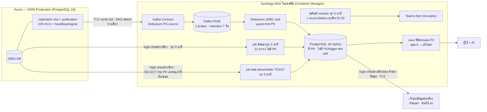

---
pmPageId:
pmParentId:
pmTitle: "[RB] สำเนา SIMS บน NAS ด้วย CDC (Debezium + Kafka) — ตรวจประจำ · แจ้งเตือน · แก้เหตุ · restart ครั้งเดียว · rollback"
pmSyncedAt:
---

# สำเนาฐาน SIMS บน NAS ด้วย CDC — runbook

เอกสารนี้ตอบคำถาม 5 ข้อ: ระบบ CDC มีชิ้นส่วนอะไรและใครดูแล · ทุกวันต้องดูอะไร · การ์ดแจ้งเตือนขึ้นแล้วทำอะไร (R1–R8) ·
เปลี่ยนค่าบน Production ครั้งเดียว (`wal_level` + เพดาน WAL + restart) ทำอย่างไรและตรวจผลอย่างไร · ถ้าจะเลิกใช้ ต้องถอนอะไรบ้าง
เหตุผลของทุกค่าอยู่ใน `docs/AD-sims-cdc-to-nas.md` เอกสารนี้ไม่อธิบายซ้ำ
**คนอ่าน**: DevOps / ผู้ดูแลระบบ CDC บน NAS · คนที่ได้รับการ์ดแจ้งเตือนในแชต Teams "Noti Innovation" · เจ้าของฐาน SIMS (คนรัน SQL บน Production)

| | |
|---|---|
| เวอร์ชันเอกสาร | 2026-11-13 — ระบบเปิดใช้งานจริง (เกณฑ์ ก) · ขอบเขต 225 CDC + 31 คัดลอกทุก 5 นาที (AD การตัดสินใจ 9) · login ของ NAS เอง · login อ่านอย่างเดียวของเจ้าของข้อมูลบน replica · ฉบับแรก 2026-11-10 |
| ชั้นเอกสาร | C — เจ้าของต้องตรวจ/เซ็น (AI ร่างจาก `docs/AD-sims-cdc-to-nas.md` และผลสำรวจระยะ 0 วันที่ 2026-11-10 · **ยังไม่ได้ซ้อม** ต้องซ้อม 1 ครั้งในระยะ 7 ก่อนเซ็น) |
| เจ้าของ | DevOps |
| สถานะระบบ | **ใช้งานจริง (LIVE) ตั้งแต่ 2026-11-13** — เจ้าของระบบเลือกเกณฑ์ ก (reconcile 2026-11-13 08:20 ตรงครบ 256/256 ตาราง ไม่รอ 3 คืน — ข้อ 5) · restart `wal_level=logical` แล้ว 2026-11-12 · slot + publication 227 ตาราง (225 + heartbeat + signal) บน SIMS ตั้งแต่ 2026-11-12 · WAL guard รันทุก 15 นาที · task บน NAS ID 9–12 (ข้อ 2) · **เอกสารยังไม่เซ็น** (ข้อ 10) |
| แหล่งความจริง | `docs/AD-sims-cdc-to-nas.md` · ไฟล์ของโฟลเดอร์งาน `SIMS-CDC` (อยู่นอก repo): `phase0-survey-findings.md` (ขอบเขต, ขนาด, อัตรา WAL, เพดาน, เกณฑ์แจ้งเตือนเป็นตัวเลขจริง) และไฟล์ config / SQL / สคริปต์ของระยะ 1 ในโฟลเดอร์ `phase1` |

> ⚠️ **repo นี้เป็น public** — เอกสารนี้ใช้ตัวแปร `<…>` แทนค่าจริงทุกตัว (host, ชื่อฐานข้อมูล, port, ชื่อ role/login, ชื่อ slot/publication,
> ชื่อ resource ของ Azure, IP, ชื่อ network rule, ค่าเพดาน/เกณฑ์เป็น GB, ขนาดและสถานะ storage ของ Production, ชื่อ 7 ตารางอ่อนไหว, secret ทุกชนิด)
> **ค่าจริง: ดูไฟล์ภายในโฟลเดอร์งาน SIMS-CDC (นอก repo)** · ห้ามคัดลอกค่าจริงกลับเข้ามาในไฟล์นี้ หรือวางใน Teams / issue / PR

> ⛔ **กฎที่อยู่เหนือทุกข้อในเอกสารนี้** (จาก AD ข้อ 2 #7): ถ้าต้องเลือกระหว่างรักษา CDC กับรักษา Production → **รักษา Production**
> CDC เสียแล้ว re-snapshot ได้เสมอ (R3) แต่ถ้าดิสก์ของฐาน SIMS เต็ม ฐานจะกลายเป็น read-only = ระบบใบงานหยุดรับการเขียน

---

## 1. ภาพรวมและขอบเขต



| กลุ่มตาราง | จำนวน | ส่งอย่างไร | ถ้าผิดพลาดดูข้อ |
|---|---|---|---|
| ตารางธุรกิจ + log ของระบบ | 132 + 29 = **161** (ณ 2026-11-11 รวมตารางที่สร้างหลังสำรวจ 1 ตาราง) | **CDC** แบบเกือบ real-time ผ่าน slot + publication · ตารางที่มีค่า TOAST (14 ตาราง) มี job ซ่อม placeholder ทุก 5 นาที (R8) | R1–R8 |
| ตารางแก้ข้อมูลชั่วคราวที่มี PK | **64** (ตั้งแต่ 2026-11-12 — AD การตัดสินใจ 9) | **CDC** เหมือนแถวบน — **รวม CDC 225 ตาราง** (ธุรกิจ 196 + ระบบ/log 29 · publication 227 = 225 + heartbeat + signal) | R1–R8 |
| ตารางแก้ข้อมูลชั่วคราวที่ไม่มี PK | **31** | **job คัดลอกทั้งตารางทุก 5 นาที** (TRUNCATE + COPY ใน transaction เดียวต่อตาราง · Task Scheduler บน NAS — ข้อมูลเก่าได้ถึง ~5 นาที + เวลารัน) | ข้อ 3 แถว "job คัดลอก 31 ตาราง (ทุก 5 นาที)" · R6 ข้อ 3 |
| อ่อนไหวด้านความปลอดภัย | **7** | **ไม่ส่งออกเด็ดขาด** — ไม่อยู่ใน publication และ role ของ CDC / job คัดลอก / login ที่สคริปต์ NAS ใช้ (`<nas_ro_login>`) **ต้องไม่มีสิทธิ์ใด ๆ** (login ของ NAS = `<copy_login>` ซึ่งไม่เคยได้สิทธิ์ 7 ตารางตั้งแต่สร้าง — ตัดสิน 2026-11-12 ตาม AD ข้อ 10 · SQL ตรวจผลแถว 47 + สคริปต์เปิดระบบ + monitor `security_access` ตรวจ) | รายชื่ออยู่ในไฟล์ภายใน ห้ามเขียนในเอกสารนี้ |

_ประวัติ (superseded 2026-11-12 โดย AD การตัดสินใจ 9)_: ก่อนหน้านั้นขอบเขตคือ CDC 161 ตาราง + ตารางชั่วคราว 95 ตาราง คัดลอกทั้งตารางวันละครั้ง · บน NAS มีทั้งหมด 256 ตารางเท่าเดิม (225 + 31)

ตารางทุกตัวอยู่ใน schema `public` และใช้ชื่อแบบ PascalCase ที่ต้องใส่เครื่องหมายคำพูดใน SQL เช่น `public."SMAServiceTo"`
(ใน config ของ Debezium เขียน `public.SMAServiceTo` ไม่มีเครื่องหมายคำพูด — ตัวพิมพ์เล็ก/ใหญ่ต้องตรงตัว)

### ตัวแปรที่ใช้ในเอกสารนี้ (ค่าจริงอยู่ในไฟล์ภายใน)

| ตัวแปร | คือ |
|---|---|
| `<sims_admin>` | admin ของฐาน SIMS ที่รัน SQL บน Production (เจ้าของฐาน) |
| `<cdc_role>` · `<copy_login>` | role ของ Debezium (REPLICATION + SELECT เฉพาะตารางในขอบเขต) · login อ่านอย่างเดียวที่สคริปต์บน NAS ใช้ต่อ SIMS (สคริปต์ทั้ง 4 ตัว: monitor + job ซ่อม placeholder + job คัดลอก 31 ตาราง (ทุก 5 นาที) + reconciliation) |
| `<repair_queue>` | ตารางคิวของ job ซ่อม placeholder **บน replica** (ชื่อเต็มรวม schema · ไม่มีบน SIMS) |
| `<slot_name>` · `<publication_name>` | ชื่อ replication slot และ publication |
| `<heartbeat_table>` · `<signal_table>` | ตาราง heartbeat และตาราง signal ของ Debezium บน SIMS (ชื่อเต็มรวม schema) — **ไม่ถูกส่งไป replica** (ไม่อยู่ใน include list ของ connector: มีไว้ให้ slot เลื่อน / รับคำสั่ง snapshot เท่านั้น) |
| `<source_connector>` · `<sink_connector>` | ชื่อ connector ใน Kafka Connect |
| `<topic_prefix>` | prefix ของชื่อ topic ใน Kafka — topic ของตาราง = `<topic_prefix>.public.<ชื่อตาราง>` (sink อ่านเฉพาะ topic ที่อยู่ในรายการ `topics` ของมัน) |
| `<sink_db_role>` | role บน **replica** ที่ sink ใช้เขียน — ต้องเป็น**เจ้าของ**ตาราง replica ทุกตัว (job คัดลอก / job ซ่อม / sink เขียนด้วย role นี้) |
| `<CONNECT_URL>` | REST API ของ Kafka Connect (bind เฉพาะ localhost ของ NAS — เรียกจาก shell บน NAS ผ่าน SSH) |
| `<BOOTSTRAP>` · `<kafka_net>` | ที่อยู่ broker และชื่อ Docker network ภายในของ Kafka — Kafka ใช้ **PLAINTEXT** บน network `internal: true` ไม่มี port เปิดออกนอก (AD ข้อ 6 — ไม่ใช่ SASL/SCRAM + TLS ตามร่างแรก) จึงไม่ต้องมีไฟล์ตั้งค่า client · เครื่องมือ command line ของ Kafka ต้องรันใน container ที่ต่อ `<kafka_net>` |
| `<cap>` · `<warn>` · `<crit>` | เพดาน WAL ของ slot ที่ **WAL guard** ใช้ (`max_slot_wal_keep_size` เป็น Read-Only บน Azure — AD การตัดสินใจ 8) และเกณฑ์ warning / critical ของ WAL ที่ slot กัก (เป็น GB ในไฟล์ภายใน) |
| `<cap_bytes>` | `<cap>` เป็นหน่วย byte (ค่า default ของ `<guard_fn>`) |
| `<nas_ro_login>` | login อ่านอย่างเดียวที่สคริปต์บน NAS ใช้ต่อ SIMS จริง (ค่าใน config ของสคริปต์) = **`<copy_login>`** — login ของ NAS เอง (ตัดสิน 2026-11-12) · **ไม่ใช่** login อ่านอย่างเดียวเดิมของฐาน ซึ่งเว็บระบบอื่นและผู้ใช้ pgAdmin ใช้ร่วม (ห้ามถอนหรือลดสิทธิ์ของ login เดิมเพื่อ CDC — SQL ระยะ 2 ขั้น 5 **เพิ่ม**สิทธิ์อ่าน `<guard_log>` / `<heartbeat_table>` + USAGE schema ให้ login เดิมด้วย ซึ่งตั้งแต่ NAS ใช้ `<copy_login>` ไม่จำเป็นแล้ว — จะถอนหรือไม่ เจ้าของฐานตัดสินหลังตรวจว่าไม่มีระบบใดใช้) · SQL ระยะ 2 ให้สิทธิ์อ่าน `<guard_log>` + `<heartbeat_table>` แก่ `<copy_login>` |
| `<report_login>` | login อ่านอย่างเดียวบน **replica** สำหรับเจ้าของข้อมูลคนเดียว (สร้าง 2026-11-13) — SELECT 256 ตารางใน schema `public` + default privileges ของตารางที่ `<sink_db_role>` สร้าง · `default_transaction_read_only=on` · `statement_timeout` 5 นาที · `idle_in_transaction_session_timeout` 5 นาที · `TimeZone` Asia/Bangkok · CONNECTION LIMIT 3 · ไม่มีสิทธิ์ schema ของ `<repair_queue>` · ต่อด้วย TLS เท่านั้น (`sslmode=require`) · **ข้อมูลส่วนบุคคลเต็มชุด: ห้ามแชร์ ห้ามให้ AI** (AI รอ view ระยะ 6) · สิทธิ์ตั้งด้วยไฟล์ grants ในโฟลเดอร์ go-live ของไฟล์ภายใน (รันซ้ำได้) |
| `<scripts>` · `<LOG_DIR>` · `<REPORT_DIR>` | โฟลเดอร์สคริปต์ CDC บน NAS · โฟลเดอร์ log ของสคริปต์ (`<job>-<YYYYMM>.log`) · โฟลเดอร์รายงาน CSV ของ reconcile (ค่าใน config ของสคริปต์) |
| `<guard_fn>` · `<guard_log>` · `<guard_job>` · `<cron_db>` | ฟังก์ชัน WAL guard และตาราง log ของมันบน SIMS (ชื่อเต็มรวม schema) · ชื่องาน pg_cron ที่เรียก guard ทุก 15 นาที · ฐานระบบที่ pg_cron เก็บงาน (`cron.job`, `cron.job_run_details`) |
| `<cdc_rule>` · `<nas_egress_ip>` | network rule ชื่อเฉพาะของ CDC บนฐาน SIMS · IP ขาออกของ NAS ที่ Azure เห็น |
| `<secrets_dir>` | โฟลเดอร์ secret บน NAS (สิทธิ์อ่านเฉพาะ container ที่ต้องใช้) |

---

## 2. ชิ้นส่วนและผู้ดูแล

> ณ 2026-11-10 **ผู้ขอโครงการเป็นเจ้าของเองทั้งฐาน SIMS, ข้อมูล (PDPA) และ NAS** — คนเดียวกันอนุมัติและลงมือในแถวเหล่านี้ได้
> ถ้าวันหลังเปลี่ยนผู้รับผิดชอบ แก้ตารางนี้และตารางเซ็นข้อ 10

| ชิ้นส่วน | อยู่ที่ไหน | ผู้ดูแล | หมายเหตุ |
|---|---|---|---|
| ฐาน SIMS Production + server parameters + restart | Azure Database for PostgreSQL Flexible Server | เจ้าของฐาน SIMS (ผู้ขอโครงการ) | **SQL / การตั้งค่าบน Production ทุกอย่าง เจ้าของฐานเป็นคนรัน** — AI ร่างได้ แต่ไม่รันบน Production |
| object ของ CDC บน SIMS: `<cdc_role>`, `<copy_login>`, publication, slot, `<heartbeat_table>`, `<signal_table>`, `<guard_fn>`, `<guard_log>` | ฐาน SIMS | เจ้าของฐาน SIMS | slot ถูกสร้างโดย Debezium ตอน start ครั้งแรก · publication ถูกสร้างโดย admin (`publication.autocreate.mode=disabled`) |
| WAL guard: ส่วนขยาย pg_cron + `<guard_job>` | `<cron_db>` บนเซิร์ฟเวอร์ SIMS (งานสั่งรันในฐาน SIMS) | เจ้าของฐาน SIMS | งานรันด้วย login `<sims_admin>` ที่ตั้งงาน — ต้องเป็นคนเดียวกับที่สร้าง `<cdc_role>` (มี ADMIN OPTION สั่ง NOLOGIN ได้) และมีสิทธิ์ตัด session ของ `<cdc_role>` (SQL ระยะ 2 ให้ไว้: membership แบบ INHERIT ไม่ SET) |
| network rule `<cdc_rule>` | Azure portal → Networking ของฐาน SIMS | เจ้าของฐาน SIMS (เพิ่ม rule เองได้) | มีคนอื่นแก้ rule ของฐานนี้เป็นประจำ → **แจ้งทุกคนที่แก้ rule ว่าห้ามลบ `<cdc_rule>`** |
| Azure Monitor alert ของ storage ฐาน SIMS | Azure portal → Alerts | เจ้าของฐาน SIMS | เป็นตัวเตือนที่ **ไม่ขึ้นกับ NAS** (ใช้ได้แม้ NAS ดับ) · เกณฑ์อยู่ในไฟล์ภายใน |
| NAS + Container Manager + volume encryption (ยังไม่เปิด — งานค้าง PDPA ระยะ 6) | ออฟฟิศ | ผู้ดูแล NAS (ผู้ขอโครงการ) | ถือข้อมูลส่วนบุคคลเต็มชุด · replica **ไม่มี backup** (ตั้งใจ — กู้ด้วย R3-ข re-snapshot จาก SIMS · ถ้าวันหลังตั้ง backup ต้องเข้ารหัสและเพิ่มแถวในตารางนี้) |
| Kafka (KRaft, 1 broker) · Kafka Connect (Debezium 3.6.3.Final) · PostgreSQL 18 replica | container บน NAS | DevOps | ตรึงเวอร์ชันทุก image ห้ามใช้ `latest` |
| สคริปต์ monitor (ทุก 5 นาที) · job ซ่อม placeholder (ทุก 5 นาที) · job คัดลอก 31 ตาราง (ทุก 5 นาที) · reconciliation (ทุกคืน 02:30) | Synology Task Scheduler บน NAS (user root) | DevOps | ส่งการ์ดไปแชต Teams "Noti Innovation" · URL ของ webhook อยู่ในไฟล์ secret ใน `<secrets_dir>` · trigger + `<repair_queue>` ของ job ซ่อมอยู่บน replica · **ID 9** monitor · **ID 10** job ซ่อม (เริ่มนาที 00) · **ID 11** job คัดลอก · **ID 12** reconcile 02:30 — ⛔ **ID 6** (ชุดซ้อม — เปิด Kafka / Connect / replica ชุดที่สองแย่ง RAM ของ NAS) และ **ID 8** (prepare เดิม) ต้องปิดไว้เสมอ ห้ามเปิด · DSM 7.3: งานที่วนซ้ำต้องเริ่มที่นาทีที่หาร 5 ลงตัว ไม่งั้นไม่รันเลยแบบเงียบ ๆ · หลัง NAS กลับมา (R5) ตรวจว่า ID 9–12 Enabled และ ID 6 / 8 ไม่ Enabled |
| view สำหรับ AI + role อ่านอย่างเดียวบน replica (ระยะ 6 — ยังไม่ทำ) | PostgreSQL บน NAS | DevOps + เจ้าของข้อมูล | เจ้าของข้อมูลอนุมัติรายการคอลัมน์ (ระดับ A–D ตาม AD ข้อ 5) · **ห้าม AI อ่านตารางดิบ** |
| `<report_login>` — login อ่านอย่างเดียวของเจ้าของข้อมูลบน replica (สร้าง 2026-11-13) | PostgreSQL บน NAS (port ของ replica · TLS บังคับ) | เจ้าของข้อมูล | ใช้คนเดียว ห้ามแชร์ ห้ามให้ AI · container เห็นทุกเครื่องใน LAN เป็น IP gateway ของ Docker (NAT) → `pg_hba` จำกัดตามเครื่องผู้ใช้ไม่ได้ ต้องจำกัดเครื่องที่เข้าถึง port ด้วย firewall ของ DSM · หลังสร้างตาราง replica ใหม่ (R3-ข / R5) ต้องรันไฟล์ grants ซ้ำ |
| เอกสารนี้ | `docs/RB-sims-cdc.md` | DevOps | |

### secret — อยู่ที่ไหน (ชื่อเท่านั้น)

| secret | เก็บที่ | ใช้โดย |
|---|---|---|
| รหัสผ่าน `<cdc_role>` · รหัสผ่าน role ของ replica | ไฟล์ properties ใน `<secrets_dir>` อ่านผ่าน **Kafka `FileConfigProvider`** เช่น `"database.password": "${file:<secrets_dir>/<file>.properties:<key>}"` | Kafka Connect (Kafka ใช้ PLAINTEXT บน network ภายใน — ไม่มี user/pass ของ Kafka) |
| CA bundle ของ Azure (DigiCert Global Root G2 + Microsoft RSA Root CA 2017 + DigiCert Global Root CA) | ไฟล์ PEM ใน `<secrets_dir>` (เป็นใบรับรองสาธารณะ ไม่ใช่ความลับ แต่เก็บรวมไว้ที่เดียว) | `database.sslmode=verify-full` · `database.sslrootcert` |
| รหัสผ่าน `<copy_login>` | ไฟล์ใน `<secrets_dir>` | สคริปต์บน NAS ทั้ง 4 ตัว (monitor, job ซ่อม, job คัดลอก, reconcile) |
| รหัสผ่าน role ของ replica (ไฟล์สำหรับสคริปต์ — คนละไฟล์กับ properties ของ Connect) | ไฟล์ใน `<secrets_dir>` | สคริปต์บน NAS ทั้ง 4 ตัว |
| webhook URL ของแชต "Noti Innovation" | ไฟล์ใน `<secrets_dir>` | monitor / reconcile / job คัดลอก / job ซ่อม |
| credential ของ Kafka Connect REST (ไม่บังคับ — เฉพาะถ้าเปิด basic auth) | ไฟล์ใน `<secrets_dir>` | monitor |
| รหัสผ่าน `<report_login>` | ไฟล์บนเครื่องของเจ้าของข้อมูลเท่านั้น (replica เก็บแค่ SCRAM verifier · ไม่อยู่บน NAS) | เจ้าของข้อมูล (pgAdmin) |

**ห้าม** ใส่ secret ใน `docker-compose.yml`, ใน connector config แบบตัวอักษรตรง ๆ, ใน environment ที่ `docker inspect` อ่านได้, หรือใน repo นี้

---

## 3. ตรวจประจำ

### ทุกวัน (ใช้เวลา ~5 นาที)

**จังหวะการ์ดปกติ ~2 การ์ด/วัน**: สรุปประจำวันของ monitor (รอบแรกตั้งแต่ 08:00 — `HEARTBEAT_HOUR`; ถ้าวันนั้นมีการ์ดเปลี่ยนสถานะหลัง 08:00 แล้ว การ์ดนั้นแทนสรุป) + ผล reconcile หลัง 02:30 (ส่งทุกคืน) ·
monitor ส่งการ์ดอื่นเฉพาะเมื่อชุดปัญหาเปลี่ยน · job คัดลอก / job ซ่อม ส่งเฉพาะตอนล้ม / กลับมาสำเร็จ (ความล้มเหลวชุดเดิมของ job คัดลอกไม่ส่งซ้ำจนครบ `COPY_NOTIFY_REPEAT_MINUTES` = 60 นาที) ·
ถึง 09:00 ยังไม่มีการ์ดใดของ monitor วันนี้ = R5 · monitor **ออก 0 แม้ pipeline เป็น CRITICAL** — ผลรอบของ task monitor ใน DSM ที่ไม่ใช่ 0 (3 config ผิด · 4 ส่งการ์ด Teams ไม่ได้ · 5 รอบก่อนยังค้าง) หมายถึงตัว monitor มีปัญหา ไม่ใช่สถานะ pipeline

| ดูอะไร | ที่ไหน / อย่างไร | ปกติคือ | ไม่ปกติ → |
|---|---|---|---|
| การ์ดสรุปรายวัน + reconciliation | Teams "Noti Innovation" | มีการ์ดของ monitor วันนี้ (สรุป 08:00 หรือการ์ดเปลี่ยนสถานะ) + การ์ด reconcile ของคืนที่ผ่านมา · ทุกตารางตรง 100% | **ไม่มีการ์ดเลย** = สคริปต์บน NAS ไม่ทำงาน หรือ NAS ดับ → R5 · ไม่ตรง → R6 |
| connector ทั้ง 2 ตัว | `curl -s "<CONNECT_URL>/connectors?expand=status"` | `<source_connector>` และ `<sink_connector>` เป็น `RUNNING` ทั้ง connector และทุก task · บรรทัด "auto-restart ของ `<sink_connector>`" ในการ์ด monitor ไม่เพิ่มบ่อย | `FAILED` → R2 · `PAUSED` / `STOPPED` ที่ไม่มีใครตั้งใจ → ถามทีมก่อน resume · auto-restart เพิ่มทุกวัน → หาสาเหตุตาม R2 แม้ sink กลับมาเอง |
| WAL ที่ slot กักบน SIMS | การ์ด monitor (ตัวเลขเดียวกับ query ในข้อ 4.1) | ต่ำกว่า warning มาก และไม่โตต่อเนื่อง · `wal_status` = `reserved` หรือ `extended` (ดูความหมายในข้อ 4.1) | warning / critical → R1 · `unreserved` / `lost` → R1 ทันที |
| heartbeat | บน **SIMS** (จาก NAS ด้วย `<nas_ro_login>` — SQL ระยะ 2 ให้สิทธิ์อ่าน `<heartbeat_table>` · หรือเจ้าของฐานใน pgAdmin ด้วย `<sims_admin>` — รหัสของ `<nas_ro_login>` ไม่มีคนเห็น): `SELECT now() - ts FROM <heartbeat_table>;` และ `confirmed_flush_lsn` ของ `<slot_name>` ใน `pg_replication_slots` ต้องเลื่อนระหว่าง 2 ครั้งที่ดู | อายุ heartbeat < 1 นาที · `confirmed_flush_lsn` เลื่อน | ค้างเกิน 5 นาที → R2 / R7 (ตาราง heartbeat ไม่ถูกส่งไป replica — อย่าดูจาก replica · **monitor ไม่ตรวจ heartbeat** — ต้องดูเอง) |
| consumer lag ของ sink | บรรทัด "lag" ในการ์ด monitor · ถ้ารันเอง: `docker run --rm --network <kafka_net> --memory 512m -e KAFKA_HEAP_OPTS=-Xmx256m <image ของ broker> /opt/kafka/bin/kafka-consumer-groups.sh --bootstrap-server <BOOTSTRAP> --describe --group connect-<sink_connector>` = **container ชั่วคราวแยก** (image เดียวกับ broker, จำกัด RAM ของตัวเอง — แบบที่สคริปต์ monitor ทำ · ไม่ต้องใช้ `--command-config` เพราะ Kafka เป็น PLAINTEXT บน network ภายใน) · ⛔ **ห้าม `docker exec` เข้า container ของ broker** — CLI จะได้ heap เท่า broker แล้ว broker อาจโดน OOM-kill | LAG ใกล้ 0 (ไม่โตต่อเนื่อง) | โตต่อเนื่อง → R5 (replica ช้า/ล่ม) |
| ค่า placeholder ของ TOAST ในสำเนา | ผลเช็ค placeholder ในการ์ด reconcile (หลัง 02:30) — ตรวจ**เฉพาะคอลัมน์ที่ระบุใน `RECON_PLACEHOLDER_COLUMNS`** ของ config สคริปต์ (ไม่ใช่ทุกคอลัมน์ text / jsonb / bytea และยังไม่ครอบคลุมทั้ง 14 ตาราง TOAST — รายการอยู่ในไฟล์ภายใน) + บรรทัด "คิวซ่อม placeholder" ในการ์ด monitor | 0 แถว (ตารางที่มีคอลัมน์ `ModifiedDateTime` ไม่นับแถวที่แก้ภายใน 10 นาทีก่อนเริ่มรัน) · คิวว่างหรือเก่าสุดไม่กี่นาที | มีแถว (การ์ด reconcile ขึ้น "พบความต่าง") / คิวค้าง → R8 |
| job คัดลอก 31 ตาราง (ทุก 5 นาที) | การ์ดของ job — ส่งเฉพาะตอนล้ม / กลับมาสำเร็จ ("กลับมาสำเร็จครบ") · ความล้มเหลวชุดเดิมส่งซ้ำทุก `COPY_NOTIFY_REPEAT_MINUTES` (60) นาที · ชุดตารางที่ล้มเปลี่ยน = ส่งทันที | **ไม่มีการ์ดของ job คัดลอก** | ล้ม → ระบบลองใหม่เองทุก 5 นาที (ไม่ต้องรันเอง) · ถ้าการ์ดบอกเหตุถาวร (ไม่มีตารางบน NAS / สิทธิ์ไม่พอ / โครงสร้างไม่ตรง) ต้องแก้ก่อน (R4 / R7) · ต่อ SIMS ไม่ได้ ("ไม่ได้เริ่ม") → R7 · "ตารางบน NAS ถูกใช้งานอยู่" = lock timeout 60 วินาที (`COPY_LOCK_TIMEOUT`) — มักเกิดจาก query ของ `<report_login>` บนตารางคัดลอกที่นานเกิน 60 วินาที ปกติหายเองรอบถัดไป |
| ดิสก์ NAS | **ตรวจเอง** — DSM → Storage Manager (หรือ `df -h <volume>` บน NAS) · monitor **ยังไม่ตรวจดิสก์ NAS** (การ์ด monitor พูดถึงดิสก์ของ SIMS / WAL เท่านั้น) | ว่างเกินเกณฑ์ในไฟล์ภายใน | ใกล้เต็ม → R5 |

### ทุกสัปดาห์ (เจ้าของฐาน SIMS รันใน pgAdmin — อ่านอย่างเดียว)

```sql
-- 1) slot ทั้งหมดบนฐาน — ต้องมีแค่ slot ของ CDC ตัวเดียว · slot ที่ไม่รู้จัก = slot กำพร้า → ตามหาเจ้าของ แล้ว drop
SELECT slot_name, plugin, slot_type, active, wal_status,
       pg_size_pretty(pg_wal_lsn_diff(pg_current_wal_lsn(), restart_lsn)) AS wal_retained
FROM pg_replication_slots;

-- 2) จำนวนตารางใน publication — ต้องเท่ากับค่าในไฟล์ภายใน (225 ตาราง ตั้งแต่ 2026-11-12 + <heartbeat_table> + <signal_table>)
SELECT count(*) FROM pg_publication_tables WHERE pubname = '<publication_name>';

-- 3) role ของ CDC / job คัดลอก / login ที่สคริปต์ NAS ใช้จริง ต้องเข้าถึง 7 ตารางอ่อนไหวไม่ได้เลย — ผลต้องเป็น 0 แถว
--    (วางรายชื่อ 7 ตารางจากไฟล์ภายใน) · นับทั้งสิทธิ์ระดับตาราง + คอลัมน์ · PUBLIC · role ที่ inherit · และ role ที่ SET ROLE ได้
--    (เกณฑ์เดียวกับ SQL ตรวจผลแถว 47 และการ์ด monitor `security_access`) · ถ้าพบแถวของ <nas_ro_login> = มีคนให้สิทธิ์
--    (GRANT ... TO PUBLIC บนตารางนั้น หรือให้ role ที่ login นี้เป็นสมาชิก) → หาที่มาแล้วถอนออก · login นี้ไม่มี default privileges
SELECT r.rolname, c.relname
FROM pg_class c
JOIN pg_namespace n ON n.oid = c.relnamespace AND n.nspname = 'public'
CROSS JOIN (VALUES ('<cdc_role>'), ('<copy_login>'), ('<nas_ro_login>')) AS r(rolname)
WHERE c.relname = ANY (ARRAY[ /* 7 ชื่อจากไฟล์ภายใน */ ]::name[])
  AND EXISTS (SELECT 1 FROM pg_roles g
              WHERE (g.rolname = r.rolname OR pg_has_role(r.rolname, g.oid, 'MEMBER'))
                AND (has_any_column_privilege(g.oid, c.oid, 'SELECT, INSERT, UPDATE, REFERENCES')
                     OR has_table_privilege(g.oid, c.oid, 'DELETE, TRUNCATE, TRIGGER, MAINTAIN')));

-- 4) 7 ตารางอ่อนไหวต้องไม่อยู่ใน publication — ผลต้องเป็น 0 แถว (รายชื่อเดียวกับข้อ 3)
SELECT tablename FROM pg_publication_tables
WHERE pubname = '<publication_name>'
  AND tablename = ANY (ARRAY[ /* 7 ชื่อจากไฟล์ภายใน */ ]::name[]);
```

และฝั่ง NAS: replica **ไม่มี backup** (ตั้งใจ — กู้ด้วย R3-ข re-snapshot จาก SIMS · ถ้าวันหลังตั้ง backup ต้องเข้ารหัสและเพิ่ม task ในข้อ 2) · ตรวจรายชื่อผู้มีสิทธิ์เข้า DSM / SSH / PostgreSQL ไม่มีคนเกิน —
login บน replica ที่ควรมี: admin ของ replica (เข้าทาง socket ใน container เท่านั้น) · `<sink_db_role>` (sink + สคริปต์บน NAS ทุกตัวใช้ role นี้ — `REPLICA_USER` ใน config ของสคริปต์) · `<report_login>` (CONNECTION LIMIT 3 · ต้องไม่ถูกแชร์) — มีมากกว่านี้ = หาที่มา ·
Task Scheduler: ID 9–12 Enabled · ID 6 / 8 ปิดอยู่ (ข้อ 2)

---

## 4. การแจ้งเตือนและวิธีรับมือ

### 4.1 ตารางแจ้งเตือน

เกณฑ์ WAL เขียนเป็น "จำนวนวันที่ slot ค้าง" ที่อัตรา WAL ซึ่งใช้ตั้งค่า (ค่าเป็น GB ในไฟล์ภายใน):

| การ์ด | เงื่อนไข | ระดับ | ทำ |
|---|---|---|---|
| WAL ที่ slot กัก ≥ `<warn>` (`wal_warning`) | slot ค้าง **~1.4 วัน** | ⚠️ warning | หาสาเหตุ (ส่วนใหญ่คือ R2 / R5 / R7) และแก้ภายในวัน |
| WAL ที่ slot กัก ≥ `<crit>` (`wal_critical`) | slot ค้าง **~4.3 วัน** | 🔴 critical | **R1** — ตัดสินใจ drop slot |
| monitor ต่อ SIMS ไม่ได้ (`sims_unreachable`) | NAS ต่อ SIMS ด้วย `<nas_ro_login>` ไม่ได้ (network rule / IP · รหัสผ่านไม่ตรง · connection limit ของ login เต็ม · SIMS ดับ เช่น Azure maintenance) — **ระหว่างนี้ monitor ไม่เห็น WAL ที่ slot กัก และไม่ได้ตรวจ WAL guard / สิทธิ์ตารางอ่อนไหว** (การ์ด guard / `security_access` ขึ้นไม่ได้) | ⚠️ (ปฏิบัติเหมือน critical ถ้าเกิน 1 ชม.) | R7 (network rule / IP) · ตรวจรหัสของ `<nas_ro_login>` (ข้อ 9) · ระหว่างนั้นเจ้าของฐานดู slot + `<guard_log>` เองด้วย query ข้อ 4.1 / R1-ข · ถ้าเป็น Azure maintenance ดู R5 "Azure planned maintenance" |
| `wal_status` = `unreserved` หรือ `lost` (`slot_unreserved` · `slot_lost`) | เกิดเฉพาะเมื่อเซิร์ฟเวอร์มี `max_slot_wal_keep_size` — บน Azure ปัจจุบันไม่มี (Read-Only) จึงไม่ควรเห็น | 🔴 critical | `unreserved` → R1 ทันที · `lost` = slot ใช้ไม่ได้แล้ว → R1 ขั้น drop แล้ว R3 |
| WAL guard ไม่ได้รัน ≥ 35 นาที / ไม่เคยรัน / ไม่พบ `<guard_log>` (`guard_stale` · `guard_never` · `guard_missing`) | monitor อ่าน `<guard_log>` ด้วย `<nas_ro_login>` — guard รันทุก 15 นาที | 🔴 critical — **SIMS ไม่มีเพดาน WAL** | **R1-ข** (ห้าม drop slot ที่ยังดีเพราะการ์ดนี้ — ต้องแก้ตัว guard) |
| WAL guard รอบล่าสุด drop ไม่สำเร็จ (`guard_drop_failed`) | slot กักเกิน `<cap>` แต่ guard drop ไม่ได้ (ข้อความ error อยู่ในการ์ด) | 🔴 critical | **R1** (drop เอง) — guard ลองใหม่ทุก 15 นาทีระหว่างนั้น |
| WAL guard drop slot แล้วยังไม่ปิดเรื่อง (`guard_drop_unhandled`) | มีแถว `dropped` ใน `<guard_log>` ที่ `handled_at` ว่าง — สำเนาหยุด/ขาดช่วงตั้งแต่เวลานั้น · การ์ด**ค้าง**แม้ connector สร้าง slot ใหม่ได้เอง (กรณี guard ตั้ง NOLOGIN ไม่สำเร็จ = สำเนาขาดช่วงแบบเงียบ) | 🔴 critical | **R3-ข** ถึงข้อ 7 (ปิดเรื่อง) — มักขึ้นคู่กับ `slot_missing` |
| ไม่พบ slot (`slot_missing`) — ถ้า guard เป็นคน drop การ์ดจะบอกเวลา | guard / คน drop slot · `<cdc_role>` เป็น NOLOGIN · Production ปลอดภัย | 🔴 critical | **R3-ข** (มีขั้นเปิด LOGIN คืน) — source FAILED ด้วย `role … is not permitted to log in` เป็นอาการปกติของกรณีนี้ |
| role ของ connector เป็น NOLOGIN ทั้งที่ slot ยังอยู่ (`cdc_role_nologin`) | ปกติเกิดหลัง `guard_drop_failed` แล้ว WAL ลดลงเอง — guard ตั้ง NOLOGIN ไปแล้วแต่ drop ไม่สำเร็จ | ⚠️ | slot ยังครบ ไม่มีช่องว่าง: ถ้า WAL ต่ำกว่า `<warn>` แล้ว เจ้าของฐานรัน `ALTER ROLE <cdc_role> LOGIN;` — ไม่งั้น connector ต่อใหม่ไม่ได้ครั้งหน้าที่หลุด |
| login ของ NAS เข้าถึงตารางอ่อนไหวได้ (`security_access`) | ทุก 5 นาที: `<nas_ro_login>` เข้าถึง 1 ใน 7 ตารางได้ (ตรง / คอลัมน์ / PUBLIC / role ที่ inherit หรือ SET ROLE ได้) — มีคน GRANT ให้ หรือให้ PUBLIC | ⚠️ | เจ้าของฐานหาที่มา (query สัปดาห์ข้อ 3) แล้วถอนสิทธิ์**จาก `<nas_ro_login>` / PUBLIC** · ⛔ ห้ามแก้ด้วยการถอนสิทธิ์ของ login อ่านอย่างเดียวเดิม (ใช้ร่วมกับเว็บระบบอื่น — เคยทำให้เว็บล่ม 2026-11-12) |
| ไม่พบตารางอ่อนไหวบางตัว (`security_tables_missing`) | release ใหม่เปลี่ยนชื่อ / ลบตาราง — ตรวจสิทธิ์ของชื่อใหม่ไม่ได้ | ⚠️ | R4 ข้อ 1 (อัปเดตรายชื่อ) |
| monitor อ่าน `<guard_log>` ไม่ได้ (`guard_noaccess`) | `<nas_ro_login>` ไม่มีสิทธิ์ USAGE schema / SELECT log | ⚠️ | เจ้าของฐานรัน SQL ระยะ 2 ซ้ำ (**ไม่ต้องใส่รหัส** — role มีแล้ว ค่าในช่องรหัสไม่ถูกใช้) · ขั้น 5 ให้สิทธิ์อ่าน log กับทั้ง `<copy_login>` และ login อ่านอย่างเดียวเดิม |
| Azure Monitor alert ของ storage ฐาน SIMS | เกณฑ์ในไฟล์ภายใน | 🔴 (ไม่ขึ้นกับ NAS) | ตรวจ slot ทันที — ถ้า slot เป็นสาเหตุ → R1 |
| source connector / task `FAILED` (`connector_failed_*`) | สถานะจาก REST ของ Connect | 🔴 | R2 (monitor **ไม่** restart source เอง) |
| sink connector / task `FAILED` (`connector_failed_*`) | monitor สั่ง restart เองก่อน 1 ครั้งต่อรอบ (ไม่มีการ์ดในรอบนั้น) — การ์ดขึ้นเมื่อ **รอบถัดไปยัง FAILED** หรือ Connect ไม่รับคำสั่ง restart | 🔴 | R2 หัวข้อ "sink FAILED — monitor restart ให้เอง" |
| sink `FAILED` ขณะ replica ไม่ตอบ (`sink_waiting_replica_*`) | monitor รอ ไม่สั่ง restart จนกว่า replica กลับมา | ⚠️ | R5 (แถว replica) |
| เรียก REST ของ Kafka Connect ไม่ได้ (`connect_unreachable`) | worker หยุด / REST ปิด — source ไม่อ่าน = **นาฬิกา R1 เดิน** | ⚠️ | R5 แถว "Kafka หรือ Kafka Connect" · ดู WAL ที่ slot กักประกอบ |
| slot ไม่มี connector ต่อ ≥ 10 นาที (`slot_inactive`) | source หยุด / ล้ม / ต่อ SIMS ไม่ได้ — WAL สะสมบน SIMS | ⚠️ | R2 / R5 / R7 · ถ้าตั้งใจหยุด source (R1 ข้อ 3 · R3-ข ข้อ 2 · ข้อ 7) การ์ดนี้เป็นผลที่คาดไว้ |
| connector `PAUSED` / `STOPPED` / ยังไม่ `RUNNING` / ไม่มี task / ไม่พบ connector / Connect ตอบ HTTP ผิด (`connector_paused_*` · `connector_not_running_*` · `connector_no_tasks_*` · `connector_missing_*` · `connector_http_*`) | สถานะจาก REST ของ Connect | ⚠️ | ถ้ามีคนตั้งใจหยุด (R1 · R3-ข · ข้อ 7) = ผลที่คาดไว้ · ถ้าไม่ได้ตั้งใจ → ถามทีมก่อน resume แล้ว R2 |
| replica ไม่ตอบ (`replica_down`) | PostgreSQL บน NAS ไม่ตอบ — sink เขียนไม่ได้ | ⚠️ | R5 แถว "PostgreSQL replica" |
| monitor อ่านสถานะไม่ได้ / ผลผิดรูปแบบ (`guard_unknown` · `security_unknown` · `lag_unknown_*`) | query ของ monitor ล้มทั้งที่ต่อได้ | ⚠️ | ตรวจด้วยมือ: WAL guard ตาม R1-ข ข้อ 1 · สิทธิ์ตามข้อ 3 query สัปดาห์ข้อ 3 · lag ตามข้อ 3 "consumer lag" · แล้วดูข้อความ error ในการ์ด / log ของ monitor |
| replica ไม่มีตาราง CDC บางตัว (`replica_tables_missing`) | ทุก 5 นาที: ตารางในรายชื่อ CDC ไม่มีบน replica — sink (`schema.evolution=basic`) จะ**สร้างตารางนั้นเอง**ด้วย type ของ Debezium (ไม่มี index / trigger ซ่อม) เมื่อมี event | ⚠️ | replica ว่าง / สร้างใหม่ → R5 แถว "replica สร้างใหม่" · ตารางใหม่ → R4 ข้อ 3 |
| sink `FAILED` ขณะ replica ไม่มีตาราง CDC ครบ (`sink_replica_not_ready_*`) | monitor **ไม่** restart ให้ (ถ้า restart sink จะสร้างตารางเองผิด type) | 🔴 | R5 แถว "replica สร้างใหม่" |
| sink ถูก restart อัตโนมัติ ≥ 2 ครั้งใน 60 นาที (`sink_flapping_*`) | restart แต่ละครั้งได้ผล แต่ sink ล้มซ้ำ | ⚠️ | R2 หัวข้อ "sink FAILED — monitor restart ให้เอง" |
| คิวซ่อม placeholder ค้าง ≥ 30 นาที / ลองซ้ำครบเกณฑ์ / monitor อ่านคิวไม่ได้ (`repair_queue_old` · `repair_queue_stuck` · `repair_queue_noaccess`) | การ์ดจาก job ซ่อม และ/หรือจาก monitor (เกณฑ์ `REPAIR_ALERT_MINUTES` / `REPAIR_MAX_ATTEMPTS`) | ⚠️ | R8 |
| replica ตอบ แต่ login / query ของ monitor ไม่ผ่าน (`replica_query_failed`) | | ⚠️ | ตรวจไฟล์รหัสผ่านของ replica ใน `<secrets_dir>` และสิทธิ์ของ role ที่ monitor ใช้ |
| consumer lag ของ sink โตต่อเนื่อง (`lag_growing_*`) | lag โตติดกัน `LAG_GROW_CHECKS` รอบ | ⚠️ | R5 (replica) |
| reconciliation ไม่ตรง / พบ placeholder / คำนวณไม่ครบ / ไม่ได้ตรวจ | การ์ด reconcile (ทุกคืน 02:30) | ⚠️ | R6 |
| **ไม่มีการ์ดของ monitor เลย** (ถึง 09:00 ยังไม่มีสรุปประจำวันหรือการ์ดเปลี่ยนสถานะ) หรือไม่มีการ์ด reconcile หลัง 02:30 | ไม่มีใครส่ง | 🔴 | R5 (NAS / Task Scheduler) — สคริปต์บน NAS **แจ้งไม่ได้ถ้า NAS ดับเอง** ต้องอาศัยคนสังเกตว่าการ์ดหาย + Azure Monitor alert ของ storage |

**ไม่มีการ์ด heartbeat** — monitor ไม่อ่าน `<heartbeat_table>`: source ที่ขึ้น `RUNNING` แต่หยุดอ่านจริงจะเห็นจากการ์ด `slot_inactive` (ถ้า slot หลุดการเชื่อมต่อ) หรือ `wal_warning` ที่ `<warn>` (~1.4 วัน) เท่านั้น → ดู heartbeat เองทุกวันตามข้อ 3

ความหมายของ `wal_status` (PostgreSQL):

| ค่า | หมายถึง | ระดับ |
|---|---|---|
| `reserved` | WAL ที่ slot กักยังไม่เกิน `max_wal_size` | ปกติ |
| `extended` | เกิน `max_wal_size` แล้ว แต่ยังอยู่ใต้เพดาน `<cap>` — **เป็นเรื่องปกติเมื่อ slot ค้างเกินไม่กี่ GB** ดูตัวเลข WAL ที่กักประกอบ ไม่ใช่ดูค่านี้อย่างเดียว | ปกติ (ตัดสินจาก `<warn>` / `<crit>`) |
| `unreserved` | เกินเพดานแล้ว WAL จะถูกลบใน checkpoint ถัดไป — slot กำลังจะใช้ไม่ได้ | 🔴 |
| `lost` | WAL ที่ slot ต้องใช้ถูกลบไปแล้ว — slot ใช้ไม่ได้อีก | 🔴 |

บน Azure ไม่มีเพดานฝั่งเซิร์ฟเวอร์ → `wal_status` จะเป็น `reserved` / `extended` ไปจนกว่า WAL guard จะ drop slot ที่ `<cap>` — ตัดสินจากตัวเลข WAL ที่กัก (`<warn>` / `<crit>`) และการ์ดของ guard

> **เหตุใดก็ตามที่ทำให้ source connector หยุดอ่าน = นาฬิกาของ R1 เริ่มเดิน** — slot ไม่เลื่อน WAL สะสมบนดิสก์ Production ทุกชั่วโมง
> ให้ดูตัวเลข WAL ที่ slot กักประกอบทุกครั้งที่แก้ R2 / R5 / R7

query ที่เจ้าของฐานใช้ดูสถานะ slot ด้วยตัวเอง (อ่านอย่างเดียว):

```sql
SELECT slot_name, active, active_pid, wal_status,
       pg_size_pretty(pg_wal_lsn_diff(pg_current_wal_lsn(), restart_lsn)) AS wal_retained,
       pg_size_pretty(<cap_bytes> - pg_wal_lsn_diff(pg_current_wal_lsn(), restart_lsn)) AS left_before_guard_drop
FROM pg_replication_slots
WHERE slot_name = '<slot_name>';
```

(`safe_wal_size` ของ PostgreSQL เป็น NULL เสมอเมื่อ `max_slot_wal_keep_size = -1` แบบบน Azure จึงไม่ใช้ — ระยะที่เหลือจริงคือถึง `<cap>` ที่ guard drop)

### R1 — WAL ที่ slot กักถึงระดับ critical → ตัดสินใจ drop slot (รักษา Production ก่อน)

**ใครทำ**: DevOps หยุด connector · เจ้าของฐาน SIMS รัน SQL · **ไม่ต้องรอประชุม** — ถ้าถึง critical และแก้สาเหตุไม่ได้ภายในวันนั้น ให้ drop

> WAL guard drop slot ให้เองเมื่อ WAL ที่กักเกิน `<cap>` (ตรวจทุก 15 นาที) — R1 คือการตัดสินใจ drop **ก่อน**ถึงเพดาน หรือเมื่อ guard ทำไม่สำเร็จ (`guard_drop_failed`) / ไม่ทำงาน (R1-ข)

1. ดู query ข้างบน: `wal_retained`, `wal_status`, `left_before_guard_drop` (หารด้วยอัตรา WAL ≈ เวลาที่เหลือก่อน guard drop เอง)
2. ตัดสินใจ:

   | สถานการณ์ | ทำ |
   |---|---|
   | รู้สาเหตุ และแก้ได้แน่นอนภายในไม่กี่ชั่วโมง (เช่น NAS กำลังบูต, rule ถูกเพิ่มคืนแล้ว) **และ** `wal_status` ยังเป็น `reserved` หรือ `extended` | แก้สาเหตุ (R2 / R5 / R7) แล้วดูว่า `wal_retained` ลดลงภายใน 1 ชม. หลัง connector กลับมา `RUNNING` · ถ้าไม่ลด → drop |
   | ไม่รู้สาเหตุ / แก้ไม่ทันวันนี้ / `wal_status` = `unreserved` / Azure storage alert ดัง | **drop slot ทันที** (ข้อ 3–5) |
   | `wal_status` = `lost` | slot ถูก PostgreSQL ทิ้งไปแล้วตามเพดาน (Production ปลอดภัย) แต่ slot ยังค้างชื่ออยู่ → drop ให้สะอาด (ข้อ 3–5) แล้วไป R3 |

3. หยุด source connector เพื่อปล่อย slot (slot ที่ `active = true` drop ไม่ได้):
   ```bash
   curl -s -X PUT "<CONNECT_URL>/connectors/<source_connector>/stop"
   ```
   ถ้า NAS / Kafka Connect ล่มอยู่ (เรียก REST ไม่ได้) → ข้ามข้อนี้ได้ (slot ไม่ active อยู่แล้ว) **แต่ต้องทำข้อ 7 ทันทีที่ Connect กลับมา**
   (การ์ด ⚠️ `connector_paused_*` (STOPPED) ขึ้นทันที และ `slot_inactive` หลัง 10 นาที — เป็นผลของการหยุดเอง)
4. เจ้าของฐาน SIMS รัน:
   ```sql
   -- กัน connector กลับมาสร้าง slot ใหม่เองแล้วอ่านต่อโดยข้ามช่วงที่หาย (แบบเดียวกับที่ WAL guard ทำ) — เปิดคืนใน R3-ข
   ALTER ROLE <cdc_role> NOLOGIN;
   -- ยืนยันว่า slot ไม่ active แล้ว (active = false) ถ้ายัง active ให้รอ 1 นาทีแล้วดูใหม่
   SELECT slot_name, active, active_pid FROM pg_replication_slots WHERE slot_name = '<slot_name>';
   -- ถ้ายัง active ทั้งที่ connector หยุดแล้ว: ปิด connection ที่ถือ slot อยู่
   -- SELECT pg_terminate_backend(active_pid) FROM pg_replication_slots WHERE slot_name = '<slot_name>';
   SELECT pg_drop_replication_slot('<slot_name>');
   ```
   admin ของ Azure ไม่ใช่ superuser — SQL ระยะ 2 ให้ `<sims_admin>` ตัด session ของ `<cdc_role>` ได้แล้ว (membership แบบ INHERIT ไม่ SET — WAL guard ต้องใช้) · ถ้า `pg_terminate_backend` ยังขึ้น `permission denied`: `GRANT <cdc_role> TO <sims_admin> WITH INHERIT TRUE, SET FALSE;` แล้วรันซ้ำ — **อย่า REVOKE ภายหลัง** (guard จะ drop slot ที่ active ไม่ได้)
5. ตรวจผล: query ใน 4.1 ต้องไม่พบ `<slot_name>` · ดิสก์ของฐานจะคืนพื้นที่หลัง checkpoint ถัดไป (ไม่ใช่ทันที)
6. แจ้งใน "Noti Innovation" ว่า drop slot แล้ว เวลาเท่าไร เพราะอะไร — **สำเนาบน NAS หยุดอัปเดต ณ เวลานั้น**
7. **ห้าม start source connector ใหม่จนกว่าจะแก้สาเหตุแล้ว** — Debezium จะสร้าง slot ใหม่ทันทีที่ start · ไป R3-ข เมื่อพร้อม
   ⛔ ถ้าข้าม ข้อ 3 เพราะ Connect ล่ม: Connect จะ start source **เอง** เมื่อกลับมา → สร้าง slot ใหม่แล้วอ่านต่อจาก offset เก่า → **ข้อมูลช่วงที่ slot ถูก drop หายจากสำเนาแบบเงียบ ๆ**
   → ทันทีที่ REST ของ Connect ตอบ ให้รัน `PUT .../<source_connector>/stop` ก่อนอย่างอื่น แล้วทำ R3-ข (ล้าง offset) — ห้ามปล่อยให้ source วิ่งต่อ

ไม่ต้องลบ publication / role / ตาราง heartbeat-signal ใน R1 (ไม่กัก WAL) — ลบเฉพาะตอน rollback ข้อ 8

### R1-ข — WAL guard ไม่ทำงาน (SIMS ไม่มีเพดาน WAL)

**ใครทำ**: เจ้าของฐาน SIMS · ด่วนระดับเดียวกับ R1 — ระหว่างนี้ slot กัก WAL ได้ไม่จำกัด (ด่านที่เหลือคือ alert ของ storage + การ์ด WAL `<warn>` / `<crit>`)

1. ฐาน `<cron_db>` (login `<sims_admin>`):
   ```sql
   SELECT jobid, schedule, command, database, username, active FROM cron.job WHERE jobname = '<guard_job>';
   SELECT status, return_message, start_time FROM cron.job_run_details
   WHERE jobid = (SELECT jobid FROM cron.job WHERE jobname = '<guard_job>') ORDER BY start_time DESC LIMIT 5;
   ```
2. แยกตามอาการ:

   | อาการ | สาเหตุ | ทำ |
   |---|---|---|
   | ไม่มีแถวใน `cron.job` / `active = false` | งานถูกลบ / ปิด | รัน SQL ตั้งงานจากไฟล์ภายในอีกครั้ง ด้วย `<sims_admin>` ตัวเดิม |
   | `relation "cron.job" does not exist` | ต่อผิดฐาน (ไม่ใช่ `<cron_db>`) หรือ extension pg_cron ถูกลบในฐานนั้น | ตรวจว่าต่อ `<cron_db>` · `SHOW shared_preload_libraries;` ยังมี pg_cron → รัน SQL ตั้งงานจากไฟล์ภายในอีกครั้ง (สร้าง extension + ตั้งงาน) — **ไม่ต้อง restart** |
   | `pg_cron can only be loaded via shared_preload_libraries` (ตอนรัน SQL ตั้งงาน) · `SHOW shared_preload_libraries;` ไม่มี pg_cron | pg_cron หลุดจาก preload (เช่น มีคนแก้ server parameter แล้ว restart) | เพิ่ม pg_cron กลับใน `shared_preload_libraries` (+ allowlist) → restart ใน window → ตั้งงานใหม่ · ระหว่างรอ window เฝ้า WAL จากการ์ด monitor และพร้อมทำ R1 |
   | `job_run_details`: `permission denied …` | สิทธิ์ของ `<sims_admin>` เปลี่ยน / งานถูกตั้งด้วย login อื่น | รัน SQL ระยะ 2 ซ้ำด้วย `<sims_admin>` (**ไม่ต้องใส่รหัส** — role มีแล้ว ค่าในช่องรหัสไม่ถูกใช้ · คืนสิทธิ์ตัด session) แล้วตั้งงานใหม่ด้วย login เดียวกัน (SQL ตั้งงานตรวจ REPLICATION / ADMIN OPTION / สิทธิ์ตัด session ให้ก่อน) · ⛔ ห้ามเอารหัสจริงของ `<cdc_role>` ไปวางในไฟล์ |
   | `job_run_details`: `failed` + `schema "…" does not exist` / `function … does not exist` · หรือการ์ด `guard_missing` | งานชี้ฐานที่ไม่มี object ของ guard หรือ `<guard_fn>` / `<guard_log>` ถูกลบ | ดูคอลัมน์ `database` ของงาน (ต้องเป็นฐาน SIMS) → ถ้าถูกฐานแต่ object หาย: รัน SQL ระยะ 2 ซ้ำ (**ไม่ต้องใส่รหัส**) → แถวใหม่ใน `<guard_log>` ภายใน 15 นาที |
   | `job_run_details`: `succeeded` แต่ `<guard_log>` ของฐาน SIMS ไม่มีแถวใหม่ | งานรันในฐานอื่นที่มี object ชื่อเดียวกัน (เช่น ฐานทดสอบ) หรือ monitor ชี้คนละฐานกับงาน | ดูคอลัมน์ `database` ของงาน และฐานใน config ของสคริปต์ NAS → ตั้งงานใหม่ให้ชี้ฐาน SIMS |
   | `job_run_details` ว่าง ทั้งที่ `active = true` | background worker ของ pg_cron ไม่ทำงาน | ดู log ของเซิร์ฟเวอร์ใน Azure · restart ใน window ถ้าจำเป็น |
3. ตรวจผล: ภายใน 15 นาทีมีแถวใหม่ใน `<guard_log>` → การ์ด monitor กลับเป็นปกติในรอบถัดไป
4. ระหว่างแก้ ถ้า WAL ที่ slot กัก ≥ `<crit>` → R1 ทันที (ไม่ต้องรอ guard)

### R2 — connector FAILED (รวมแถวใหญ่เกิน 32 MiB)

1. อ่านสาเหตุ:
   ```bash
   curl -s "<CONNECT_URL>/connectors/<source_connector>/status"   # ดู "trace" ของ connector และ task
   curl -s "<CONNECT_URL>/connectors/<sink_connector>/status"
   ```
   และ log ของ container Kafka Connect บน NAS
2. แยกตามข้อความใน `trace`:

   | ข้อความ / อาการ | สาเหตุ | ทำ |
   |---|---|---|
   | `RecordTooLargeException` · `The message is … bytes when serialized which is larger than …` · `larger than the max message size the server will accept` | แถวใหม่บน SIMS ใหญ่เกินเพดาน **32 MiB** | ดูหัวข้อ "แถวใหญ่เกิน 32 MiB" ข้างล่าง |
   | `Connection refused` · `timeout` · `no pg_hba.conf entry for host …` | ต่อ SIMS ไม่ได้ | R7 |
   | `password authentication failed` | รหัสผ่าน `<cdc_role>` ถูกเปลี่ยน / ไฟล์ secret ผิด | เจ้าของฐานยืนยันรหัสผ่าน → แก้ไฟล์ใน `<secrets_dir>` → restart |
   | `role "<cdc_role>" is not permitted to log in` **และ slot ยังอยู่** (query 4.1) | guard `drop_failed` ตั้ง NOLOGIN ไว้แล้ว WAL ลดลงเอง (การ์ด `cdc_role_nologin`) — slot ครบ ไม่มีช่องว่าง | ถ้า WAL ต่ำกว่า `<warn>`: `ALTER ROLE <cdc_role> LOGIN;` แล้ว restart connector — **ไม่ต้อง R3-ข** · ถ้า WAL ยังสูง → R1 |
   | `role "<cdc_role>" is not permitted to log in` **และไม่มี slot** · `replication slot "<slot_name>" does not exist` | WAL guard (หรือคนตาม R1) drop slot แล้วตั้ง NOLOGIN — ดูแถวล่าสุด `action = 'dropped'` ใน `<guard_log>` | **R3-ข** · ⛔ ห้ามแค่ `ALTER ROLE … LOGIN` แล้ว restart source — Debezium จะสร้าง slot ใหม่แล้วอ่านต่อจาก offset เก่า สำเนาขาดช่วงแบบเงียบ ๆ |
   | `certificate verify failed` · `hostname … does not match` | CA bundle ไม่ครบ / ใบรับรองของ Azure เปลี่ยน root | ตรวจว่า bundle มีครบ 3 root (ข้อ 2) · **ห้ามลดเป็น `require`** |
   | `publication … does not exist` | publication ถูกลบ / ชื่อผิด | เจ้าของฐานสร้างใหม่ด้วย SQL ในไฟล์ภายใน (Debezium ตั้งให้ไม่สร้างเอง) |
   | `can no longer get changes from replication slot …` · `This slot has been invalidated because it exceeded the maximum reserved size` · `requested WAL segment … has already been removed` | slot ถูกทิ้งตามเพดาน (`wal_status` = `lost`) | R1 (drop) แล้ว R3-ข |
   | sink: error จาก PostgreSQL ปลายทาง (ชนิดข้อมูล, คอลัมน์ไม่มี) | schema บน SIMS เปลี่ยน | R4 |
   | sink: ต่อ replica ไม่ได้ | replica ล่ม | R5 |

3. หลังแก้สาเหตุ:
   ```bash
   curl -s -X POST "<CONNECT_URL>/connectors/<connector>/restart?includeTasks=true&onlyFailed=true"
   ```
   ตรวจ: สถานะ `RUNNING` · heartbeat ขยับภายใน 1 นาที · WAL ที่ slot กักลดลงภายใน 1 ชม.

**sink FAILED — monitor restart ให้เอง** (`SINK_AUTO_RESTART=1` ใน config ของสคริปต์ — ค่าเริ่มต้น)

ที่มา: ซ้อมระยะ 1 บน NAS พบว่าเมื่อปิด replica `<sink_connector>` เปลี่ยนเป็น `FAILED` และ**ไม่กลับมาเอง**แม้ replica เปิดแล้ว (ต้องสั่ง restart เอง) ทั้งที่ตั้งให้ retry error ชั่วคราวไว้แล้ว

| รอบของ monitor (ทุก 5 นาที) | monitor ทำอะไร | การ์ด |
|---|---|---|
| เห็น sink (connector หรือ task) `FAILED` และ replica ตอบ | `POST <CONNECT_URL>/connectors/<sink_connector>/restart?includeTasks=true&onlyFailed=true` **1 ครั้ง** · จดเวลาไว้ | ไม่มี (บันทึกใน log และนับในบรรทัด "auto-restart ของ `<sink_connector>`" ของการ์ด monitor) |
| รอบถัดไป sink `RUNNING` | ล้างสถานะที่จดไว้ | ไม่มี — ถ้ามีการ์ดเตือนอื่นค้างอยู่ จะได้การ์ด "กลับมาปกติ" ตามปกติ |
| รอบถัดไป**ยัง** `FAILED` | สั่ง restart ซ้ำทุกรอบ (รอบละ 1 ครั้ง) | 🔴 "ยัง FAILED หลัง monitor สั่ง restart อัตโนมัติ" พร้อมบรรทัดแรกของ `trace` |
| Connect ไม่รับคำสั่ง restart (เช่น HTTP 409 ระหว่าง rebalance, 404) | — | 🔴 ทันที "สั่ง restart อัตโนมัติไม่สำเร็จ (HTTP …)" |
| sink `FAILED` แต่ replica ไม่ตอบ | **ไม่สั่ง** (restart ตอนนี้ก็ล้มซ้ำ) · รอ replica | ⚠️ replica ไม่ตอบ + sink รอ replica → R5 · เมื่อ replica กลับมา monitor สั่ง restart เองในรอบนั้น |
| restart แบบเงียบ (แถวแรกของตารางนี้) เกิด **ตั้งแต่ 2 ครั้งใน 60 นาที** — restart แล้วทำงานได้ แต่กลับมา `FAILED` ซ้ำ (**flapping**) | สั่ง restart ตามปกติ | ⚠️ `sink_flapping` ค้างตราบที่ยังมี restart แบบเงียบ ≥ `SINK_FLAP_RESTARTS` (2) ครั้งภายใน `SINK_FLAP_WINDOW_MINUTES` (60) นาที (นับเฉพาะ restart ครั้งแรกของแต่ละรอบที่ล้ม — restart ซ้ำที่มาพร้อมการ์ด 🔴 ไม่นับ) → อ่าน `trace` / log ของ Connect หาสาเหตุ (ข้อ 1–2) · ไม่มีกฎนี้ sink ที่ล้มทุก 10–30 นาทีจะถูก restart ไปเรื่อย ๆ โดยไม่มีการ์ดเลย |

เมื่อได้การ์ด 🔴 ของ sink: ทำข้อ 1–2 ข้างบน (อ่าน `trace` หาสาเหตุ) · sink FAILED **ไม่**ทำให้ WAL บน SIMS สะสม (source ยังอ่าน slot ยังเลื่อน) แต่ event รอใน Kafka ได้แค่ retention 7 วัน

- monitor **ไม่ restart source** อัตโนมัติ — source ผูกกับ slot บน Production ต้องมีคนอ่านสาเหตุก่อน
- monitor ไม่ restart connector ที่ `STOPPED` / `PAUSED` (แต่ส่งการ์ด ⚠️ `connector_paused_*`) → ถ้าตั้งใจหยุด sink ให้ใช้ `stop` / `pause` (ข้อ 7) ไม่ต้องปิด auto-restart
- ปิด auto-restart: ตั้ง `SINK_AUTO_RESTART=0` (การ์ด 🔴 ขึ้นทันทีที่ FAILED เหมือนเดิม) — เช่นระหว่างหาสาเหตุที่ restart แล้วล้มซ้ำ ไม่อยากให้สั่งทุก 5 นาที
- ⛔ auto-restart ไม่ใช่การข้าม record — ถ้า sink ล้มเพราะข้อมูล record เดิมจะล้มซ้ำทุกครั้งและการ์ด 🔴 จะค้าง · ห้ามแก้ด้วย `errors.tolerance=all` (ดูท้ายหัวข้อนี้)

**แถวใหญ่เกิน 32 MiB** (source FAILED → slot ไม่เลื่อน → นาฬิกา R1 เดิน):

- หาว่าแถวไหน/ตารางไหนจาก `trace` · เจ้าของฐานวัดขนาดแถวด้วยวิธีเดียวกับ `phase0-followup.sql` ในไฟล์ภายใน
- มี 2 ทาง — **ผู้ขอโครงการเป็นคนเลือก** แล้วบันทึกเป็น `docs/AD-*.md` ฉบับใหม่ (เพราะ 32 MiB เป็นค่าที่ AD ตัดสินไว้):

  | ทาง | ทำ | ผลข้างเคียง |
  |---|---|---|
  | ก. ขยายเพดาน | แก้**ทุกค่าพร้อมกัน**: broker `message.max.bytes` + `replica.fetch.max.bytes` · worker `producer.max.request.size` · `producer.buffer.memory` (ต้องมากกว่า record ใหญ่สุด — ปัจจุบัน 64 MiB) · `consumer.max.partition.fetch.bytes` · ถ้ามี topic override `max.message.bytes` ก็แก้ด้วย → restart broker แล้ว Connect | ใช้ RAM ของ Connect มากขึ้น — NAS ใช้ profile ประหยัด RAM (เพิ่มแรมไม่ได้) ต้องดู RAM ว่างของ NAS ก่อนขยับ heap/`mem_limit` ของ Connect · ถ้าไม่พอ ใช้ทาง ข. แทน |
  | ข. ตัดคอลัมน์นั้นเฉพาะตาราง | เพิ่ม `column.exclude.list` ของ source เฉพาะคอลัมน์นั้น | คอลัมน์นั้นในสำเนาหยุดอัปเดต (ค่าเก่าค้าง) — ต้องบอกผู้ใช้รายงาน |

- ระหว่างตัดสินใจ ถ้า WAL ถึง critical → R1 ก่อน (Production มาก่อน)

⛔ **ห้ามตั้ง `errors.tolerance=all`** หรือ skip record เพื่อให้ connector วิ่งต่อ — สำเนาจะผิดแบบเงียบ ๆ และไม่มีใครรู้ว่าแถวไหนหาย (AD ข้อ 6)

### R3 — re-snapshot (ดึงข้อมูลตั้งต้นใหม่)

ใช้เมื่อ: หลัง R1 drop slot · **หลัง WAL guard drop slot** · slot `lost` · Kafka เสียข้อมูล / event หายเพราะเกิน retention 7 วัน (R5) · reconciliation ไม่ตรงแบบแก้รายตารางไม่ได้ (R6)
**ทำนอกเวลา peak ของ SIMS** และเฝ้า WAL ที่ slot กัก + CPU ของ SIMS ตลอดเวลาที่ snapshot (snapshot อ่าน Production)

**R3-ก re-snapshot บางตาราง (slot ยังดี)** — incremental snapshot ผ่าน signal table, ไม่ต้องหยุดอะไร

เจ้าของฐาน SIMS รัน (ใส่หลายตารางใน `data-collections` ได้):

```sql
INSERT INTO <signal_table> (id, type, data)          -- <signal_table> = ชื่อเต็มรวม schema แล้ว (ห้ามเติม public. ข้างหน้า)
VALUES (gen_random_uuid()::text, 'execute-snapshot',  -- id ต้องไม่ซ้ำแถวเดิม (id เป็น primary key) — gen_random_uuid() ไม่ซ้ำเสมอ
        '{"data-collections": ["public.SMAServiceTo"], "type": "incremental"}');
```

- ถ้าต้องการให้แถวที่ถูกลบบน SIMS หายจากสำเนาด้วย: `TRUNCATE` ตารางนั้นใน replica **ก่อน** ส่ง signal (incremental snapshot เติม/ทับแถวที่มีอยู่ แต่ไม่ลบแถวที่หายไปจากต้นทาง)
- ตรวจ: log ของ Connect บอก snapshot ของตารางนั้นจบ → รัน reconciliation เฉพาะตารางนั้นด้วย config สำรอง (วิธีใน R6 ข้อ 1 — `reconcile.sh` ไม่รับชื่อตารางเป็น argument) หรือรอการ์ด reconcile คืนนั้น
- ⛔ ไฟล์ signal ของ go-live (ตารางใหญ่ 13 ตัว + 64 ตารางชั่วคราว ส่งไปแล้ว 2026-11-12) **ห้ามส่งซ้ำ** — ใช้เฉพาะหลัง re-snapshot ทั้งระบบ (R3-ข ข้อ 5 — ต้องครบ 15 ตาราง ไฟล์ตารางใหญ่มีแค่ 13) และต้องใช้ id ใหม่

**R3-ข re-snapshot ทั้งระบบ (หลัง drop slot)**

1. แก้สาเหตุที่ทำให้ต้อง drop slot ให้เสร็จก่อน (ไม่งั้นจะวนกลับมา R1)
2. หยุด source ก่อน: `curl -s -X PUT "<CONNECT_URL>/connectors/<source_connector>/stop"` · **รอให้ consumer lag ของ sink เป็น 0** (คำสั่งในข้อ 3 "ทุกวัน") แล้วค่อยหยุด sink: `curl -s -X PUT "<CONNECT_URL>/connectors/<sink_connector>/stop"`
   (ถ้าไม่รอ event เก่าที่ค้างใน Kafka จะถูกเขียนลงหลัง TRUNCATE ในข้อ 4 — แถวที่ถูกลบบน SIMS ระหว่างที่ slot หายจะกลับมาค้างในสำเนา)
   การ์ด ⚠️ `connector_paused_*` (STOPPED) ของทั้ง 2 ตัวขึ้นทันที และ `slot_inactive` หลัง 10 นาที (ถ้า slot ยังอยู่) — เป็นผลของการหยุดเอง
3. ล้าง offset ของ source เพื่อให้เริ่มใหม่จาก snapshot: `curl -s -X DELETE "<CONNECT_URL>/connectors/<source_connector>/offsets"` (connector ต้องอยู่สถานะ `STOPPED`)
4. replica: `TRUNCATE` ตาราง CDC ทั้ง 225 ตาราง (หรือสร้างใหม่จาก schema-only dump — คง PK ตัด FK + trigger) — สคริปต์อยู่ในไฟล์ภายใน
   · ถ้าเลือก**สร้างใหม่**: **ปิด task ของ job คัดลอก (ID 11) + job ซ่อม (ID 10) ใน Task Scheduler ก่อน** (ไม่ปิด = ทุก 5 นาที job ล้มเพราะไม่มีตาราง / lock แล้วส่งการ์ด) → admin ของ replica ลบ schema แล้วสร้างใหม่ **พร้อม `GRANT USAGE, CREATE ON SCHEMA` ให้ `<sink_db_role>`** (schema ใหม่ไม่มีสิทธิ์ของใครเลย — ไม่ให้ = restore ล้ม "permission denied for schema") → admin ของ replica ให้ `<sink_db_role>` มีสิทธิ์ CREATE บนฐานของ replica และสร้าง extension ที่ SIMS ใช้ (`CREATE EXTENSION IF NOT EXISTS …` ตามรายการ extension บน SIMS — `CASCADE` ลบไปพร้อม schema) → รัน `make-replica-schema.sh` (ไฟล์ภายใน · อ่านอย่างเดียวบน SIMS · รันได้เฉพาะตอน schema ว่าง) → ตรวจว่าตารางใน schema ของ replica = 256 และไม่มี 7 ตารางอ่อนไหว → **รันไฟล์ grants ของ `<report_login>` ซ้ำ** (DROP SCHEMA … CASCADE ลบสิทธิ์ + default privileges ของ login นี้ไปด้วย) → เปิด task ID 10 / 11 คืน (job ซ่อมสร้าง trigger + คิวของตัวเองใหม่ในรอบถัดไปเมื่อเห็นว่า schema เปลี่ยน) — sink ต้อง `STOPPED` อยู่ตลอด (ข้อ 2) · ⛔ **ไม่ใช้ prepare ของสคริปต์ go-live แล้ว** (ปลดระวางหลังใช้งานจริง 2026-11-13: ยังตั้งจำนวนตารางเป็นชุดก่อนการตัดสินใจ 9 และเช็ค RAM ว่างที่ไม่ผ่านขณะ stack รันอยู่ — จะหยุดตั้งแต่ขั้นแรก)
   · ถ้าเลือก TRUNCATE อย่างเดียว: สิทธิ์ของ `<report_login>` ยังอยู่ · job คัดลอกไม่แตะตาราง CDC ไม่ต้องปิด
4.5 **เปิด login ของ connector คืน** (ทำ**หลัง**ข้อ 3–4 เท่านั้น — R1 / WAL guard ตั้ง NOLOGIN ไว้): เจ้าของฐานรัน `ALTER ROLE <cdc_role> LOGIN;`
    และตรวจว่า WAL guard ยังทำงาน (แถวใหม่ใน `<guard_log>` ภายใน 15 นาที) — ห้ามสร้าง slot ใหม่ถ้า guard ไม่ทำงาน (R1-ข)
5. resume sink ก่อน แล้วค่อย source:
   ```bash
   curl -s -X PUT "<CONNECT_URL>/connectors/<sink_connector>/resume"
   curl -s -X PUT "<CONNECT_URL>/connectors/<source_connector>/resume"
   ```
   source สร้าง `<slot_name>` ใหม่บน SIMS แล้ว snapshot ตามแผนเดิม: ตารางใน `snapshot.include.collection.list` ได้ initial snapshot · **ตาราง CDC ที่ไม่อยู่ในรายการนั้นไม่อยู่** (ณ 2026-11-13 = **15 ตาราง**: ตารางใหญ่เกินเกณฑ์ 100 MB — 13 ตัวจาก go-live + 2 ตารางชั่วคราวที่ย้ายเข้า CDC 2026-11-12) → เมื่อ initial snapshot จบ ส่ง signal แบบ R3-ก ให้**ครบทั้ง 15 ตาราง** (รายชื่อ = ผลต่างของ `table.include.list` กับ `snapshot.include.collection.list` ใน config ของ source · มีในแผน snapshot ของไฟล์ภายใน — ไฟล์ signal ของ go-live สำหรับตารางใหญ่มีแค่ 13) ด้วย **id ใหม่** — id ของรอบ go-live ยังอยู่ในตาราง signal ใช้ซ้ำไม่ได้ (duplicate key) · คอลัมน์ `data` ของ `<signal_table>` ยาวได้ 2048 ตัวอักษร — รายชื่อยาวต้องแบ่งเป็นหลายแถว
6. ตรวจ: query ข้อ 4.1 มี slot `active = true` · WAL ที่ slot กักไม่โตต่อเนื่อง · reconciliation ทุกตารางตรง 100% → แจ้งใน "Noti Innovation" ว่าสำเนากลับมาเป็นปัจจุบันแล้ว
7. **ปิดเรื่อง drop ของ WAL guard** (ถ้า R3-ข นี้เริ่มจาก guard drop): เจ้าของฐานรัน
   ```sql
   UPDATE <guard_log> SET handled_at = now() WHERE action = 'dropped' AND handled_at IS NULL;
   ```
   → การ์ด `guard_drop_unhandled` หายในรอบถัดไป · แถว 15 ของ SQL ตรวจผลกลับเป็น PASS · ห้ามปิดเรื่องก่อนข้อ 6 ผ่าน (การ์ดนี้คือสิ่งเดียวที่เตือนเมื่อ connector สร้าง slot ใหม่เองแล้วสำเนาขาดช่วง)

ระหว่าง re-snapshot ข้อมูลในสำเนาไม่ครบ → แจ้งผู้ใช้รายงานว่าอย่าเชื่อตัวเลขจนกว่าจะมีการ์ด reconciliation ตรง 100%

### R4 — schema บน SIMS เปลี่ยน (ตารางใหม่ / คอลัมน์ใหม่)

ขอให้ทีมที่ deploy SIMS **แจ้งล่วงหน้าทุกครั้งที่มี schema migration** · ตรวจตาราง migration history ของแอปหลังทุก deploy

| การเปลี่ยน | เกิดอะไรขึ้นเอง | ต้องทำ |
|---|---|---|
| **คอลัมน์ใหม่** ในตารางที่อยู่ใน CDC แล้ว | Debezium เห็นคอลัมน์ใหม่จาก WAL · sink (`schema.evolution=basic`) เพิ่มคอลัมน์ใน replica ให้เอง | แถวเดิมในสำเนาจะเป็น NULL ในคอลัมน์ใหม่ (แม้ต้นทางมีค่า default) → ถ้ารายงานต้องใช้ ทำ R3-ก ตารางนั้น · ถ้าคอลัมน์ใหม่เป็นข้อมูลส่วนบุคคล → แจ้งเจ้าของข้อมูล ตัดสินว่า view เปิดหรือไม่ (default: ไม่เปิด) · ถ้าเป็นคอลัมน์ใหญ่ (`text` / `jsonb` / `bytea`) → ให้ตารางนั้นอยู่ในรายการตาราง TOAST ของ job ซ่อม (R8 "เพิ่มตารางเข้า job ซ่อม" — job ซ่อมตรวจ drift และรัน setup ให้เองในรอบถัดไป ≤ 5 นาที) และเพิ่ม `<Table>.<Col>` ใน `RECON_PLACEHOLDER_COLUMNS` ของ config สคริปต์บน NAS |
| **ลบคอลัมน์** / เปลี่ยนชื่อคอลัมน์ | `basic` ไม่ลบคอลัมน์ใน replica — คอลัมน์เก่าค้างเป็น NULL สำหรับแถวใหม่ · เปลี่ยนชื่อ = ได้คอลัมน์ใหม่เพิ่ม | ลบ/เปลี่ยนชื่อใน replica เอง · แก้ view (reconcile เลือกคอลัมน์ที่ทั้ง 2 ฝั่งมีเองทุกรอบ — คอลัมน์ฝั่งเดียวถูกบันทึกในช่อง note ของ CSV ไม่ต้องแก้ checksum) · ถ้าคอลัมน์อยู่ใน `RECON_PLACEHOLDER_COLUMNS` แก้ชื่อในนั้นด้วย |
| **เปลี่ยนชนิดข้อมูล** | sink อาจ FAILED (monitor จะลอง restart เองก่อน แล้วแจ้ง 🔴 เมื่อยัง FAILED) | แก้ชนิดใน replica ให้ตรง แล้ว restart sink (R2) · ถ้าเป็นตารางของ job ซ่อม: job ซ่อมตรวจ drift (คอลัมน์ใหม่ / ถูกลบ / เปลี่ยนชนิด) และรัน setup ให้เองในรอบถัดไป (≤ 5 นาที) — ถ้าต้องการทันที: `bash <scripts>/repair-placeholders.sh --setup` บน NAS (รันด้วย role ที่เป็นเจ้าของตาราง replica ตาม config) |
| **ตารางใหม่** | **ไม่ถูกส่งออก** (publication เป็น `FOR TABLE` รายตาราง) | ทำตามขั้นข้างล่าง |
| **ลบตาราง** | PostgreSQL เอาตารางออกจาก publication เอง | เอาออกจาก include list + ไฟล์รายชื่อ CDC บน NAS (reconcile / monitor ใช้ไฟล์เดียวกัน) · ตารางใน replica เก็บไว้หรือลบตามตกลง |

**เพิ่มตารางใหม่เข้า CDC** — ทำตามลำดับ:

1. **จัดกลุ่มก่อน**: เป็นตารางธุรกิจ / log / แก้ข้อมูลชั่วคราว / อ่อนไหว? ถ้าเก็บ token / session / credential / payload ดิบ → **ไม่ส่งออก** เพิ่มเข้ารายชื่อตารางอ่อนไหวในไฟล์ภายใน (ตัวสร้าง SQL ตรวจจำนวนไว้ — แก้จำนวนที่คาดไว้ด้วย) → generate SQL ใหม่ (`<nas_ro_login>` ไม่ได้สิทธิ์ตารางใหม่อัตโนมัติ — ห้าม GRANT ให้ · การ์ด `security_access` เตือนถ้ามีใครให้) → copy รายชื่อใหม่ขึ้น NAS แล้วหยุดแค่นี้
2. ตรวจว่ามี PK — **ไม่มี PK → ห้ามใส่ใน publication** (UPDATE/DELETE ของแอป SIMS บนตารางนั้นจะ error) ให้เข้า job คัดลอกทั้งตาราง (ทุก 5 นาที) แทน (เพิ่มชื่อในรายชื่อตารางคัดลอกของไฟล์ภายใน แล้ว copy ขึ้น NAS · ตัวเลข 31 ในเอกสารนี้เปลี่ยนตาม)
3. replica: สร้างตารางจาก schema-only dump ของตารางนั้น (คง PK ตัด FK + trigger) **ด้วย `<sink_db_role>`** — หรือสร้างด้วย admin แล้ว `ALTER TABLE public."NewTable" OWNER TO <sink_db_role>;`
   (เจ้าของเป็นคนอื่น = sink / job คัดลอก / job ซ่อม ได้ "permission denied" · ทำข้อนี้ **ก่อน** ข้อ 5 — ถ้า sink ได้ event ก่อนมีตาราง มันจะสร้างตารางเองผิด type และ monitor แจ้ง `replica_tables_missing` ตั้งแต่เพิ่มชื่อเข้ารายชื่อ CDC)
4. เจ้าของฐาน SIMS รัน:
   ```sql
   GRANT SELECT ON public."NewTable" TO <cdc_role>;
   GRANT SELECT ON public."NewTable" TO <nas_ro_login>;   -- ไม่ได้สิทธิ์ตารางใหม่อัตโนมัติ: reconcile / job ซ่อม / dump โครงตารางต้องใช้
   ALTER PUBLICATION <publication_name> ADD TABLE public."NewTable";
   ```
5. เพิ่มตารางในรายชื่อ CDC ของไฟล์ภายใน แล้ว generate config ของ connector **ทั้ง 2 ตัว**ใหม่: source (`table.include.list` + `public.NewTable`) และ **sink (`topics` + `<topic_prefix>.public.NewTable`)**
   → `PUT <CONNECT_URL>/connectors/<sink_connector>/config` **ก่อน** แล้วจึง `PUT <CONNECT_URL>/connectors/<source_connector>/config` (config เต็มชุด)
   (ลืม sink = event ของตารางใหม่ค้างใน topic ไม่มีใครอ่าน ตารางใน replica ว่าง และหายเมื่อเกิน retention 7 วัน) · ถ้ามีคอลัมน์ใหญ่ (`text` / `jsonb` / `bytea`): เพิ่มเข้า job ซ่อม (R8) และให้ `<copy_login>` มี SELECT ตารางนั้น (job ซ่อมอ่านค่าจริงด้วย login นี้)
6. ดึงข้อมูลเดิมของตารางด้วย R3-ก
7. รายการ reconciliation = รายชื่อ CDC บน NAS (ไฟล์เดียวกับที่ monitor ใช้ตรวจ `replica_tables_missing`) — copy ไฟล์รายชื่อใหม่ขึ้น NAS · ตารางใหม่ถูก `<report_login>` อ่านได้เองถ้าสร้างด้วย `<sink_db_role>` (default privileges) — ถ้าสร้างด้วย role อื่นให้รันไฟล์ grants ของ `<report_login>` ซ้ำ · ตัดสิน view ร่วมกับเจ้าของข้อมูล · อัปเดตไฟล์ภายใน (รายชื่อ + จำนวนตารางใน publication)

### R5 — NAS ดับ / replica ล่ม / Kafka ล่ม

| อะไรล่ม | ผลบน Production | ข้อมูลรอที่ไหน | ทำ |
|---|---|---|---|
| **PostgreSQL replica** อย่างเดียว | ไม่มี — source ยังอ่าน slot ยังเลื่อน | event รอใน Kafka ได้ **7 วัน** (retention) | กู้ replica → sink ที่ FAILED ระหว่างนั้น **monitor restart ให้เองภายในรอบถัดไป** (≤ 5 นาทีหลัง replica ตอบ — R2 "sink FAILED — monitor restart ให้เอง") · ถ้าการ์ด 🔴 ของ sink ยังขึ้น หรือปิด auto-restart ไว้ → `restart` sink เอง (R2 ข้อ 3) → lag ลดจนใกล้ 0 · job ซ่อม placeholder จะตามซ่อมแถวที่เข้าคิวระหว่างนั้นเอง · ถ้าล่มนานเกิน 7 วัน event เก่าถูกลบ → R3-ข |
| **PostgreSQL replica ถูกสร้างใหม่ / ข้อมูลหาย** (ไม่ใช่แค่หยุด) | ไม่มี | event รอใน Kafka แต่ข้อมูลตั้งต้นหาย | ⛔ **หยุด sink ก่อน start replica**: `PUT <CONNECT_URL>/connectors/<sink_connector>/stop` (ไม่หยุด = sink สร้างตารางเองผิด type ทันทีที่ replica รับ login — monitor แจ้ง `replica_tables_missing` / `sink_replica_not_ready_*` และไม่ restart ให้) · ปิด task ของ job คัดลอก (ID 11) + job ซ่อม (ID 10) ด้วย → start replica → สร้างตาราง + สิทธิ์ตามขั้น "สร้างใหม่" ใน R3-ข ข้อ 4 (สิทธิ์ CREATE ของ `<sink_db_role>` → extension → `make-replica-schema.sh` → ตรวจ 256 ตาราง → ไฟล์ grants ของ `<report_login>` · ถ้า replica เป็น cluster ใหม่ทั้งก้อน login นี้หายไปด้วย: สร้างใหม่ก่อนด้วยสคริปต์ในไฟล์ภายใน (สุ่มรหัสใหม่บนเครื่องเจ้าของข้อมูล ส่งไป replica แค่ SCRAM verifier) แล้วแจ้งเจ้าของข้อมูลให้เปลี่ยนรหัสใน pgAdmin) → เปิด task ID 10 / 11 คืน → R3-ข ข้อ 3 ขึ้นไป (sink resume ในข้อ 5) · ไม่ใช้ prepare ของสคริปต์ go-live (ปลดระวางแล้ว) |
| **Kafka** หรือ **Kafka Connect** | slot ไม่เลื่อน → **WAL สะสมบน SIMS** (นาฬิกา R1) | ไม่มีที่รอ — WAL ค้างอยู่บน Production | start Kafka ก่อน แล้ว Connect → ตรวจสถานะ connector · ถ้าใกล้ critical และกู้ไม่ทัน → R1 |
| **NAS ทั้งเครื่อง** (ไฟดับ, อัปเดต DSM, ดิสก์เสีย) | เหมือนแถวบน **และไม่มีการ์ดเตือน** เพราะสคริปต์ monitor อยู่บน NAS | — | เจ้าของฐานดู slot ด้วย query ข้อ 4.1 จากเครื่องอื่น · Azure Monitor alert ของ storage เป็นตัวสำรอง · กู้ NAS → Kafka → Connect → replica → ตรวจทั้งหมด · `wal_status` = `lost` → R3-ข |
| ข้อมูล Kafka เสีย (volume เสีย, ลบ topic) | ขึ้นกับว่า Connect ยังวิ่งหรือไม่ | หาย (replication factor 1 — ไม่มีสำเนา) | R3-ข |

**งานบำรุง NAS ที่วางแผนได้** (อัปเดต DSM, เปลี่ยนดิสก์): แจ้งใน "Noti Innovation" ก่อน · ทำให้เสร็จภายในเวลาที่ WAL ยังไม่ถึง warning (~1.4 วัน) · ถ้าจะหยุดนานกว่านั้น ให้ตัดสินใจล่วงหน้าว่าจะ drop slot (R1) แล้ว R3-ข ทีหลังหรือไม่

**Azure planned maintenance ของฐาน SIMS** (system-managed ช่วงกลางคืน เลื่อนเองไม่ได้ — ดู Azure portal → Overview → Next maintenance ล่วงหน้า):
ฐานดับไม่กี่นาทีแล้วกลับเอง (2026-11-12 ~23:35 ดับ ~6 นาที กลับเอง ไม่ต้อง re-snapshot) ·
การ์ดที่คาดได้: ⚠️ `sims_unreachable` · อาจมี ⚠️ `slot_inactive` · 🔴 `guard_stale` ถ้าดับนานจน guard พลาดหลายรอบ (หายเองเมื่อ pg_cron รันรอบถัดไป — **ห้าม drop slot เพราะการ์ดนี้**) · 🔴 source `FAILED` (monitor ไม่ restart source → R2 ข้อ 3) · การ์ด job คัดลอก "ไม่ได้เริ่ม — ต่อฐานข้อมูลฝั่ง SIMS ไม่ได้" ระหว่างฐานดับ แล้ว "กลับมาสำเร็จครบ" เมื่อรอบถัดไปผ่าน (ไม่ต้องทำอะไร) ·
หลังกลับมา ตรวจ: connector ทั้ง 2 ตัว `RUNNING` · `<guard_log>` มีแถวใหม่ภายใน 15 นาที · `SHOW shared_preload_libraries;` ยังมี pg_cron ·
⛔ **ห้าม Save server parameter แบบ static (`wal_level`, `shared_preload_libraries`) ค้างไว้โดยไม่ restart** — restart ของ maintenance จะใช้ค่านั้นทันที: `wal_level=replica` ขณะมี logical slot = SIMS start ไม่ขึ้น · ถอด pg_cron = WAL guard หยุดเงียบ (R1-ข)

ลำดับ start หลัง NAS กลับมา: Kafka → Kafka Connect → PostgreSQL replica → ตรวจ connector ทั้ง 2 ตัว (sink ที่ FAILED: monitor restart ให้เอง · source FAILED → R2) → ดู WAL ที่ slot กักลดลง → ดูว่า Task Scheduler รันครบทั้ง 4 task (ID 9 monitor · ID 10 job ซ่อม · ID 11 job คัดลอก · ID 12 reconcile) และ ID 6 / 8 ยังปิดอยู่

⛔ **ถ้าระหว่างที่ NAS ดับ slot ถูก drop (R1) หรือกลายเป็น `lost`**: ทันทีที่ REST ของ Connect ตอบ ให้ `PUT <CONNECT_URL>/connectors/<source_connector>/stop` ก่อนทำอย่างอื่น แล้วไป R3-ข
(Connect start source เองอัตโนมัติ → Debezium สร้าง slot ใหม่และอ่านต่อจาก offset เก่า → ข้อมูลช่วงที่หายไม่มี error แจ้ง)

### R6 — reconciliation ไม่ตรง

reconciliation (ทุกคืน 02:30 · ตาราง 256 ตัว = รายชื่อ CDC + รายชื่อตารางคัดลอก) เทียบ **row count + checksum เฉพาะคอลัมน์ที่ซิงก์** ทั้ง 2 ฝั่ง โดยตั้ง `TimeZone='UTC'` ทั้งคู่ ·
คอลัมน์ที่ซิงก์ = คอลัมน์ชื่อเดียวกันที่ทั้ง 2 ฝั่งมี (เลือกใหม่ทุกรอบ — คอลัมน์ฝั่งเดียว / type ต่าง บันทึกในช่อง note ของ CSV) · numeric เทียบผ่าน `trim_scale()` (Debezium ตัดศูนย์ท้ายทศนิยม) ·
ตารางที่มีคอลัมน์ `ModifiedDateTime` (timestamp ทั้ง 2 ฝั่ง) เทียบเฉพาะแถวที่แก้ก่อนเวลาเริ่มรัน − `RECON_STABLE_MINUTES` (10) นาที (`RECON_STABLE_COLUMN`) ตารางอื่นเทียบทั้งตาราง ·
ตารางที่ไม่ตรงถูกตรวจซ้ำเองอีก 1 รอบหลัง `RECON_RECHECK_DELAY` (120 วินาที) — ตารางที่การ์ดรายงานว่าไม่ตรงคือไม่ตรงทั้ง 2 รอบ · ตารางใน `RECON_COUNT_ONLY_TABLES` เทียบจำนวนแถวอย่างเดียว ·
รายงานเต็ม: `<REPORT_DIR>/reconcile-<เวลา>.csv`

1. **สคริปต์ตรวจซ้ำตารางที่ไม่ตรงเองแล้ว 1 รอบ** — ถ้ายังต้องการรันเฉพาะบางตาราง (หลัง consumer lag ของ sink เป็น ~0): `reconcile.sh` ไม่รับชื่อตารางเป็น argument →
   เขียนชื่อตารางลงไฟล์ชั่วคราวบน NAS แล้วสร้าง config สำรอง `<alt.conf>` ที่มีบรรทัด `. <scripts>/cdc.conf` ตามด้วย `TABLES_CDC_FILE=<ไฟล์ชั่วคราว>` และ `RECON_INCLUDE_ONEOFF=0`
   → รัน `CDC_CONF=<alt.conf> bash <scripts>/reconcile.sh` (ได้การ์ด reconcile + CSV ของชุดย่อยนั้น) ·
   ⛔ รัน `reconcile.sh` แบบปกติด้วยมือ = อ่านทุกตารางบน SIMS Production — ทำนอกเวลา peak เท่านั้น ·
   ตารางที่ไม่มี `ModifiedDateTime` และเขียนบ่อย (เช่น log) อาจต่างเล็กน้อยเพราะจังหวะเวลา ไม่ใช่ข้อมูลหาย
2. ยังไม่ตรง → หาสาเหตุ:

   | อาการ | สาเหตุที่เป็นไปได้ | ทำ |
   |---|---|---|
   | พบค่า `__debezium_unavailable_value` | TOAST placeholder เขียนทับ และ job ซ่อมยังไม่ได้ซ่อม — ตารางไม่อยู่ในรายการของ job ซ่อม, คิวค้าง, หรือเป็นแถวที่มี placeholder ก่อนติดตั้ง trigger | R8 |
   | ERROR / การ์ด "คำนวณไม่ครบ" | query ของตารางนั้นเกิน `RECON_STATEMENT_TIMEOUT` | เพิ่ม `RECON_STATEMENT_TIMEOUT` หรือใส่ตารางใน `RECON_COUNT_ONLY_TABLES` |
   | `MISSING_REPLICA` / `MISSING_SOURCE` | ตารางไม่มีบนฝั่งใดฝั่งหนึ่ง (ตารางใหม่ / ถูกลบ / ยังไม่ได้สร้างบน replica) | R4 |
   | การ์ด "ไม่ได้ตรวจ — อ่าน catalog ฝั่ง … ไม่ได้" | ต่อ SIMS หรือ replica ไม่ได้ / รหัสผ่านไม่ตรง | ฝั่ง SIMS → R7 · ฝั่ง replica → R5 |
   | replica มีแถวมากกว่าต้นทาง | DELETE ไม่ถูกส่ง / ถูกลบระหว่าง slot ถูก drop | ตรวจ `delete.enabled=true` · TRUNCATE ตารางนั้นใน replica แล้ว R3-ก |
   | replica มีแถวน้อยกว่า | ตารางไม่อยู่ใน include list / publication · event หายเกิน retention | R4 (ถ้าเป็นตารางใหม่) หรือ R3-ก |
   | checksum ต่างแต่ count เท่า | คอลัมน์ใหม่ (R4) · ชนิดข้อมูลแปลงต่างกัน · timezone ไม่ใช่ UTC | ตรวจ R4 ก่อน แล้วตรวจ query ของ reconciliation |
   | ไม่ตรงหลายสิบตารางพร้อมกัน | slot เคยถูกทิ้ง / Kafka เสีย | R3-ข |

3. ตาราง 31 ตัวของ job คัดลอกทุก 5 นาที: job แทนทั้งตารางทุก 5 นาทีอยู่แล้ว (ไม่ต้องรันเอง) — ไม่ตรง = ดูว่ารอบล่าสุดของ job สำเร็จไหม (การ์ด / log ของ job คัดลอก) · ถ้าต้นทางถูกเขียนระหว่างรอบคัดลอกกับรอบ reconcile อาจต่างชั่วคราว → ดูคืนถัดไป

### R7 — network rule ถูกลบ / IP ขาออกของออฟฟิศเปลี่ยน

อาการ: source FAILED ด้วย `timeout` / `Connection refused` / `no pg_hba.conf entry for host …` · การ์ด monitor ⚠️ `sims_unreachable` (+ `slot_inactive`) · heartbeat ค้าง · job คัดลอก 31 ตาราง (ทุก 5 นาที) ส่งการ์ด "ไม่ได้เริ่ม — ต่อฐานข้อมูลฝั่ง SIMS ไม่ได้" · job ซ่อม attempts เพิ่ม

1. ตรวจ IP ขาออกที่ NAS ใช้จริง (รันบน NAS): `curl -s https://ifconfig.me` → เทียบกับ `<nas_egress_ip>` ในไฟล์ภายใน
   (ออฟฟิศอาจมีทางออก internet มากกว่า 1 ทาง — ต้องเป็นค่าที่ได้จากตัว NAS เอง ไม่ใช่จากเครื่องอื่น)
2. Azure portal → ฐาน SIMS → **Networking**: มี `<cdc_rule>` อยู่ไหม และ IP ตรงกับข้อ 1 ไหม
3. เจ้าของฐานเพิ่ม/แก้ `<cdc_rule>` ให้ตรง → Save (มีผลภายในไม่กี่นาที ไม่ต้อง restart ฐาน)
4. restart source (R2 ข้อ 3) → ตรวจ heartbeat ขยับ · WAL ที่ slot กักลดลง
5. อัปเดต IP ในไฟล์ภายใน · แจ้งทุกคนที่แก้ rule ของฐานนี้อีกครั้งว่า `<cdc_rule>` ห้ามลบ
6. ถ้า IP ขาออกเปลี่ยนบ่อย → เสนอ IP ขาออกแบบคงที่ หรือ VPN (AD ข้อ 7 ยอมรับการต่อตรงในรอบแรกเท่านั้น) → บันทึกใน `docs/AD-*.md` ฉบับใหม่

### R8 — คิวซ่อม placeholder (TOAST) โต / มีรายการค้างนาน

**ทำงานอย่างไร** (เหตุผลใน AD ข้อ 6 แถว TOAST): UPDATE บน SIMS ที่ไม่แตะคอลัมน์ใหญ่ทำให้ sink เขียนค่า `{"__debezium_unavailable_value":true}` ลง replica →
trigger บนตารางนั้น (เฉพาะตารางในรายการตาราง TOAST) ใส่รายการลง `<repair_queue>` (ตาราง, PK, คอลัมน์ที่เป็น placeholder) →
job ซ่อมทุก 5 นาทีอ่านค่าปัจจุบันจาก SIMS ด้วย `<copy_login>` แล้วแก้ cell ที่**ยังเป็น placeholder** · แถวที่ต้นทางไม่มีแล้วถูกทิ้งจากคิว · ล้มแล้วนับ attempts + เก็บ `last_error`

อาการ: การ์ดจาก job ซ่อม (รายการเก่ากว่า `REPAIR_ALERT_MINUTES` หรือ attempts เกิน `REPAIR_MAX_ATTEMPTS`) หรือการ์ด monitor `repair_queue_old` / `repair_queue_stuck` / `repair_queue_noaccess` ·
การ์ดของ monitor เป็นตัวสำรอง — ถ้า**มีแต่การ์ด monitor ไม่มีการ์ดจาก job ซ่อมเลย** แปลว่า job ซ่อมไม่ได้รัน

**ไม่แตะ Production** — ทุกขั้นใน R8 อ่าน SIMS อย่างเดียว เขียนเฉพาะบน replica

1. ดูคิวบน replica (อ่านอย่างเดียว):
   ```sql
   SELECT tbl, count(*) AS entries, min(queued_at) AS oldest, max(attempts) AS max_attempts
   FROM <repair_queue> GROUP BY tbl ORDER BY entries DESC;

   SELECT tbl, pk, cols, attempts, left(last_error, 200) AS last_error
   FROM <repair_queue> WHERE attempts > 0 ORDER BY attempts DESC, queued_at LIMIT 20;
   ```
2. แยกตามอาการ:

   | อาการ | สาเหตุที่เป็นไปได้ | ทำ |
   |---|---|---|
   | ทุกรายการ `attempts = 0` และเก่าขึ้นเรื่อย ๆ | job ซ่อมไม่ได้รัน: task ใน Task Scheduler (ID 10) ถูกปิด · config ผิด (exit 3) · รันก่อนหน้าค้าง (exit 5) · setup / plan / apply บน replica ล้ม (exit 2) · replica ต่อไม่ได้ (job ออก 0 — ดู log) | DSM → Task Scheduler ดูผลรอบล่าสุด + log ของ job ซ่อม (`<LOG_DIR>/repair-<YYYYMM>.log`) → แก้ แล้วสั่ง Run 1 ครั้ง |
   | `last_error` = `fetching the current values from SIMS failed (see the NAS log)` | ดึงค่าจาก SIMS ไม่สำเร็จ — ข้อความใน `last_error` เหมือนกันทุกสาเหตุ **error จริงอยู่ใน log บน NAS เท่านั้น** | เปิด `<LOG_DIR>/repair-<YYYYMM>.log` (บรรทัด `SIMS: … (psql exit N)` และบรรทัด `sims:` ที่ตามมา — ต่อไม่ได้แบบ refused / timeout อาจเห็นแค่ `psql exit 2` ไม่มีบรรทัด `sims:`) แล้วแยกตามข้อความ: ต่อไม่ได้ / timeout / `no pg_hba.conf entry` → R7 (รายการจะถูกซ่อมเองเมื่อต่อได้ ไม่ต้องลบคิว) · `permission denied for table …` → เจ้าของฐาน SIMS `GRANT SELECT` ให้ `<copy_login>` **เฉพาะตารางนั้น** (⛔ ถ้าเป็น 1 ใน 7 ตารางอ่อนไหว ตารางนั้นต้องไม่อยู่ใน CDC ตั้งแต่แรก → R4 ข้อ 1) · `statement_timeout` / SIMS ช้า → ปล่อยให้ลองซ้ำรอบถัดไป ถ้าค้างหลายรอบ ลด `REPAIR_BATCH` |
   | `last_error` = `column … does not exist` / ชนิดข้อมูลไม่ตรง | schema เปลี่ยน | R4 → แก้ replica ให้ตรง → job ซ่อมรัน setup ให้เองในรอบถัดไป (หรือ `repair-placeholders.sh --setup`) |
   | คิวโตเร็ว (หลักพันขึ้นไป) และไม่ลด ทั้งที่ `last_error` ว่าง | ตารางที่ UPDATE ถี่โดยไม่แตะคอลัมน์ใหญ่ — ซ่อมไม่ทัน | เพิ่ม `REPAIR_BATCH` ทีละน้อยพร้อมดู CPU ของ SIMS · ถ้ายังไม่ทัน ปรึกษาเจ้าของฐาน (ทางแก้ที่ต้องเปลี่ยน Production = `docs/AD-*.md` ฉบับใหม่) |
   | การ์ด `repair_queue_noaccess` | role ที่ monitor ใช้บน replica ไม่มีสิทธิ์อ่าน `<repair_queue>` | บน replica: `GRANT USAGE` บน schema ของคิว + `GRANT SELECT ON <repair_queue>` ให้ role นั้น |

3. ตรวจผล: รันคำสั่งข้อ 1 ซ้ำหลังรอบถัดไปของ job ซ่อม — จำนวนรายการลดลง · ผลเช็ค placeholder ในการ์ด reconcile คืนถัดไปกลับเป็น 0 · การ์ด monitor "กลับมาปกติ"

**เพิ่มตารางเข้า job ซ่อม** (เช็ค placeholder ของ reconcile เจอตารางที่ไม่อยู่ในรายการ · ตารางใหม่ที่มีคอลัมน์ใหญ่ใน R4):

1. เพิ่มชื่อตารางในรายการตาราง TOAST ของสคริปต์ (สร้างใหม่จากผลสำรวจ หรือเพิ่มบรรทัดเอง — ดูไฟล์ภายใน) และเพิ่ม `<Table>.<Col>` ของคอลัมน์ใหญ่ใน `RECON_PLACEHOLDER_COLUMNS` ของ config สคริปต์บน NAS (ไม่งั้น reconcile ไม่ตรวจ placeholder ของตารางนั้น)
2. job ซ่อมตรวจ drift (ตารางเพิ่ม/ลดในรายการ · คอลัมน์ใหม่ / ถูกลบ / เปลี่ยนชนิด) และรัน setup บน replica ให้เองในรอบถัดไป (≤ 5 นาที) — ถ้าต้องการทันที: `bash <scripts>/repair-placeholders.sh --setup` บน NAS (รันซ้ำได้ ไม่กระทบตารางที่มี trigger แล้ว · ใช้ role ที่เป็นเจ้าของตาราง replica ตาม config)
3. trigger จับเฉพาะ INSERT / UPDATE **หลังติดตั้ง** → แถวที่มี placeholder อยู่ก่อนแล้วต้องกระตุ้นด้วย UPDATE ที่ไม่เปลี่ยนค่า **บน replica** (ไม่ใช่ SIMS) เพื่อให้เข้าคิว เช่น
   ```sql
   -- คอลัมน์ text / varchar / jsonb
   UPDATE public."<Table>" SET "<Col>" = "<Col>" WHERE strpos("<Col>"::text, '__debezium_unavailable_value') > 0;
   -- คอลัมน์ bytea
   UPDATE public."<Table>" SET "<Col>" = "<Col>" WHERE position(convert_to('__debezium_unavailable_value', 'UTF8') IN "<Col>") > 0;
   ```
   แล้วรอรอบถัดไปของ job ซ่อม → ตรวจตามข้อ 3 ข้างบน

⛔ **ห้าม**:
- ลบรายการออกจาก `<repair_queue>` เพื่อให้การ์ดหาย — cell บน replica ยังเป็น placeholder (สำเนาผิด) · ลบได้เฉพาะรายการที่ยืนยันแล้วว่าแถวบน SIMS ไม่มีแล้ว
- แก้ cell บน replica เองด้วยค่าที่ไม่ได้อ่านจาก SIMS ณ ตอนนั้น (อาจทับค่าที่ใหม่กว่า)
- แก้ปัญหาด้วย DDL บน Production (`REPLICA IDENTITY FULL` ฯลฯ) — เจ้าของฐานตัดสินแล้วว่าไม่ทำ (AD ข้อ 2 #6) · ถ้าจำเป็นต้องเปลี่ยน ทำเป็น `docs/AD-*.md` ฉบับใหม่

---

## 5. ลำดับการนำขึ้น (deploy) ระยะ 1 → 7

**ลำดับที่ผู้ขอโครงการกำหนด (2026-11-10)**: ทำงานเตรียมทุกอย่างที่ไม่ต้อง restart ให้เสร็จก่อน แล้ว **restart ฐาน SIMS เป็นขั้นสุดท้ายของการเตรียม** (ข้อ 6)
ขั้นที่สร้าง replication slot (ระยะ 3) ต้องอยู่**หลัง** restart เสมอ เพราะ slot แบบ logical สร้างไม่ได้ถ้า `wal_level` ยังไม่เป็น `logical`

> **สถานะ ณ 2026-11-13**: ขั้น 1–5 เสร็จแล้ว (restart 2-ข 2026-11-12 ~12:00 · snapshot ตารางใหญ่ 13 ตัวจบ 2026-11-12 16:36 · 64 ตารางชั่วคราวจบ 16:47 · lag ของ sink เป็น 0 เวลา 17:15) · **go-live 2026-11-13 ตามเกณฑ์ ก** (ข้างล่าง) ·
> ขั้น 6 (view + role สำหรับ AI) ยังไม่ทำ · ขั้น 7: ยังไม่ได้ซ้อม runbook และยังไม่เซ็น · ตารางนี้เก็บเป็นบันทึกลำดับ และใช้อ้างอิงถ้าต้องติดตั้งใหม่

| ขั้น | งาน | แตะ Production? | ผ่านเมื่อ |
|---|---|---|---|
| **1** | ติดตั้งบน NAS: Kafka KRaft (PLAINTEXT บน Docker network ภายใน `internal: true` ไม่มี port เปิดออกนอก — AD ข้อ 6) + Kafka Connect (Debezium 3.6.3.Final + JDBC sink) + PostgreSQL 18 · secret ผ่าน `FileConfigProvider` · REST ของ Connect bind เฉพาะ localhost ของ NAS · ซ้อมทั้ง pipeline กับฐานทดสอบ | ไม่ | ผ่านทุกข้อในตาราง "ซ้อมระยะ 1" ข้างล่าง · สคริปต์ monitor ส่งการ์ดเข้า "Noti Innovation" ได้ (ชี้ฐานทดสอบ) |
| **2-ก** | เตรียม Production **ที่ไม่ต้อง restart**: Azure Monitor alert ของ storage + Maximum Used Transaction IDs · เพิ่ม pg_cron ใน allowlist ของ extension · สร้าง `<nas_ro_login>` (= `<copy_login>`, SQL ที่สคริปต์เปิดระบบเตรียมพร้อม SCRAM verifier — ไม่แตะ login อ่านอย่างเดียวเดิม) · `<cdc_rule>` (จาก IP ที่ได้จากตัว NAS) · **หลัง 2-ข** เจ้าของฐานรัน SQL สร้าง `<cdc_role>` (REPLICATION + SELECT **เฉพาะ 225 ตาราง** (ตั้งแต่ 2026-11-12 — AD การตัดสินใจ 9 · เดิม 161) — ห้าม `GRANT SELECT ON ALL TABLES` · บวก INSERT/UPDATE บน `<heartbeat_table>` สำหรับ heartbeat และ SELECT/INSERT บน `<signal_table>` เพราะ incremental snapshot เขียน watermark ลงตารางนี้), `<copy_login>` (SELECT เฉพาะตารางในขอบเขต 256 ตาราง: job คัดลอกอ่าน 31 ตาราง (ไม่มี PK — เดิม 95) · reconciliation และ job ซ่อม placeholder อ่านตาราง CDC — **ไม่มี** 7 ตารางอ่อนไหว), `<heartbeat_table>`, `<signal_table>`, publication `FOR TABLE` 225 ตาราง + heartbeat + signal (= 227), `<guard_fn>` + `<guard_log>` (SQL หยุดเองที่ขั้น 0 ถ้า `wal_level` ยังไม่ใช่ `logical` จึงรันหลัง 2-ข) → ตั้ง `<guard_job>` ใน `<cron_db>` ด้วย login เดียวกัน | ใช่ (ไม่มี downtime) | query สัปดาห์ข้อ 3 ข้อ 2–4 ผ่าน (ข้อ 1 ณ ขั้นนี้ต้องยังไม่มี slot) · `<guard_log>` มีแถวใหม่ภายใน 15 นาที · ทดสอบ TLS `verify-full` จาก NAS ด้วย `<cdc_role>` และ `<copy_login>` ต่อได้ |
| **2-ข** | **restart ครั้งเดียว** (`wal_level=logical` + pg_cron ใน `shared_preload_libraries`) — ขั้นสุดท้ายของการเตรียม | **ใช่ (downtime)** | ข้อ 6 ข้อ 4 ผ่านทุกข้อ |
| **3** | สร้างตารางใน replica จาก schema-only dump (คง PK ตัด FK + trigger) · start source → Debezium สร้าง slot · snapshot นอกเวลา peak (เล็ก/กลาง `initial` · ใหญ่ `no_data` + incremental) · **ชี้สคริปต์ monitor ไปที่ SIMS ก่อน start source** | อ่าน | WAL ที่ slot กักไม่โตต่อเนื่องตลอด snapshot |
| **4** | start sink · reconciliation ทุกตาราง · สุ่มอ่าน payload หาความลับ (รวมตารางที่ระยะ 0 ยังไม่ได้สแกน) | อ่าน | ทุกตารางตรง 100% · ไม่พบความลับ |
| **5** | monitor ทุก 5 นาที + job ซ่อม placeholder ทุก 5 นาที (setup ของ job ซ่อมบน replica ก่อน — ทำได้ตั้งแต่ขั้น 3 หลังสร้างตาราง) + reconciliation ทุกคืน 02:30 + job คัดลอก 31 ตาราง ทุก 5 นาที ตั้งใน Task Scheduler (ID 9–12 ตามข้อ 2 · DSM 7.3: งานที่วนซ้ำต้องเริ่มที่นาทีที่หาร 5 ลงตัว ไม่งั้นไม่รันเลยแบบเงียบ ๆ) | อ่าน | การ์ดครบตามข้อ 3 · ทดสอบ alert (หยุด Connect จน warning ดัง แล้วกู้ได้) |
| **6** | role อ่านอย่างเดียว + view ตามที่เจ้าของข้อมูลอนุมัติ · ต่อ AI (RIM หรือ MCP) | ไม่ | AI ตอบรายงานจาก view ได้ และไม่เห็นคอลัมน์ PII |
| **7** | Go/No-Go · บันทึกเวอร์ชันทุก image · **ซ้อม runbook นี้ 1 ครั้ง** (อย่างน้อย R1 กับฐานทดสอบ + R2 + R5) · ทยอยเปิดผู้ใช้ | — | เกณฑ์ go-live ข้างล่างครบ · ตารางเซ็นข้อ 10 ครบ |

**ซ้อมระยะ 1** (กับฐาน PostgreSQL 18 ทดสอบ ห้ามใช้ Production):

- [ ] INSERT / UPDATE / DELETE เห็นในสำเนาภายใน < 1 นาที
- [ ] ข้อความภาษาไทย และ `jsonb` ตรงทุกตัวอักษร
- [ ] **UPDATE คอลัมน์เล็กของแถวที่มี payload ใหญ่ (TOAST) → แถวเข้า `<repair_queue>` → หลัง job ซ่อมรอบถัดไป สำเนามี payload เดิม ไม่ใช่ `__debezium_unavailable_value`** · ถ้า payload บน SIMS ถูก UPDATE อีกก่อน job ซ่อมรัน สำเนาต้องได้ค่าใหม่ล่าสุด (ไม่ถูกทับด้วยค่าเก่า) · แถวที่ถูกลบก่อนซ่อมหายจากคิว
- [ ] sink jsonb ได้ placeholder แล้วยัง `RUNNING` (ไม่ FAILED)
- [ ] แถวขนาด ~13–17 MB ผ่าน Kafka ได้ (เพดาน 32 MiB)
- [ ] restart Kafka Connect แล้วไม่มีแถวซ้ำ/หาย
- [ ] ปิด replica 1 ชม. แล้ว slot บนฐานทดสอบยังเลื่อน · เปิดกลับแล้ว lag ลดเป็น ~0 — **ให้สคริปต์ monitor รันอยู่ตลอด**: ระหว่างปิดได้การ์ด ⚠️ replica ไม่ตอบ (ไม่สั่ง restart) · เปิดกลับแล้ว monitor restart sink เองภายใน ~5 นาที โดยไม่มีคนสั่ง
- [ ] heartbeat อัปเดตบนฐานต้นทางทุก 30 วินาที และ `confirmed_flush_lsn` ของ slot เลื่อนแม้ไม่มีการเขียนตารางในขอบเขต (การตรวจรายวันในข้อ 3 ดูบนฐานต้นทาง ไม่ใช่ replica)
- [ ] ส่ง signal incremental snapshot (R3-ก) แล้วตารางนั้นถูกเติมครบ
- [ ] ซ้อม R1 (stop → drop slot) และ R3-ข จนกลับมาตรง 100%
- [ ] ซ้อม "drop slot ขณะ Connect ล่ม" → Connect กลับมาแล้ว stop source ทันที (R1 ข้อ 7) → R3-ข
- [ ] WAL guard กับฐานทดสอบ (เรียกฟังก์ชันด้วยเพดานต่ำ): slot ไม่มีคนต่อ / มี connector ต่ออยู่ → drop + NOLOGIN · connector ต่อกลับไม่ได้ · รัน SQL ระยะ 2 ซ้ำไม่ปลด NOLOGIN · monitor ส่งการ์ด `guard_stale` เมื่อ log เก่า และ `guard_drop_unhandled` จนกว่าจะ set `handled_at` (ตัว pg_cron ซ้อมได้บน Azure เท่านั้น)

**เกณฑ์ go-live** (จาก AD ข้อ 8): CRUD เห็นในสำเนา < 1 นาที · restart Connect แล้วไม่ซ้ำ/ไม่หาย · reconciliation ตรง 100% ติดกัน 3 วัน · heartbeat อัปเดตทุก 30 วินาที · ปิด replica 1 ชม. แล้ว WAL บน SIMS ไม่โต · หยุด Connect จน alert ดังแล้วกู้ได้ · ผู้ใช้ถาม AI ได้รายงานจาก view และไม่เห็นคอลัมน์ PII

> ✅ **2026-11-13 เจ้าของระบบเลือกเกณฑ์ ก**: เปิดใช้งานจริงด้วยผล reconcile 2026-11-13 08:20 ตรงครบ 256/256 ตาราง (placeholder 0) แทน "ตรง 100% ติดกัน 3 วัน" (ไม่รอ 3 คืน) ·
> ที่ยังค้างหลัง go-live (ไม่ขวางการใช้งาน — รายการเต็มใน AD ข้อ 10): commit เอกสารนี้ + AD เข้า PR #13 แล้วเซ็น (ข้อ 10) · ซ้อม runbook 1 ครั้ง · PDPA ระยะ 6 (volume encryption + view / role สำหรับ AI — ข้อ "ผู้ใช้ถาม AI" ข้างบนยังไม่ผ่าน) · เปลี่ยนรหัสผ่าน login อ่านอย่างเดียวเดิมพร้อม app setting ของเว็บที่ใช้ร่วม (ข้อ 9) · สุ่มตรวจ payload หาความลับบนสำเนา (ระยะ 4 — ยังไม่มีผลบันทึก) · การ์ด Teams ของ job ซ่อม / reconcile ให้อ่านเข้าใจง่าย · ปรับจูน sink · หาต้นเหตุที่ job คัดลอกล้มชั่วคราวครั้งหนึ่ง

---

## 6. การเปลี่ยน Production ครั้งเดียว — `wal_level` + pg_cron (สำหรับเพดาน WAL) + restart (ทำเป็นขั้นสุดท้าย)

**ใครทำ**: เจ้าของฐาน SIMS ใน Azure portal (AI ไม่เปลี่ยนค่าบน Production) · DevOps จับเวลาและตรวจผล

> ✅ **ทำแล้ว 2026-11-12 ~12:00** — ข้อนี้เก็บเป็นบันทึก / อ้างอิง · ตอนนี้**มี logical slot แล้ว**: ⛔ ห้ามตั้ง `wal_level=replica` ขณะยังมี logical slot (PostgreSQL จะ start ไม่ขึ้น — ทำได้เฉพาะตาม rollback ข้อ 8 หลัง drop slot) ·
> ⛔ ห้าม Save server parameter แบบ static ค้างไว้โดยไม่ restart — Azure planned maintenance จะ restart แล้วใช้ค่านั้นเอง (R5 "Azure planned maintenance")

| ค่า | ชนิด | ค่าที่ตั้ง |
|---|---|---|
| allowlist ของ extension | dynamic — มีผลทันทีหลัง Save | เพิ่ม pg_cron (ของเดิมคงไว้) — ทำได้ตั้งแต่ขั้น 2-ก |
| `shared_preload_libraries` | static — มีผลหลัง restart เท่านั้น | เพิ่ม pg_cron (ของเดิมคงไว้) |
| `wal_level` | static — มีผลหลัง restart เท่านั้น | `logical` |
| `max_slot_wal_keep_size` | **Read-Only บน Azure** — ตั้งไม่ได้ | ไม่แตะ (คง `-1`) · เพดาน `<cap>` = WAL guard (AD การตัดสินใจ 8) |

การเปลี่ยน `wal_level` และเพิ่ม pg_cron **ยังไม่ส่งข้อมูลออกไปไหน** (ยังไม่มี slot) · ผลข้างเคียงคือ WAL ใหญ่ขึ้นเล็กน้อย + pg_cron ใช้ background worker 1 ตัว · ถ้าโครงการถูกยกเลิก ปล่อยค่าไว้ได้โดยไม่เสียหาย

### 1. ก่อนกด — ต้องครบทุกข้อ

- [ ] ขั้น 1 และ 2-ก ในข้อ 5 เสร็จแล้ว (ตามลำดับที่ผู้ขอโครงการกำหนด) — อย่างน้อย Azure Monitor alert ของ storage ต้องตั้งแล้ว
- [ ] pg_cron อยู่ใน allowlist ของ extension แล้ว
- [ ] นัดเวลาที่ช่าง/ผู้ใช้ไม่ได้ใช้แอป SIMS และแจ้งผู้ใช้ล่วงหน้าแล้ว
- [ ] ไม่มี deploy / migration ของแอป SIMS ในช่วงเดียวกัน
- [ ] บันทึกค่าปัจจุบันของ `wal_level` และ `shared_preload_libraries` ไว้ในไฟล์ภายใน (ใช้ย้อนกลับ)

### 2. เปลี่ยนค่า

1. Azure portal → ฐาน SIMS → **Server parameters**
2. `wal_level` = `logical` · `shared_preload_libraries` เพิ่ม pg_cron → **Save** ครั้งเดียว (ลืม pg_cron = ต้อง restart อีกรอบ — SQL ระยะ 2 / SQL ตั้งงานจะหยุดพร้อมบอก)

### 3. restart

1. **Overview** → **Restart** → ยืนยัน → รอจนสถานะกลับเป็น **Ready**
2. DevOps บันทึกเวลาเริ่ม/จบ และ downtime จริงลงไฟล์ภายใน (ใช้วางแผนครั้งถัดไป)

### 4. ตรวจผล (เจ้าของฐานรันใน pgAdmin)

```sql
SHOW wal_level;                 -- ต้องได้ logical
SHOW shared_preload_libraries;  -- ต้องมี pg_cron
SELECT count(*) FROM pg_replication_slots;   -- ต้องได้ 0 (ยังไม่มี slot จนกว่าจะเริ่มระยะ 3)
```

ต่อด้วย SQL ระยะ 2 (ขั้น 2-ก ส่วนที่ทำหลัง restart) → ตั้ง `<guard_job>` → รอ 15 นาที → `<guard_log>` มีแถวใหม่ · SQL ตรวจผลผ่านทุกแถว

- [ ] แอป SIMS ใช้งานได้: login · เปิดใบงาน · บันทึกข้อมูล 1 รายการ
- [ ] จำนวน connection ของแอปกลับมาใกล้ระดับปกติ และไม่มี error พุ่งใน log ของแอปหลัง restart
- [ ] แจ้งผู้ใช้ว่าใช้งานได้แล้ว · บันทึกผลลงไฟล์ภายใน
- [ ] **วัดอัตรา WAL ซ้ำภายใน 1 สัปดาห์** (`logical` เขียน WAL มากกว่า `replica`) → ถ้าสูงขึ้นชัดเจน ปรับ `<cap>` / `<warn>` / `<crit>` และขนาดดิสก์ Kafka ในไฟล์ภายใน

### 5. ถ้าผิดปกติ

| อาการ | ทำ |
|---|---|
| ฐานไม่กลับมา Ready นานผิดปกติ | ติดต่อ Azure support (ไม่ต้องแก้อะไรฝั่ง CDC — ยังไม่มี slot) |
| แอป SIMS error หลัง restart ที่ไม่เกี่ยวกับ connection หลุดชั่วคราว | ย้อน**ทั้ง** `wal_level` และ `shared_preload_libraries` เป็นค่าที่บันทึกไว้ในข้อ 1 → Save → Restart (ปลอดภัยเฉพาะตอนที่ยังไม่มี logical slot · ตั้ง guard ใหม่ได้ทีหลัง) — ⛔ **ตอนนี้มี slot แล้ว ห้ามใช้แถวนี้** ต้องทำ rollback ข้อ 8 (drop slot ก่อน) |
| `SHOW wal_level` ยังเป็นค่าเดิม | ยังไม่ได้ restart หลัง Save หรือ Save ไม่สำเร็จ → ทำข้อ 2–3 ใหม่ |

---

## 7. ปิดชั่วคราว

| ต้องการ | ทำ | ผล |
|---|---|---|
| หยุดอ่าน SIMS ชั่วคราว (ไม่เกินไม่กี่ชั่วโมง) | `PUT <CONNECT_URL>/connectors/<source_connector>/stop` · กลับ: `.../resume` | slot ยังอยู่ → **WAL สะสมบน SIMS** (นาฬิกา R1) · การ์ด ⚠️ `connector_paused_*` (STOPPED) ขึ้นทันที และ `slot_inactive` หลัง 10 นาที — เป็นผลของการหยุดเอง |
| หยุดเขียน replica ชั่วคราว | stop `<sink_connector>` (monitor ไม่ restart connector ที่ `STOPPED` — auto-restart ทำเฉพาะ `FAILED`) · ถ้างานบน replica ต้องไม่มีการเขียนเลย ปิด task ของ job ซ่อม (ID 10) **และ job คัดลอก 31 ตาราง (ID 11 — ทุก 5 นาที TRUNCATE + COPY ลง replica)** ใน Task Scheduler ด้วย | event รอใน Kafka ได้ 7 วัน · Production ไม่กระทบ · คิวซ่อมรอได้ (ซ่อมต่อเมื่อเปิด) · การ์ด ⚠️ `connector_paused_*` ของ sink ขึ้น (ไม่มี `slot_inactive` เพราะ source ยังอ่าน) |
| หยุดนานเกิน warning (~1.4 วัน) | **อย่าแค่ stop** — drop slot ตาม R1 แล้ว R3-ข ตอนกลับมา | Production ไม่ต้องแบก WAL |

---

## 8. ย้อนกลับ / เลิกใช้ (rollback) — ต้องทำครบทุกข้อ

> ⛔ **slot ที่ลืม drop จะกัก WAL บน Production ไปเรื่อย ๆ แม้ไม่มีใครอ่าน** จนชนเพดาน — ข้อ 2 ห้ามข้าม
> ⛔ **ห้ามเปลี่ยน `wal_level` กลับเป็น `replica` ขณะยังมี logical slot** — PostgreSQL จะไม่ยอม start หลัง restart

ลำดับ (บน SIMS เจ้าของฐานเป็นคนรัน):

1. NAS: ปิด task ทั้ง 4 ตัวใน Task Scheduler ก่อน — monitor (ID 9, ทุก 5 นาที), job ซ่อม placeholder (ID 10, ทุก 5 นาที), job คัดลอก 31 ตาราง (ID 11, ทุก 5 นาที), reconciliation (ID 12, ทุกคืน 02:30 — ไม่ปิด = อ่านทุกตารางบน SIMS ทุกคืน แล้วหลังข้อ 4 จะส่งการ์ด "ไม่ได้ตรวจ — อ่าน catalog ฝั่ง SIMS ไม่ได้" ทุกคืน) (monitor จะได้ไม่พยายาม restart sink) · stop + ลบ `<source_connector>` และ `<sink_connector>` (`DELETE <CONNECT_URL>/connectors/<name>`)
2. **drop replication slot** (ขั้นตอน R1 ข้อ 4)
3. **เฉพาะเมื่อข้อ 2 สำเร็จแล้ว** (query ข้อ 4.1 ไม่พบ `<slot_name>`) — ถ้า drop ไม่สำเร็จ **หยุดตรงนี้** แก้ก่อน: guard คือเพดานเดียวของ slot ที่ยังค้าง
   ฐาน `<cron_db>`: ยกเลิกงาน WAL guard — `SELECT cron.unschedule(jobid) FROM cron.job WHERE jobname = '<guard_job>';` (ไม่งั้นงานจะ error ทุก 15 นาทีหลังลบฟังก์ชัน)
4. ลบ object ของ CDC (ยืนยันอีกครั้งว่าไม่มี `<slot_name>` ก่อนลบ `<guard_fn>` / `<guard_log>`):
   ```sql
   DROP PUBLICATION IF EXISTS <publication_name>;
   DROP FUNCTION IF EXISTS <guard_fn>(text, bigint, text);
   DROP TABLE IF EXISTS <guard_log>, <heartbeat_table>, <signal_table>;   -- ชื่อเต็มรวม schema ตามไฟล์ภายใน (ลบ schema ของ CDC ด้วยถ้าว่าง)
   -- ถอนสิทธิ์ทั้งหมดที่ role ถืออยู่ในฐานนี้ แล้วลบ role (ทำทั้ง 2 role)
   -- admin ของ Azure ไม่ใช่ superuser: ถ้า DROP OWNED ขึ้น permission denied ให้รัน
   --   GRANT <cdc_role> TO <sims_admin>;  GRANT <copy_login> TO <sims_admin>;  ก่อน แล้วรันซ้ำ
   DROP OWNED BY <cdc_role>;
   DROP ROLE <cdc_role>;
   DROP OWNED BY <copy_login>;
   DROP ROLE <copy_login>;
   ```
5. ตรวจ: `SELECT * FROM pg_replication_slots;` ไม่มี slot ของ CDC · `SELECT * FROM pg_publication WHERE pubname = '<publication_name>';` ไม่มีแถว · `SELECT rolname FROM pg_roles WHERE rolname IN ('<cdc_role>', '<copy_login>');` ไม่มีแถว
6. Azure portal: ลบ `<cdc_rule>` (ตกลงกับคนที่ดูแล rule ของฐานนี้) · ลบ/ปรับ Azure Monitor alert ที่ตั้งเพื่อ CDC (หรือเก็บ alert storage ไว้ก็ได้ ไม่มีผลเสีย)
7. **ตัดสินใจ** ร่วมกับเจ้าของฐาน: คง `wal_level=logical` และ pg_cron ไว้ (ไม่เสียหาย ไม่ต้อง restart) หรือคืน `wal_level` เป็น `replica` / ถอด pg_cron ออกจาก `shared_preload_libraries` (ต้อง restart อีกครั้ง — ทำหลังข้อ 2 เท่านั้น · ถอด pg_cron เฉพาะเมื่อไม่มีงานอื่นของทีม SIMS ใช้)
8. NAS: ถ้าจะเก็บ replica ไว้ใช้ต่อชั่วคราว ให้ลบ `<report_login>` ก่อน (admin ของ replica: `DROP OWNED BY <report_login>; DROP ROLE <report_login>;`) และบอกเจ้าของข้อมูลให้ลบไฟล์รหัสบนเครื่องตัวเอง · หยุด container · ลบ volume ของ Kafka และ replica (มีข้อมูลส่วนบุคคลเต็มชุด · ปัจจุบันไม่มี backup ของ replica — ถ้าวันหลังตั้ง backup ให้ลบด้วยตามที่เจ้าของข้อมูลกำหนด) · ลบไฟล์ใน `<secrets_dir>` · ถอนสิทธิ์ของ role อ่านอย่างเดียวที่ AI ใช้ (ถ้าระยะ 6 ทำแล้ว) · ถอดการเชื่อมต่อ AI (RIM / MCP) · ตรวจว่า task ID 6 / 8 ยังปิดอยู่หรือลบทิ้ง
9. ถอน webhook ของสคริปต์ monitor (ถ้าไม่ใช้กับงานอื่น) · บันทึกการเลิกใช้ใน `docs/AD-*.md` ฉบับใหม่ และมาร์ค `docs/AD-sims-cdc-to-nas.md` เป็น superseded

---

## 9. เปลี่ยนแปลงแล้วต้องแก้ที่ไหน

| แก้อะไร | อัปเดตด้วย |
|---|---|
| เพิ่ม/ลบตารางในขอบเขต (R4) | ไฟล์ภายใน (รายชื่อ + จำนวนใน publication) · connector config · ไฟล์รายชื่อ CDC / ตารางคัดลอกบน NAS (= รายการ reconciliation + monitor) · รายการตาราง TOAST ของ job ซ่อม (setup รันเองรอบถัดไป — R8) + `RECON_PLACEHOLDER_COLUMNS` ถ้ามีคอลัมน์ใหญ่ · สิทธิ์ของ `<report_login>` ถ้าตารางไม่ได้สร้างด้วย `<sink_db_role>` · ตัวเลขในข้อ 1 ถ้าจำนวนเปลี่ยน |
| เปลี่ยนเกณฑ์ของ job ซ่อม / auto-restart (`REPAIR_*`, `SINK_AUTO_RESTART`, `SINK_FLAP_*`) | config ของสคริปต์บน NAS · ข้อ 4.1 + R2 + R8 ของเอกสารนี้ถ้าพฤติกรรมเปลี่ยน |
| กลับไปใช้ reselect ของ Debezium (ถ้ารุ่นใหม่แก้การ quote ชื่อ PK) | ซ้อมระยะ 1 ข้อ TOAST ใหม่ก่อน · `docs/AD-*.md` ฉบับใหม่ (AD ข้อ 6 ตัดสินให้ใช้ job ซ่อม) |
| เปลี่ยนเพดาน 32 MiB / retention / `<cap>` (ค่า default ของ `<guard_fn>`) / เกณฑ์แจ้งเตือน | `docs/AD-*.md` ฉบับใหม่ (ค่าเดิมตัดสินใน AD) · ไฟล์ภายใน · เอกสารนี้ข้อ 4.1 ถ้าจำนวนวันเปลี่ยน |
| อัปเกรด Debezium / Kafka / PostgreSQL image | ซ้อมระยะ 1 ใหม่กับฐานทดสอบก่อน · บันทึกเวอร์ชันในไฟล์ภายใน · `docs/AD-sims-cdc-to-nas.md` ถ้าเปลี่ยน major |
| เปลี่ยนรายการคอลัมน์ที่ view เปิด | เจ้าของข้อมูลอนุมัติก่อน · บันทึกผลอนุมัติในไฟล์ภายใน |
| เปลี่ยนวิธีต่อ (VPN / IP คงที่) | `docs/AD-*.md` ฉบับใหม่ + R7 ของเอกสารนี้ |
| เปลี่ยนรหัสผ่านของ `<nas_ro_login>` | รหัสเป็นของ NAS (สุ่มบน NAS ไม่มีคนเห็น): ลบไฟล์รหัสของ login นี้ใน `<secrets_dir>` → รัน prepare ของสคริปต์เปิดระบบ (สุ่มใหม่ + เขียน SQL พร้อม SCRAM verifier) → เจ้าของฐานรันไฟล์นั้นทันที (รันซ้ำ = ตั้งรหัสใหม่) → prepare อีกรอบต้อง PASS · ระหว่างรหัสไม่ตรง **สคริปต์บน NAS ทุกตัวต่อ SIMS ไม่ได้**: monitor ขึ้น `sims_unreachable` (ไม่เห็น WAL ที่ slot กัก / WAL guard / สิทธิ์ตารางอ่อนไหว — guard บน SIMS ยังทำงาน), job คัดลอกส่งการ์ด "ไม่ได้เริ่ม", job ซ่อม attempts เพิ่ม — ทำให้เสร็จในไม่กี่นาที และไม่ทำใกล้ 02:30 (reconcile) |
| เปลี่ยนรหัสผ่านของ login อ่านอย่างเดียวเดิม (ใช้ร่วมหลายระบบ) | เปลี่ยนได้โดยไม่กระทบ NAS — ⛔ **แต่เว็บจัดการงานบริการ (Service Management) ใช้ login นี้**: ต้องเปลี่ยน app setting รหัสผ่านของเว็บนั้นในรอบเดียวกัน (แล้วทดสอบหน้าที่อ่าน SIMS) และแจ้งผู้ใช้ pgAdmin ก่อน — impact analysis ตามบทเรียน 2026-11-12 (AD ข้อ 10) · ยังเป็นงานค้าง |
| เปลี่ยนรหัสผ่านของ `<report_login>` | เจ้าของข้อมูลเปลี่ยนเองผ่าน pgAdmin (Change Password / `\password`) — replica เก็บแค่ SCRAM verifier · อัปเดตไฟล์รหัสบนเครื่องของเจ้าของ · ไม่กระทบสคริปต์บน NAS |
| สร้างตาราง replica ใหม่ / re-snapshot แบบลบ schema (R3-ข · R5) | รันไฟล์ grants ของ `<report_login>` ซ้ำ (ในโฟลเดอร์ go-live ของไฟล์ภายใน — รันซ้ำได้) |

---

## 10. การเซ็นรับรอง

> 2026-11-11: ผู้ขอโครงการรับเป็น**ผู้เซ็นเอกสารนี้** (ทำหน้าที่ DevOps + tech lead) — เห็นชอบโดย review และ merge PR ·
> 2026-11-13: go-live ไปแล้วตามเกณฑ์ ก (ข้อ 5) โดย**ยังไม่ได้เซ็น** · ยังต้องซ้อม runbook 1 ครั้ง แล้วจึงเซ็นตารางนี้

| บทบาท | ชื่อ | วันที่ | เห็นชอบ |
|---|---|---|---|
| ผู้ขอโครงการ — DevOps + tech lead (ยืนยันว่าซ้อม runbook แล้ว) | | | ☐ |
| ผู้ขอโครงการ — เจ้าของฐาน SIMS / ข้อมูล (PDPA) / NAS (ยืนยันว่ารับทำขั้นตอนบน Production ในข้อ 4 R1, R3, R4, R7 · ข้อ 6 · ข้อ 8) | | | ☐ |
| ผู้ดูแล network rule ของฐาน SIMS (รับทราบว่า `<cdc_rule>` ห้ามลบ) | | | ☐ |
